# Comparativa de estructuras de mensajes con Mermaid, TreeView y ASCII

Este documento permite revisar las sustituciones antes de modificar la memoria. Solo se incluyen estructuras que ya aparecen como bloques de texto, hexadecimal o representaciones equivalentes. Las sustituciones Mermaid existentes se conservan para compararlas con las nuevas alternativas ASCII y TreeView.

Se aplican los siguientes criterios:

- `packet` se utiliza cuando la estructura completa está formada por campos consecutivos de tamaño fijo en el caso representado.
- `block-beta` se utiliza cuando existe al menos un campo variable, opcional o alternativo, o cuando la estructura que se representa es jerárquica.
- `treeView-beta` se prueba únicamente en estructuras con jerarquía real: `HELO`, `SET` y la familia de mensajes del proxy.
- Las alternativas ASCII utilizan cajas de ancho esquemático para mensajes lineales. El tamaño real se escribe dentro del campo y no se infiere del ancho de la caja.
- Ninguna línea ASCII debe superar aproximadamente 78 caracteres y nunca se utilizan tabuladores.
- En todos los diagramas `packet` de esta propuesta, las posiciones numéricas representan desplazamientos en bytes. La unidad se declara expresamente en la redacción y no se convierte el tamaño de los campos a bits.
- Los delimitadores que formen parte del protocolo se representan expresamente. Una sustitución nunca debe ocultar `:`, `#`, `_` u otro carácter necesario para interpretar el mensaje.
- La yuxtaposición de bloques Mermaid representa concatenación. Operadores documentales como `||`, los espacios de un volcado hexadecimal, las ramas de un árbol (`├──`) y los signos usados para explicar valores no se convierten en campos porque no son bytes transmitidos.
- Los bloques JSON, XML, HTTP, IRC y de código fuente se conservan cuando son la representación natural del contenido o constituyen evidencia de ingeniería inversa.
- No se crea un diagrama para un único valor escalar, como un número de puerto.
- Los identificadores definidos por cada protocolo (`CH`, `DT`, `VER`, `USERID`, etc.) se conservan literalmente. Debajo se indica su función semántica con terminología técnica y, cuando se conoce, su codificación, tamaño o valor.
- En los mensajes con prefijo de longitud se distinguen dos magnitudes: el tamaño ocupado por el propio prefijo y la longitud que este anuncia. Esta construcción se denomina `LV` (longitud y valor), no `TLV`, cuando no existe un campo de tipo independiente.
- Se evitan etiquetas vagas o relativas como «contenido», «datos», «mismo identificador», «grupo actual» o «contiene hijos». Se emplean denominaciones como «carga útil», «identificador del canal confirmado», «grupo de servidores activo» o «indicador de subpaquetes».
- Los textos internos se redactan en español, comienzan en mayúscula y separan la función, la codificación, la longitud y el valor en líneas distintas. No se emplean puntos medios como separadores visuales.
- El texto anterior a una figura explica su relevancia; el pie de figura identifica la estructura. Se evita repetir literalmente en ambos lugares la misma descripción.

### Compatibilidad de TreeView

La [documentación oficial de TreeView](https://mermaid.ai/open-source/syntax/treeView.html) indica que el formato está disponible desde Mermaid 11.14. El Mermaid CLI instalado es 11.16 y ha renderizado correctamente la prueba local. Quarto 1.10.18 incorpora Mermaid 11.12, por lo que todavía no puede procesar `treeView-beta` directamente. Para integrarlo en el PDF habría que prerenderizar el diagrama a SVG mediante `mmdc` o actualizar Quarto cuando incluya Mermaid 11.14 o posterior.

## 1. NotCompatible

Fuente: [S0299-NotCompatible.qmd](repositorio/S0299-NotCompatible.qmd)

### 1.1 Intercambio RSA inicial

**Acción propuesta:** sustituir los dos bloques `text` por dos diagramas Mermaid consecutivos.

Representación actual del mensaje enviado por la víctima:

```text
u32le(128) || MODULO_RSA_LOCAL_DE_128_BYTES
```

Posible sustitución:

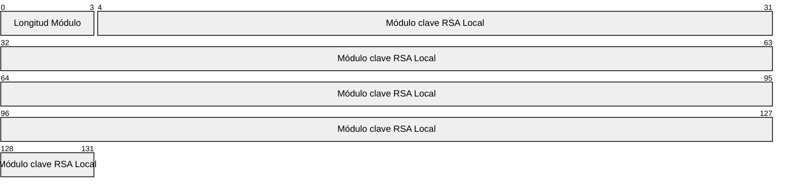

Alternativa ASCII (anchura esquemática):

```text
+--------------------------+------------------------------------------+
| Prefijo de longitud      | Modulo de la clave RSA local             |
| u32le; 4 bytes; valor 128| 128 bytes                                |
+--------------------------+------------------------------------------+
```

`L` es el prefijo `u32le`: ocupa 4 bytes y contiene el valor numérico `128`. El segundo campo son los 128 bytes anunciados por ese prefijo. La estructura es `LV`, no `TLV`, porque no incorpora un campo de tipo.

NOTA: Cuida también el contenido de cada bloque, en el sentido de que no se por qué hay un punto entre 32 bits y valor 128.

RESPUESTA: El punto medio se utilizó como separador tipográfico, pero no aportaba semántica y rompía la uniformidad. Se ha eliminado. El prefijo ocupa 32 bits y el valor numérico que transporta anuncia los 128 bytes del módulo; son dos magnitudes diferentes. La figura revisada utiliza `packet` y representa ambos campos con sus tamaños reales.

NOTA: Los || de los bloques originales también eran parte del mensaje??? esto aplica a todo el documento, en el sentido de que cuando generas el diagrama dejas de poder colocar los caracteres separadores. Analiza

RESPUESTA: En NotCompatible, `||` no representa dos caracteres transmitidos: es el operador documental de concatenación. `u32le(128) || MODULO_RSA_LOCAL_DE_128_BYTES` significa que los cuatro bytes del entero aparecen inmediatamente seguidos por los 128 bytes del módulo. Lo mismo sucede dentro de `RSA_RAW(MARCADOR || CLAVE_RC4_DE_100_BYTES)`. En Mermaid, esa concatenación queda representada por la adyacencia de los bloques, por lo que no debe añadirse una caja `||`. La revisión global sí ha detectado símbolos que son bytes reales y deben conservarse: el espacio inicial y los `#` de Exodus, los `:` de GPlayed, el marcador `0x01` de Monokle y los terminadores `0x00` de SOCKS4. También se han localizado signos `|` y `/` usados solo como decoración en las propuestas; se eliminan para que no puedan confundirse con separadores del protocolo. El resultado completo de la auditoría se recoge en la sección «Auditoría global de separadores».

Representación actual de la respuesta:

```text
u32le(128) || RSA_RAW(MARCADOR || CLAVE_RC4_DE_100_BYTES)
```

Posible sustitución:

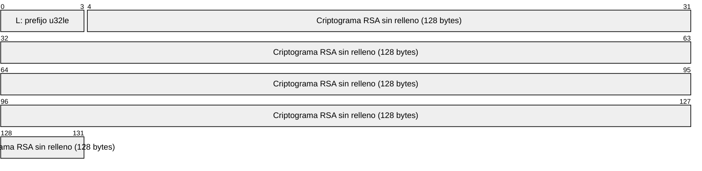

Alternativa ASCII (anchura esquemática):

```text
+--------------------------+------------------------------------------+
| Prefijo de longitud      | Criptograma RSA sin relleno              |
| u32le; 4 bytes; valor 128| 128 bytes                                |
+--------------------------+------------------------------------------+
```

`L` vuelve a ser el prefijo `u32le` de 4 bytes con valor `128`. El marcador de protocolo y la clave RC4 de 100 bytes no son campos adicionales de la trama: aparecen dentro del texto recuperado al descifrar el criptograma.

NOTA: El hecho de que el contenido recuperado vaya abajo significa que va dentro del criptograma?? No lo entiendo bien.

RESPUESTA: Sí. En la red solo aparecen el campo de longitud y el criptograma RSA de 128 bytes. Después de aplicar la operación RSA, el texto recuperado contiene el marcador y la clave RC4 de 100 bytes. El diagrama anterior parecía añadir un tercer campo transmitido; se ha corregido integrando esa información dentro del propio bloque del criptograma.

### 1.2 Cabecera genérica de los paquetes etiquetados

**Acción propuesta:** sustituir el bloque `text` por un único diagrama esquemático del paquete etiquetado. Como la etiqueta y la carga útil son variables, no puede expresarse como un `packet` completamente dimensionado.

Representación actual:

```text
u32le  tamaño total
u8     bit 7: contiene hijos; bits 0-6: longitud de etiqueta
ASCII  etiqueta
bytes  datos sin procesar o paquetes hijo concatenados
```

Posible sustitución:

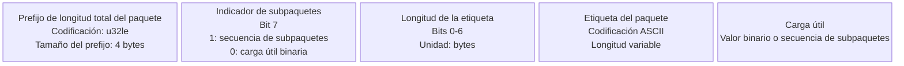

Alternativa ASCII (orden de transmisión de arriba abajo):

```text
+----------------------------------------------------------------------+
| Longitud total: u32le; 4 bytes                                       |
+--------------------------+-------------------------------------------+
| Indicador: bit 7         | Longitud de etiqueta: bits 0-6            |
| 1: subpaquetes           | Unidad: bytes                             |
| 0: carga binaria         |                                           |
+--------------------------+-------------------------------------------+
| Etiqueta ASCII: n bytes                                              |
+----------------------------------------------------------------------+
| Carga binaria o secuencia de subpaquetes: m bytes                    |
+----------------------------------------------------------------------+
```

NOTA: No entiendo por qué has usado los dos tipos de paquetes aquí mezclados. No se ve bien.

RESPUESTA: Se intentó separar la cabecera de longitud fija de los campos variables, pero visualmente parecía que existían dos estructuras independientes. Se ha unificado todo en un único `block-beta` con aspecto TLV. De este modo se conserva el orden real de los campos sin asignar una anchura ficticia a la etiqueta ni al contenido. 

NOTA: Usa nomenclatura de calidad en estos bloques. En el sentido de que no me pongas "contiene hijos" sino por ejemplo "Flag que indica..." Piensa en como lo nombraría un profesional. Esto aplica a absolutamente todo el documento, así que revisa todo.

RESPUESTA: Se ha revisado la nomenclatura de todos los diagramas propuestos, no solo la de esta cabecera. Cada bloque conserva primero el identificador real del protocolo cuando existe y después describe su función con términos técnicos; la codificación, el tamaño del campo, la longitud anunciada y el valor se presentan como propiedades distintas. Se han reemplazado expresiones vagas como «contiene hijos», «contenido», «mismo identificador», «grupo actual» y «datos hacia el destino». También se han separado `FB` y `OP`, que son campos opcionales distintos y habían quedado agrupados por error. Cuando el código solo demuestra un valor constante, se denomina «constante de protocolo» en lugar de atribuirle una función no acreditada.

### 1.3 Estructura lógica de `HELO`

**Acción propuesta:** sustituir el árbol de texto por una cuadrícula Mermaid. Los elementos `FB` y `OP` continúan marcados como opcionales.

Representación actual:

```text
HELO
├── VER      = 2
├── UUID     = identificador de 16 bytes
├── PORT     = puerto P2P local
├── GROUP    = grupo de servidores actual
├── LDGROUP  = grupo de distribución
├── LID      = versión de la configuración SET
├── CT       = tipo de red informado por Android
├── FB       = opcional, presente durante el primer arranque
└── OP       = opcional, puerto P2P confirmado como accesible
```

Posible sustitución:

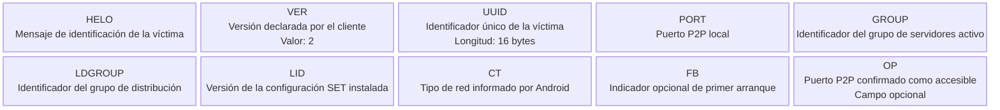

Alternativa TreeView:


### 1.4 Paquetes de configuración `SET`

**Acción propuesta:** agrupar las dos representaciones actuales en un único diagrama TLV por niveles. Cada fila desarrolla el contenedor indicado en la fila anterior.

Representaciones actuales:

```text
SET
├── DATA
│   ├── GROUP
│   │   ├── ID = 0
│   │   └── SERV
│   │       ├── IP   = 173.242.124.163
│   │       └── PORT = 443
│   └── LID = 1
└── Sign = firma RSA de 128 bytes

LDGROUP = 1000
FB      = presente
GROUP   = 0
```

```text
SET
├── DATA
│   ├── GROUP ...
│   └── LID
└── Sign
```

Posible sustitución:

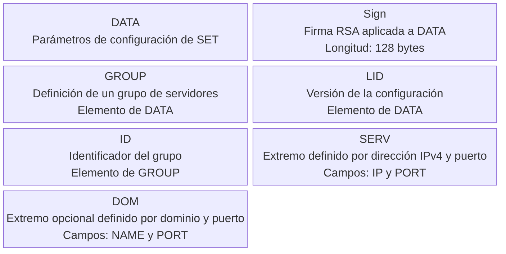

Alternativa TreeView:


### 1.5 Familia de mensajes del proxy

**Acción propuesta:** sustituir los cinco árboles de texto por una única figura comparativa.

Representaciones actuales:

```text
CONN
├── CH    = identificador de canal
├── PORT  = puerto remoto
└── IP    = dirección IPv4
```

```text
CONN
├── CH
├── PORT
└── DOM   = nombre que resolverá el dispositivo
```

```text
CONN
├── CH    = mismo identificador
└── PORT  = puerto local del socket creado por la víctima
```

```text
SEND
├── CH
└── DT    = bytes que se escribirán en el socket remoto
```

```text
RECV
├── CH
└── DT    = bytes recibidos del servicio remoto
```

Posible sustitución:

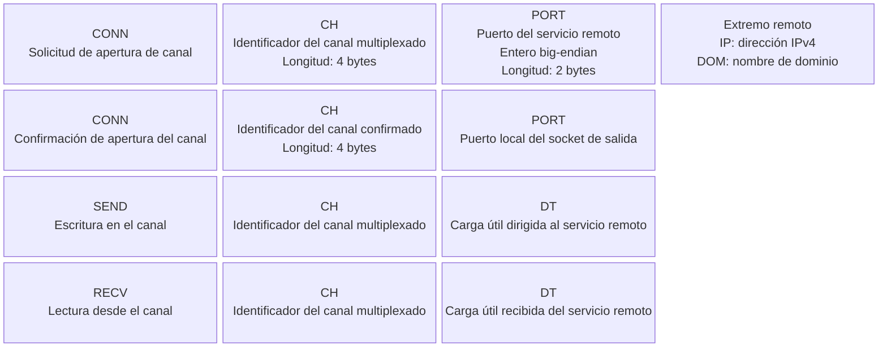

Alternativa TreeView:


## 2. Monokle

Fuente: [S0407-Monokle.qmd](repositorio/S0407-Monokle.qmd)

### 2.1 Registro inicial

**Acción propuesta:** sustituir el bloque `text`.

Representación actual:

```text
Sentido: de la víctima al C2
<uint32_le length>
<TCompactProtocol AgentRegistration>
```

Posible sustitución:

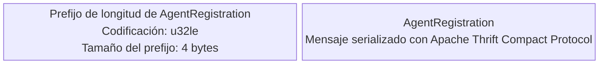

Alternativa ASCII (orden de transmisión de arriba abajo):

```text
+----------------------------------------------------------------------+
| Prefijo de longitud: u32le; 4 bytes                                 |
+----------------------------------------------------------------------+
| AgentRegistration: Apache Thrift Compact; n bytes                   |
+----------------------------------------------------------------------+
```

### 2.2 Orden cifrada del C2

**Acción propuesta:** sustituir los dos bloques de texto por un diagrama exterior y otro interior.

Representaciones actuales:

```text
Sentido: del C2 a la víctima
<uint16_le encrypted_length>
<16 bytes IV>
<AES-GCM ciphertext + 16 bytes tag>
```

```text
<uint16_le thrift_length>
<TCompactProtocol ServerCommand>
```

Posible sustitución de la envoltura cifrada:

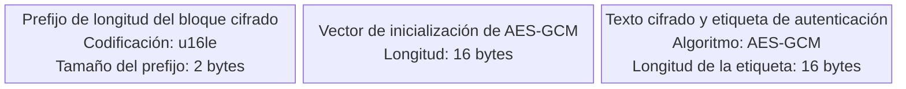

Alternativa ASCII de la envoltura cifrada:

```text
+----------------------------------------------------------------------+
| Prefijo de longitud del bloque cifrado: u16le; 2 bytes              |
+----------------------------------------------------------------------+
| Vector de inicialización de AES-GCM: 16 bytes                       |
+----------------------------------------------------------------------+
| Texto cifrado: n bytes                                              |
+----------------------------------------------------------------------+
| Etiqueta de autenticación GCM: 16 bytes                             |
+----------------------------------------------------------------------+
```

Posible sustitución del contenido descifrado:

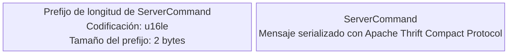

Alternativa ASCII del contenido descifrado:

```text
+----------------------------------------------------------------------+
| Prefijo de longitud de ServerCommand: u16le; 2 bytes                |
+----------------------------------------------------------------------+
| ServerCommand: Apache Thrift Compact; n bytes                       |
+----------------------------------------------------------------------+
```

### 2.3 Respuesta cifrada de la víctima

**Acción propuesta:** sustituir el primer bloque por el diagrama del mensaje transmitido y el segundo por el diagrama de los datos autenticados adicionales (AAD). Son estructuras relacionadas, pero no representan lo mismo.

Representaciones actuales:

```text
Sentido: de la víctima al C2
<uint32_le encrypted_length>
01
<16 bytes IV>
<AES-GCM ciphertext + 16 bytes tag>
```

```text
<uint32_le encrypted_length>
01
```

Posible sustitución:

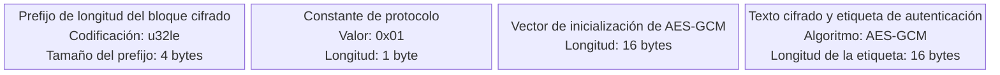

Alternativa ASCII del mensaje transmitido:

```text
+----------------------------------------------------------------------+
| Prefijo de longitud del bloque cifrado: u32le; 4 bytes              |
+----------------------------------------------------------------------+
| Constante de protocolo: 0x01; 1 byte                                |
+----------------------------------------------------------------------+
| Vector de inicialización de AES-GCM: 16 bytes                       |
+----------------------------------------------------------------------+
| Texto cifrado: n bytes                                              |
+----------------------------------------------------------------------+
| Etiqueta de autenticación GCM: 16 bytes                             |
+----------------------------------------------------------------------+
```

Posible sustitución de la estructura AAD:

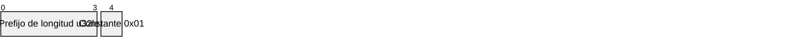

Alternativa ASCII del AAD:

```text
+----------------------------------------------------------------------+
| Prefijo de longitud autenticado como AAD: u32le; 4 bytes             |
+----------------------------------------------------------------------+
| Constante autenticada como AAD: 0x01; 1 byte                         |
+----------------------------------------------------------------------+
```

El segundo bloque original no describe una respuesta vacía. Contiene los cinco bytes que el algoritmo autentica como AAD y que, por tanto, no forman parte del texto cifrado.

## 3. FluBot

Fuente: [S1067-FluBot.qmd](repositorio/S1067-FluBot.qmd)

### 3.1 Saludo del canal de control

**Acción propuesta:** sustituir el bloque hexadecimal por un diagrama que conserve los valores observados.

Representación actual:

```text
Víctima a C2

00 02 C3 26                  # 181030
00 00 00 20                  # longitud del BotId
<32 bytes ASCII del BotId>
```

Posible sustitución:

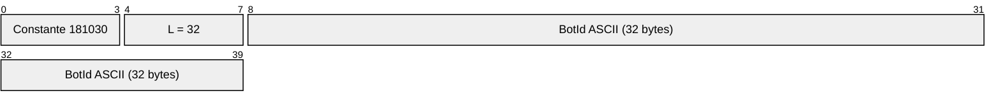

Alternativa ASCII (orden de transmisión de arriba abajo):

```text
+----------------------------------------------------------------------+
| Constante de identificación: u32be; 4 bytes; valor 181030            |
+----------------------------------------------------------------------+
| Prefijo de longitud de BotId: u32be; 4 bytes; valor 32               |
+----------------------------------------------------------------------+
| BotId: ASCII; 32 bytes                                               |
+----------------------------------------------------------------------+
```

El primer campo es la constante `181030`, codificada como `u32be` mediante `00 02 C3 26`. `L` es otro `u32be` de 4 bytes cuyo valor `32` anuncia el tamaño del `BotId` observado.

### 3.2 Asignación de puerto del subcanal

**Acción propuesta:** eliminar el bloque y trasladar la información a la redacción, porque representa un único entero y no justifica una figura.

Representación actual:

```text
C2 a víctima

23 29                         # puerto 9001
```

Posible sustitución textual:

> El C2 envía el puerto de cada subcanal como un entero de 16 bits en orden *big-endian*. En el escenario, TCP/9001 se transmite mediante los bytes `23 29` (`0x2329`).

### 3.3 Petición SOCKS4

**Acción propuesta:** sustituir el bloque de texto. Como `USERID` tiene longitud variable, no se escala mediante `packet`.

Representación actual:

```text
C2 a víctima

04 01 <PUERTO_DESTINO_BE> <IPV4_DESTINO> <USERID_ASCII> 00
```

Posible sustitución:

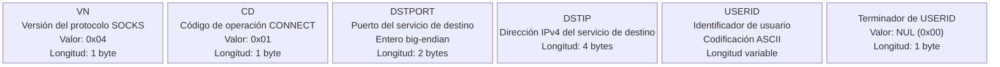

Alternativa ASCII (orden de transmisión de arriba abajo):

```text
+----------------------------------------------------------------------+
| VN: versión SOCKS; 0x04; 1 byte                                     |
+----------------------------------------------------------------------+
| CD: operación CONNECT; 0x01; 1 byte                                 |
+----------------------------------------------------------------------+
| DSTPORT: puerto de destino; big-endian; 2 bytes                     |
+----------------------------------------------------------------------+
| DSTIP: dirección IPv4 de destino; 4 bytes                           |
+----------------------------------------------------------------------+
| USERID: identificador ASCII; n bytes                                |
+----------------------------------------------------------------------+
| Terminador de USERID: NUL (0x00); 1 byte                            |
+----------------------------------------------------------------------+
```

### 3.4 Respuesta SOCKS4 positiva

**Acción propuesta:** sustituir el bloque hexadecimal.

Representación actual:

```text
Víctima a C2

00 5A 00 00 00 00 00 00
```

Posible sustitución:

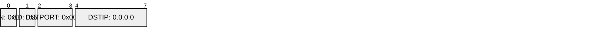

Alternativa ASCII (orden de transmisión de arriba abajo):

```text
+----------------------------------------------------------------------+
| VN: byte nulo; 0x00; 1 byte                                        |
+----------------------------------------------------------------------+
| CD: solicitud concedida; 0x5A; 1 byte                              |
+----------------------------------------------------------------------+
| DSTPORT: puerto devuelto; 0x0000; 2 bytes                           |
+----------------------------------------------------------------------+
| DSTIP: dirección IPv4 devuelta; 0.0.0.0; 4 bytes                    |
+----------------------------------------------------------------------+
```

## 4. Exodus

Fuente: [S0405-Exodus.qmd](repositorio/S0405-Exodus.qmd)

**Acción propuesta:** sustituir el bloque textual y representar expresamente el espacio inicial, cada separador `#` y el campo vacío.

Representación actual:

```text
 #<IMEI>#<versión de Android>#<número de teléfono>##<IMSI>#<operador>#<tipo de red>#<estado de la SIM>
```

Posible sustitución:

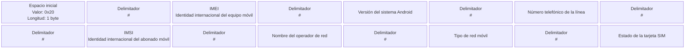

Alternativa ASCII (la segunda línea continúa la primera):

```text
[SP 0x20] ['#'] [IMEI] ['#'] [ANDROID] ['#'] [TELEFONO] ['#']
                                                                  |
                                                                  v
['#'] [IMSI] ['#'] [OPERADOR] ['#'] [TIPO_RED] ['#'] [ESTADO_SIM]

Los campos entre corchetes tienen longitud variable, salvo SP y '#'.
Los dos delimitadores ['#'] consecutivos representan el campo vacío.
```

El diagrama se lee de izquierda a derecha y continúa en la segunda fila. El espacio inicial procede del literal `" #"` del código. Los bloques `sep3` y `sep4` son dos bytes `#` consecutivos y, por tanto, delimitan un campo vacío anterior al IMSI. El cuerpo resultante se cifra mediante RSA y ocupa 256 bytes antes de entregarse a HTTPS.

## 5. GPlayed

Fuente: [S0536-GPlayed.qmd](repositorio/S0536-GPlayed.qmd)

La petición ya está expresada mediante un bloque HTTP y se conserva sin cambios. La única sustitución propuesta afecta al bloque textual de respuesta.

### 5.1 Respuesta

**Acción propuesta:** sustituir el bloque `text` sin perder el carácter `:`, que forma parte obligatoria del formato.

Representación actual:

```text
<EResponse>:<Base64 estándar del JSON>
```

Posible sustitución:

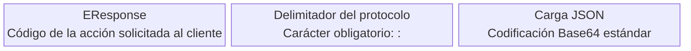

Alternativa ASCII (anchura esquemática):

```text
+---------------------------+---+--------------------------------------+
| EResponse                 |':'| JSON codificado en Base64 estándar  |
| Longitud variable         |1 B| Longitud variable                    |
+---------------------------+---+--------------------------------------+
```

NOTA: Creo que eran obligatorios los ":" en el formato requerido por el malware. Ten cuidado a ver si estas rompiendo la calidad del documento con tus sustituciones.

RESPUESTA: Correcto. `:` es el delimitador obligatorio entre `EResponse` y el JSON codificado en Base64. La primera propuesta conservaba los contenidos pero ocultaba el delimitador, lo que alteraba la definición del formato. El diagrama revisado lo representa como un bloque independiente y explícito.

## 6. Auditoría de las alternativas comparadas

Las sustituciones Mermaid previas permanecen en el documento. La nueva alternativa se elige según la naturaleza de la estructura, no según si sus campos tienen o no una longitud fija.

| Estructura | Sustitución Mermaid conservada | Nueva alternativa | Motivo |
|---|---|---|---|
| NotCompatible: intercambio RSA | `packet` | ASCII lineal | Evita el desbordamiento y la repetición del campo RSA. |
| NotCompatible: paquete etiquetado | `block-beta` | ASCII lineal | Permite combinar subcampos de bits y campos variables. |
| NotCompatible: `HELO` | `block-beta` | TreeView | La estructura es jerárquica y contiene campos opcionales. |
| NotCompatible: `SET` | `block-beta` | TreeView | Conserva los niveles `SET`, `DATA`, `GROUP`, `SERV` y `DOM`. |
| NotCompatible: familia del proxy | `block-beta` | TreeView | Separa cada tipo de mensaje y sus campos subordinados. |
| Monokle: registro y órdenes | `block-beta` | ASCII lineal | Son envolturas ordenadas, no árboles. |
| Monokle: AAD | `packet` | ASCII lineal | La estructura solo contiene dos campos consecutivos. |
| FluBot: saludo | `packet` | ASCII lineal | Evita que el `BotId` se divida en varias filas. |
| FluBot: petición SOCKS4 | `block-beta` | ASCII lineal | `USERID` es variable, pero el orden de campos es lineal. |
| FluBot: respuesta SOCKS4 | `packet` | ASCII lineal | La PDU completa ocupa ocho bytes consecutivos. |
| Exodus | `block-beta` | ASCII lineal | Hace visibles los dos `'#'` consecutivos sin crear cajas desproporcionadas. |
| GPlayed | `block-beta` | ASCII lineal | Conserva el delimitador `':'` entre dos campos variables. |

TreeView es la alternativa semánticamente más adecuada para los tres árboles, pero requiere prerenderizado con Mermaid CLI mientras Quarto continúe incorporando Mermaid 11.12.

## 7. Auditoría global de separadores

La siguiente tabla distingue los caracteres que pertenecen al flujo de bytes de los utilizados únicamente para explicar una estructura en Markdown.

| Caso | Símbolos de la representación original | ¿Se transmiten? | Tratamiento |
|---|---|---|---|
| NotCompatible: intercambio RSA | Doble barra vertical | No | Es el operador documental de concatenación. La adyacencia de los bloques Mermaid expresa la misma operación. |
| NotCompatible: árboles de paquetes | `├──`, `│`, `└──`, `=` y `...` | No | Describen jerarquía, asignación o contenido omitido. No se convierten en campos. |
| NotCompatible: límites de campos | Longitudes de 32, 8 y 7 bits | Sí | Los límites se conservan mediante campos separados. No existe un byte delimitador entre ellos. |
| Monokle | `<...>`, saltos de línea y `+` explicativo | No | Son metanotación. El marcador `0x01`, que sí es un byte, permanece como campo independiente. |
| FluBot: volcados hexadecimales | Espacios, alineación y comentarios precedidos por `#` | No | Solo facilitan la lectura del volcado. Los octetos, el orden de los campos y el terminador `0x00` sí se conservan. |
| FluBot: orden textual `SOCKS` | `,` y `:` | Sí | Ese bloque no se sustituye y mantiene literalmente `SOCKS,<host_c2>:<puerto_control>`. |
| Exodus | Espacio inicial y `#` | Sí | Cada uno se representa como un bloque propio, incluido el espacio `0x20` y los dos `#` consecutivos. |
| GPlayed: respuesta | `:` | Sí | Se conserva como bloque independiente entre `EResponse` y Base64. |
| GPlayed: petición HTTP | `-` y `:` dentro de `q` | Sí | El bloque HTTP no se sustituye y conserva ambos delimitadores. |
| Drinik | `:::`, `####` y `##-##` | Sí | Se retiró la sustitución Mermaid; el bloque textual permanece intacto. |
| Skygofree | `_` | Sí | Se retiró la sustitución Mermaid; el patrón textual permanece intacto. |
| BusyGasper | Sintaxis IRC y comas de `#U` | Sí | Se retiró la sustitución Mermaid para no perder esa semántica. |
| DressCode: figura ya integrada | Barras verticales dentro de las etiquetas Mermaid | No | Eran separadores meramente visuales. Cuando se integre la normalización definitiva deberán sustituirse por paréntesis, igual que en la respuesta SOCKS4 de FluBot. |

La regla resultante es: los campos adyacentes se dibujan contiguos; los delimitadores transmitidos reciben un bloque explícito; y los operadores puramente documentales no aparecen dentro del diagrama.

## 8. Elementos que se mantienen sin transformación

No se proponen sustituciones para:

- Los bloques HTTP completos.
- Los objetos JSON de TeleRAT, GPlayed, Drinik, RedAlert, Skygofree y LightSpy.
- Los plist/XML de KeyRaider.
- Los ejemplos multipart de LightSpy.
- El código y los objetos MessagePack de XLoader, porque la redacción cercana ya explica el encuadre y la serialización.
- MQTT en GoldenCup y el prefijo de LightSpy, porque las propuestas anteriores solo añadían figuras y no sustituían bloques deficientes.
- Las órdenes de Drinik y Skygofree, porque sus delimitadores forman parte esencial del formato y el diagrama añadía una segunda notación más confusa.
- Las líneas IRC y las órdenes `#U` de BusyGasper, porque el formato textual conserva más semántica.
- La transformación Base64 de RedAlert, porque ya está vinculada al bloque HTTP y no requiere una figura adicional.
- Los mensajes MAP/SS7, hasta disponer de la descomposición BER/TLV concreta obtenida de cada PCAP.

## 9. Decisiones retiradas tras revisar el contexto

### 9.1 XLoader para Android

NOTA: Tendrás que pensar en el texto que envuelve al bloque de código, eso te dice también si es necesario o merece la pena añadir diagrama. En general este analisis de la redacción cercana lo debes hacer con todo eh. Recuerda que en el documento todo está relacionado con todo. Aquí además has intentado mezclar formatos de nuevo. Por cierto, el texto explicativo de Packet en muchos casos va a resultar redundate con el indice de figura que va a aparece justo debajo. De hecho ya ocurre con el packet que se introdujo en el documento en la prueba que hicimos.

RESPUESTA: Revisado el contexto completo de la sección, no se propone ninguna sustitución para XLoader. La redacción ya explica `FIN`, `opcode`, `MASK`, las longitudes extendidas, la máscara de cuatro bytes y la carga MessagePack, y el código Java demuestra cómo se serializan. Un diagrama añadido repetiría información y mezclaría `packet` con `block-beta`. También se adopta como criterio general que la introducción de una figura explique por qué es relevante, mientras que el pie de figura identifica lo representado sin duplicar literalmente esa explicación.

### 9.2 Contenido MessagePack

NOTA: No lo veo la verdad. De todas formas no me has mostrado un ejemplo de bloque map aquí, así que no puedo analizar si realmente hace falta o no.

RESPUESTA: La representación actual utiliza bloques como `map {"jsonrpc": "2.0", "method": <cadena>, "id": <entero>, "params": array [...]}`. Esa notación conserva mejor la jerarquía y los tipos de MessagePack que una fila de cajas. Se retira la propuesta y los bloques `map {...}` permanecen sin cambios.

## 10. Orden sugerido de validación

1. NotCompatible.
2. Monokle.
3. FluBot.
4. Exodus.
5. GPlayed.
